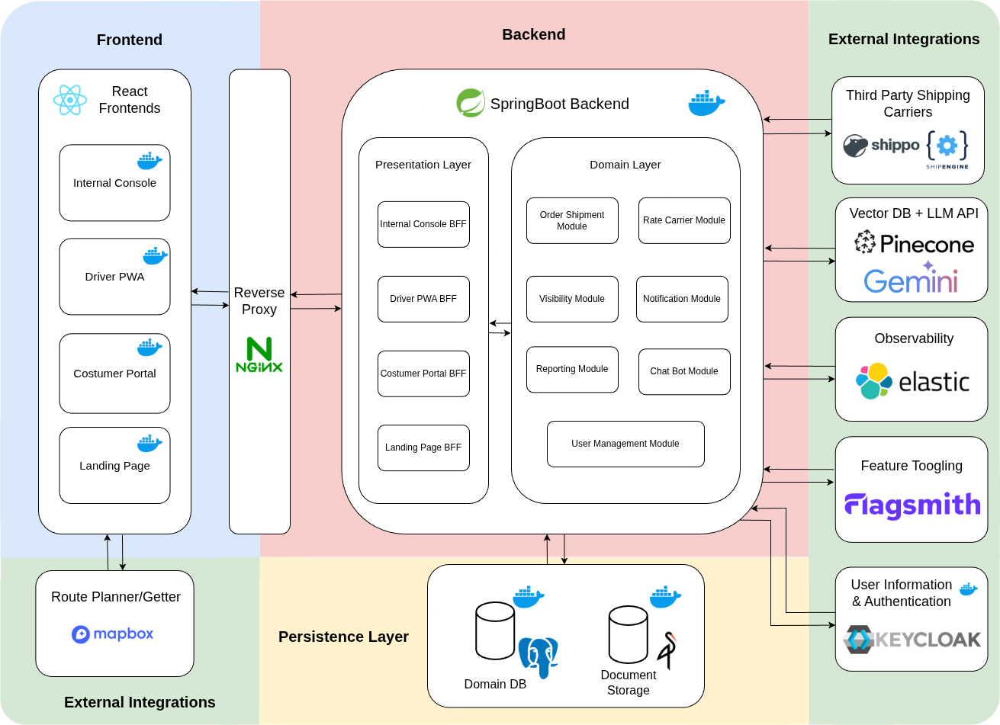
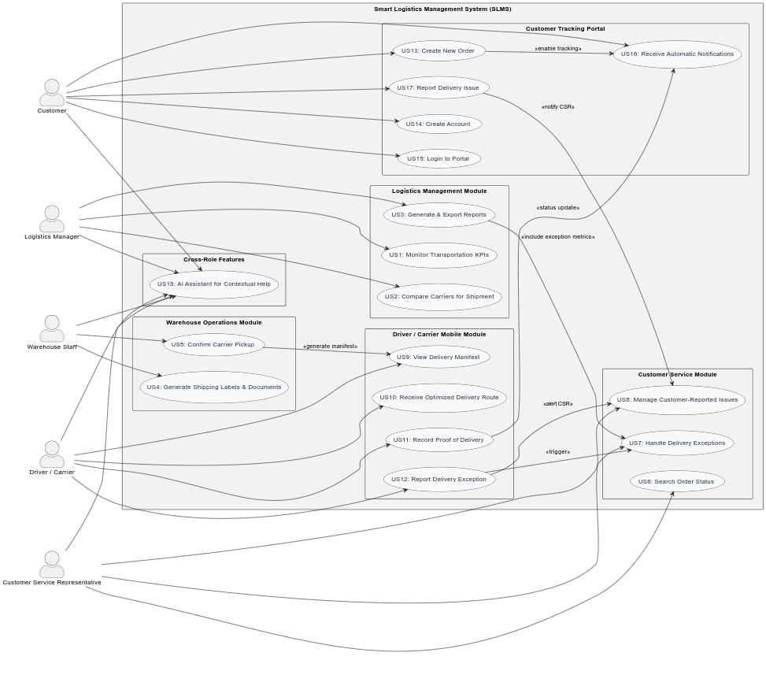
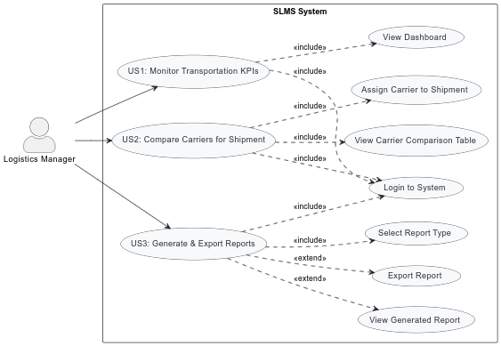
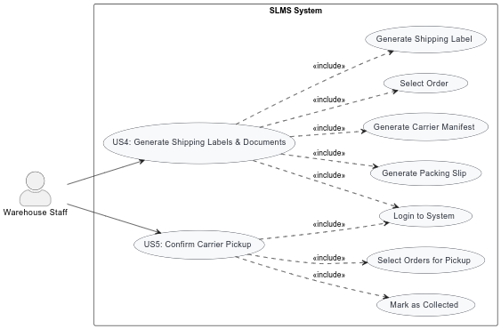
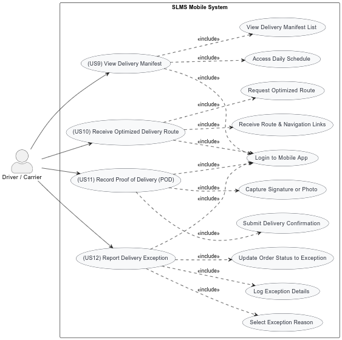
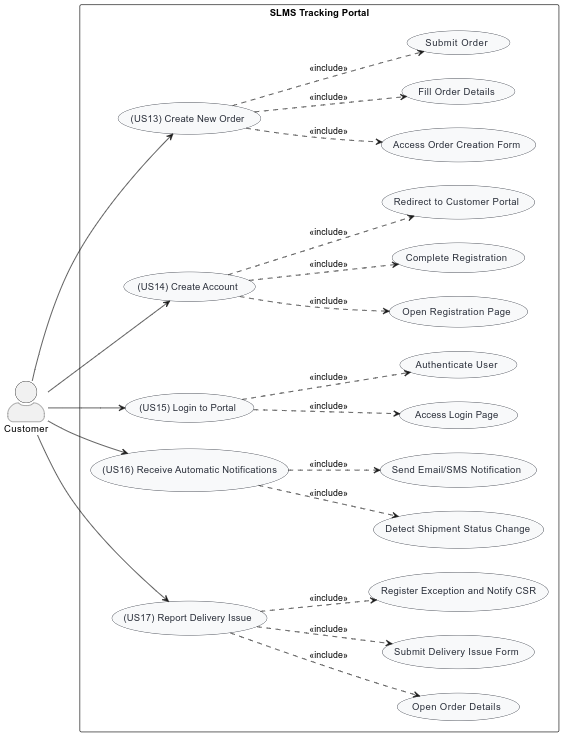

# Smart Logistics Management System (SLMS)
## Project Report - Group 304

**Course:** Software Engineering
**Academic Year:** 2025/2026
**Institution:** University of Aveiro - DETI

---

## Team

| **Role**        | **Name**           | **NMEC** |
|-----------------|--------------------|----------|
| Scrum Master    | João Roldão        | 113920   |
| Product Owner   | Hugo Castro        | 113889   |
| QA Engineer     | Hugo Sousa         | 112733   |
| Service Analyst | Henrique Teixeira  | 114588   |
| DevOps Master   | João Varela        | 113780   |

---

## Table of Contents

1. [Introduction](#1-introduction)
2. [System Architecture](#2-system-architecture)
3. [Data Model](#3-data-model)
4. [User Requirements](#4-user-requirements)
5. [Developer Onboarding](#5-developer-onboarding)
6. [Production Configuration](#6-production-configuration)
7. [Security & Authentication](#7-security--authentication)
8. [Key Features & Modules](#8-key-features--modules)
9. [AI-Powered Chatbot](#9-ai-powered-chatbot)
10. [Testing & Quality Assurance](#10-testing--quality-assurance)
11. [Observability & Monitoring](#11-observability--monitoring)
12. [Lessons Learned & Future Work](#12-lessons-learned--future-work)
13. [Conclusion](#13-conclusion)

---

# 1. Introduction

## 1.1 Project Context

The exponential growth of e-commerce has transformed logistics into one of the most critical components of business competitiveness. Customers increasingly expect fast, reliable, and transparent deliveries, while companies face rising transportation costs, fragmented carrier networks, and limited visibility across the delivery chain. Traditional logistics management solutions often fail to provide real-time data, carrier performance comparisons, and seamless customer communication. As a result, companies struggle to reduce costs, drivers face inefficient route planning, customer service representatives spend valuable time handling avoidable calls, and customers remain frustrated due to lack of visibility over their orders.

The Smart Logistics Management System (SLMS) addresses these challenges by providing a centralized, intelligent platform that integrates multiple actors in the logistics ecosystem: logistics managers, warehouse staff, carriers, customer service representatives, and end customers. By offering real-time insights, automation, and advanced exception handling, SLMS optimizes logistics operations, increases customer satisfaction, and reduces inefficiencies across the supply chain.

This project was developed as part of the Software Engineering course at the University of Aveiro (DETI) during the 2025/2026 academic year by Group 304, demonstrating the practical application of modern software engineering practices, architecture patterns, and cloud-native technologies in solving real-world business problems.

## 1.2 Objectives & Scope

The primary objective of SLMS is to provide a comprehensive logistics management solution that supports all key roles involved in the shipping and delivery process. The system addresses several core challenges:

- **Real-time monitoring and decision-making:** Enable logistics managers to track key performance indicators (KPIs), compare carrier performance, and generate reports for data-driven decision-making
- **Streamlined warehouse operations:** Support warehouse staff with order registration, automatic label and document generation, and carrier pickup confirmation
- **Improved customer service efficiency:** Provide customer service representatives with real-time access to order status, delivery exceptions, and tools to resolve issues quickly
- **Driver empowerment:** Equip carriers with a mobile Progressive Web Application (PWA) to view delivery manifests, receive optimized routes, and record proof of delivery
- **Customer transparency:** Allow customers to track orders in real time, receive proactive notifications, and report delivery problems directly through a public portal
- **Structured exception management:** Ensure that delivery problems such as failed attempts, incorrect addresses, or damaged packages are logged, assigned, and resolved systematically

The system's scope encompasses 18 user stories addressing 5 distinct user personas (detailed in Section 4), with 12 user stories completed, 5 in progress, and 1 pending. The platform handles the complete order lifecycle from creation through carrier selection, shipment, tracking, exception handling, and final delivery confirmation.

## 1.3 System Overview

SLMS implements a modular monolith architecture designed to balance development velocity, operational simplicity, and long-term maintainability. The system comprises four distinct frontend applications, each optimized for specific user roles through the Backend-for-Frontend (BFF) pattern:

- **Landing Page:** Public-facing application for unauthenticated order tracking and system information
- **Admin Console:** Comprehensive administrative interface serving three internal roles—logistics managers, warehouse staff, and customer service representatives—with role-specific dashboards, order management, carrier integration, exception handling, and reporting capabilities
- **Customer Portal:** Self-service application enabling customers to track their orders, view delivery history, and manage delivery preferences
- **Driver PWA:** Mobile-optimized Progressive Web Application providing drivers with delivery manifests, route optimization, real-time status updates, and proof of delivery capture

These frontends interact with a centralized backend organized into eight business modules: Order Management, Rate & Carrier Integration, Visibility & Tracking, User Management, Notifications, Reporting, Warehouse Management, and AI-Powered Chatbot. Each module encapsulates specific domain logic while maintaining clear boundaries that prevent tight coupling and enable independent evolution (detailed in Section 2).

The technology stack combines mature, production-proven technologies with modern capabilities. The backend leverages **Spring Boot 3.5.0** with **Java 21** for application logic, **Spring Data JPA** with **Hibernate** for object-relational mapping, and **PostgreSQL 16** for relational data storage. All four frontend applications are built with **Next.js 15.5.4** and **React 19.1.0**, using **TypeScript** for type safety and **Tailwind CSS** for styling. The infrastructure employs **Docker** for containerization, **Terraform** for infrastructure as code, and **Nginx** as the reverse proxy and load balancer.

Key external integrations include **Keycloak 26.0** for OAuth 2.0/OpenID Connect authentication and authorization, **ShipEngine API** for multi-carrier integration (FedEx, UPS, DHL), **Google Gemini** for large language model capabilities in the AI chatbot, **Pinecone** for vector database and semantic search, **Elastic APM** for application performance monitoring and distributed tracing, **MinIO** for S3-compatible object storage of shipping documents and proof of delivery photos, **Mapbox** for mapping and routing services in the Driver PWA, and **Flagsmith** for feature flag management. The complete technical stack is detailed in Section 2.3.

## 1.4 Development Approach

The project follows an Agile/Scrum methodology with a five-person development team, each member fulfilling a specific role:

- **Scrum Master (João Roldão, NMEC 113920):** Sprint coordination and backlog management
- **Product Owner (Hugo Castro, NMEC 113889):** Requirement prioritization, user story definition
- **QA Engineer (Hugo Sousa, NMEC 112733):** Testing strategy and quality assurance
- **Service Analyst (Henrique Teixeira, NMEC 114588):** Requirements analysis and feature specification
- **DevOps Master (João Varela, NMEC 113780):** Infrastructure management and CI/CD pipeline implementation

Development proceeded through multiple sprint cycles, with each sprint delivering incremental functionality. The team employed continuous integration and deployment practices, comprehensive documentation, and regular retrospectives to maintain quality and adapt to evolving requirements. The development workflow and collaboration practices are documented in the project handbook.

## 1.5 Report Organization

This report provides comprehensive documentation of the SLMS project, organized to serve different audiences and information needs:

- **Section 2 (System Architecture)** details the architectural decisions, design patterns, and component interactions that structure the system
- **Section 3 (Data Model)** describes the database schema, entity relationships, and data modeling decisions
- **Section 4 (User Requirements)** presents the five user personas, usage scenarios, and 18 user stories that drive system functionality
- **Section 5 (Developer Onboarding)** provides practical guidance for developers setting up local environments and contributing to the codebase
- **Section 6 (Production Configuration)** covers environment variables, external service configuration, build processes, CI/CD pipelines, and deployment procedures
- **Section 7 (Security & Authentication)** explains the OAuth 2.0/OIDC integration with Keycloak, role-based access control, and security patterns
- **Section 8 (Key Features & Modules)** describes the major functional capabilities organized by frontend application
- **Section 9 (AI-Powered Chatbot)** documents the architecture, RAG implementation, and tool-calling system for context-aware assistance
- **Section 10 (Testing & Quality Assurance)** outlines the testing strategy, coverage metrics, and quality assurance processes
- **Section 11 (Observability & Monitoring)** presents the SLI/SLO definitions, monitoring infrastructure, and alerting mechanisms
- **Section 12 (Conclusion)** synthesizes project achievements, technical contributions, academic value, and future evolution opportunities

---

# 2. System Architecture

## 2.1 Architectural Overview

The Smart Logistics Management System (SLMS) employs a modular monolith architecture designed to balance development velocity, operational simplicity, and long-term maintainability. This architectural approach organizes the system into well-defined, loosely coupled modules within a single deployable application, while maintaining clear boundaries between different functional domains.



**Figure 3.1:** Overall SLMS Architecture showing Frontend, Backend, Persistence Layer, and External Integrations

### Architectural Philosophy

The decision to adopt a modular monolith rather than a microservices architecture stemmed from careful consideration of the project's context: a development team of five engineers building a comprehensive logistics platform under time constraints. While microservices offer attractive benefits such as independent scaling and technology diversity, they introduce significant operational complexity that would have diverted effort from delivering business value. The modular monolith provides a pragmatic middle ground—offering many of the organizational benefits of microservices while avoiding the overhead of distributed systems management.

At its core, the architecture establishes clear module boundaries around business capabilities. Each module owns its domain logic, data access patterns, and internal workflows, communicating with other modules through well-defined interfaces. This separation of concerns ensures that changes within one module—such as modifications to the order management logic—do not ripple unpredictably through the carrier integration or notification systems. The boundaries are enforced through package structure and dependency management, preventing tight coupling between modules while allowing them to collaborate when necessary.

### Modular Monolith Design

The backend application comprises eight distinct business modules, each encapsulating a specific domain within the logistics workflow. The Order Module manages the complete lifecycle of shipment orders from creation through delivery. The Rate Carrier Module handles interactions with shipping carriers and manages the physical shipment entities. The Visibility Module provides real-time tracking and exception management capabilities. Supporting these core logistics functions, the User Management Module integrates with the authentication system, while the Notification Module handles asynchronous communication with users. The Reporting Module generates performance metrics and dashboards for management oversight, and the Chatbot Module is for providing AI-powered assistance to users across all frontends.

This modular organization delivers several key advantages. Each module can evolve independently—teams can refactor the internal implementation of rate calculation without touching order management code. The clear boundaries make the codebase more understandable, as developers can reason about each module's responsibilities without needing to understand the entire system. Testing becomes more focused, as unit and integration tests can target specific modules. The architecture also preserves future flexibility: if operational needs change and independent scaling becomes necessary, well-defined module boundaries provide natural seams for extracting microservices.

### Backend-for-Frontend Pattern

Complementing the modular backend, the system implements the Backend-for-Frontend (BFF) pattern to optimize interactions between the business logic layer and the four distinct frontend applications. Each frontend—the Landing Page, Admin Console, Customer Portal, and Driver PWA—has unique requirements for data structure, aggregation, and security context. Rather than forcing all frontends to consume a single generic API, the BFF pattern provides each frontend with a dedicated backend layer that aggregates and transforms data specifically for that client's needs.

The Admin Console BFF, for instance, serves three different internal user roles (logistics managers, warehouse staff, and customer service representatives) through a unified interface. It combines data from multiple business modules—pulling order details from the Order Module, carrier information from the Rate Carrier Module, and exception data from the Visibility Module—and presents them in aggregated views optimized for administrative dashboards. The Customer Portal BFF, by contrast, focuses exclusively on customer-facing data: order tracking information, delivery status updates, and self-service capabilities. It enforces strict data isolation, ensuring customers can only access their own orders while providing a simplified API surface tailored to the customer experience.

The Driver PWA BFF serves the unique needs of mobile delivery drivers. It provides delivery manifests, route information, and real-time status update capabilities, all optimized for the constraints of mobile networks and intermittent connectivity. The BFF aggregates shipment details, destination addresses, and proof-of-delivery requirements into compact payloads designed for efficient transmission over cellular networks. Finally, the Landing Page BFF handles public-facing endpoints such as order tracking lookups that don't require authentication, implementing appropriate rate limiting and caching strategies.

This pattern delivers significant benefits beyond simple API convenience. Security becomes more robust, as each BFF can enforce role-specific authorization rules and data access controls appropriate to its frontend. The BFFs serve as a security boundary, preventing frontends from directly accessing backend business logic and ensuring all requests flow through a controlled layer that validates permissions. Performance optimizes naturally, as each BFF can tailor its responses—pre-aggregating data that would otherwise require multiple round trips, implementing frontend-specific caching strategies, and minimizing payload sizes for mobile clients. The pattern also isolates frontends from backend complexity, allowing business modules to evolve their internal APIs without breaking frontend applications, as the BFFs can adapt and translate changes.

### Deployment and Scalability

Despite being a monolithic application, the architecture supports operational flexibility through containerization and infrastructure as code. The entire system deploys as a set of Docker containers—one for the Spring Boot backend, four for the Next.js frontend applications, and additional containers for infrastructure services like PostgreSQL, Keycloak, Kafka, and MinIO. This containerized approach ensures consistency across development, testing, and production environments while providing deployment flexibility.

The system scales vertically by allocating additional resources to containers, a straightforward approach that aligns well with the modular monolith's single-process nature. For horizontal scaling, multiple backend instances run behind a load balancer, with session affinity or stateless JWT-based authentication ensuring requests can route to any instance. The database uses connection pooling to manage concurrent access efficiently, while Kafka provides asynchronous processing for operations that don't require immediate completion, such as notification delivery.

The architecture recognizes that different components may have different scaling needs. The frontend applications, being relatively stateless, can scale independently from the backend. Static assets serve through Nginx with appropriate caching headers, reducing load on the application servers. The MinIO object storage scales independently to handle document and image storage growth. This selective scaling capability demonstrates that monolithic architecture doesn't preclude operational sophistication—it simply concentrates scaling decisions on the components that matter most.

### Separation of Concerns

The architecture maintains clear separation between different types of concerns. Business logic resides entirely within the backend modules, isolated from presentation concerns. The modules interact with the database through repository interfaces, abstracting data access patterns and enabling easier testing through mocks. Domain entities remain independent of their persistence mechanism, following clean architecture principles that keep core business rules free from framework dependencies.

Cross-cutting concerns—logging, monitoring, security, and transaction management—are handled through framework-level capabilities rather than being scattered throughout business logic. Spring Boot's autoconfiguration and aspect-oriented programming features provide centralized solutions for these concerns, ensuring consistent application across all modules without duplicating code.

The separation extends to the frontend architecture as well. Each Next.js application maintains its own component library, styling system, and state management, ensuring that changes to the admin interface don't affect the customer portal. Shared utilities and common components are organized in a dedicated shared module, providing code reuse without creating tight coupling between applications.

### Deployment Architecture

The system deploys as containerized services orchestrated through Docker Compose in development and Terraform in production. The infrastructure consists of self-hosted containers for core services—PostgreSQL 16 for data persistence, Keycloak 26.0 for authentication, MinIO for S3-compatible object storage, Apache Kafka for event streaming, and Nginx as reverse proxy—alongside the Spring Boot backend and four Next.js frontend applications. All containers run within a shared Docker network enabling service discovery while maintaining isolation.

External managed services provide specialized capabilities: Shippo for multi-carrier shipping integration, Google Gemini for AI chatbot functionality, Pinecone for vector search, Elastic APM for observability, Mapbox for mapping and routing, and Flagsmith for feature flag management. This hybrid approach balances operational simplicity for core infrastructure with leveraging managed services for complex, specialized functionality.

## 2.2 Logic Architecture

The logic architecture of SLMS organizes functionality into distinct layers, with the business layer at its core containing eight specialized modules that encapsulate domain logic. These modules interact with a presentation layer that implements the Backend-for-Frontend pattern, and a data access layer that manages persistence through PostgreSQL.

### 2.2.1 Backend Modules

The backend comprises eight specialized modules, each encapsulating a distinct domain within the logistics workflow. Modules operate independently while collaborating through well-defined interfaces.

**Order Module:** Manages the complete order lifecycle from creation to delivery. Captures shipment details (package dimensions, destination, special requirements), tracks order status through a state machine (PENDING → READY → ASSIGNED → IN_TRANSIT → DELIVERED), generates shipping documents stored in MinIO, and maintains an immutable audit trail of all order events.

**Rate Carrier Module:** Handles carrier integration and shipment execution through the Shippo API aggregator, supporting FedEx, UPS, and DHL. Provides rate comparison functionality for cost-optimal carrier selection, generates shipping labels with tracking numbers, manages shipment entities containing carrier-specific data, and tracks driver assignments for delivery execution.

**Visibility Module:** Aggregates real-time tracking updates from multiple sources (carrier webhooks, driver app, warehouse staff) into a unified order status view. Manages delivery exception workflow—capturing, categorizing, prioritizing, and routing exceptions to customer service representatives based on severity, workload, and expertise. Integrates with notifications to keep stakeholders informed.

**Chatbot Module:** Provides AI-powered contextual assistance using Google Gemini (LLM), Pinecone (vector database for semantic search), and custom tool calling for real-time database queries. Filters help content by user role, frontend application, current page route, and language preference. Tools enable the AI to answer questions like "What's the status of my order?" with actual database data, enforcing role-based authorization on tool execution.

**User Management Module:** Bridges application logic with Keycloak authentication. Validates JWT tokens on every request, extracting user identity and roles (LOGISTICS_MANAGER, WAREHOUSE_STAFF, CUSTOMER_SERVICE, DRIVER, CUSTOMER) for authorization decisions. Enforces role-based access control across all modules and handles token refresh for seamless user experience.

**Notification Module:** Event-driven communication system built on Kafka. Subscribes to events from other modules (order status changes, exceptions, deliveries) and transforms them into user notifications via email and SMS. Maintains multi-language templates, respects user channel preferences, implements delivery tracking and retry logic, and prioritizes critical alerts.

**Reporting Module:** Transforms operational data into business intelligence for logistics managers. Calculates KPIs (on-time delivery %, average duration, cost per package, carrier performance, exception rates), generates real-time dashboards, enables time-series analysis for pattern identification, and supports custom ad-hoc reports. Uses pre-calculated aggregates and caching to avoid impacting transactional performance.

### 2.2.2 Frontend Applications

SLMS implements four separate Next.js applications rather than a single monolithic frontend. This separation enables each application to optimize for its specific user persona's workflows, security requirements, and device constraints without compromising other user experiences. All frontends share Next.js 15, React 19, and TypeScript but diverge in features and interface complexity.

**Why Four Separate Frontends?** Different user groups have fundamentally different needs that would create complexity if forced into a single application. Internal staff need sophisticated tools on desktop computers; customers need simple tracking on any device; drivers need mobile-optimized interfaces with offline capability. Separate applications allow independent evolution, tailored performance optimization, and appropriate security boundaries.

**Landing Page (Public visitors):** Public entry point providing marketing information and unauthenticated order tracking. Enables anyone with a tracking number to check shipment status without creating an account. Routes authenticated users to appropriate applications based on their role (managers to Admin Console, customers to Customer Portal).

**Admin Console (Logistics managers, warehouse staff, customer service):** Unified internal operations interface serving three roles with role-based UI adaptation. Managers access analytics dashboards and carrier configuration; warehouse staff create orders and generate shipping labels; customer service investigates issues and manages delivery exceptions. Consolidation enables cross-functional visibility while maintaining focused interfaces per role.

**Customer Portal (End customers):** Self-service interface for order tracking, delivery preference management, and issue reporting. Prioritizes simplicity and responsive design for infrequent users across all devices. Implements strict data isolation ensuring customers only access their own orders. Provides real-time tracking updates and direct exception reporting to reduce customer service load.

**Driver PWA (Delivery drivers):** Mobile Progressive Web App for field operations with offline-first design. Displays optimized delivery manifests with turn-by-turn navigation (Mapbox integration), captures proof of delivery (photos, signatures), and reports delivery exceptions. Service workers cache route data for offline access, with automatic sync when connectivity returns. Optimized for mobile constraints: large touch targets, minimal typing, battery efficiency.

### 2.2.3 BFF Pattern Implementation

The Backend-for-Frontend (BFF) pattern provides dedicated API layers tailored to each frontend's specific requirements rather than exposing a single generic API to all clients. Four distinct BFF controllers in the presentation layer align with the four frontend applications.

Each BFF orchestrates calls to multiple business modules, aggregating data into optimized responses that eliminate multiple frontend round trips. For example, an order detail request might combine data from Order, Rate Carrier, Visibility, and Reporting modules into a single response. The BFF also transforms data formats (date conversions, restructuring objects) and handles frontend-specific patterns (pagination, sorting, filtering).

The BFF layer enforces frontend-specific security boundaries. The Customer Portal BFF verifies order ownership before returning data, preventing customers from accessing others' information. The Admin Console BFF implements role-specific endpoint authorization. The Driver PWA BFF validates shipment assignments. Each BFF optimizes for its frontend's constraints: the Driver PWA BFF minimizes payload sizes for mobile bandwidth, while the Admin Console BFF prioritizes comprehensive data over size.

## 2.3 Technical Stack

The SLMS technical stack combines mature, production-proven technologies with selective adoption of modern capabilities where they provide clear value. This section provides a concise overview of the technologies employed across backend, frontend, infrastructure, and external services.

### Backend Technologies

**Spring Boot 3.5.0** serves as the application framework, providing dependency injection, autoconfiguration, and production-ready features. **Java 21** brings modern language features including records, pattern matching, and virtual threads. The Spring ecosystem provides comprehensive capabilities out of the box, reducing the amount of custom infrastructure code required.

**Spring Data JPA** with **Hibernate** handles object-relational mapping and data access. Repository interfaces provide CRUD operations without boilerplate code, while the JPA specification ensures portability if database or ORM needs change. Transaction management happens declaratively through annotations, simplifying consistency management.

**Spring Security** implements OAuth 2.0 resource server capabilities, validating JWT tokens and enforcing method-level authorization. The framework integrates seamlessly with Keycloak, extracting user identity and roles from token claims to enable role-based access control throughout the application.

**PostgreSQL 16** (Alpine-based Docker image) provides the relational database foundation. ACID transactions ensure data consistency, foreign key constraints maintain referential integrity, and JSONB columns handle semi-structured data. The database supports the full application data model including orders, shipments, carriers, exceptions, users, and chatbot documents.

**Apache Kafka 7.6.1** and **Zookeeper** provide event streaming capabilities. Kafka enables asynchronous notification delivery and event-driven architecture patterns, decoupling event publishers from consumers while providing durability and replay capabilities.

**Maven** handles dependency management, build lifecycle, and packaging. The POM file declares dependencies on Spring Boot starters, database drivers, testing frameworks, and external service clients, with Maven resolving transitive dependencies and ensuring consistent versions across the build.

### Frontend Technologies

**Next.js 15.5.4** powers all four frontend applications, providing server-side rendering, static site generation, API routes, and file-based routing. The framework optimizes performance through automatic code splitting and image optimization while simplifying deployment and SEO.

**React 19.1.0** implements the component-based UI architecture. Hooks manage component state and lifecycle, while the virtual DOM efficiently updates the browser DOM. All four frontends share React as their foundation while implementing different features and interfaces.

**TypeScript** adds static typing to JavaScript, catching errors at compile time rather than runtime. Type definitions document component props and API contracts, improve IDE autocomplete and refactoring capabilities, and provide confidence when making changes.

**Tailwind CSS** provides utility-first styling, enabling rapid UI development with consistent design tokens. The approach reduces custom CSS, maintains design system consistency, and produces small production bundles through automatic purging of unused styles.

**NextAuth.js** integrates frontend applications with Keycloak authentication. The library handles OAuth 2.0 flows, session management, and token refresh, providing protected route capabilities and user session hooks.

**Elastic APM RUM 5.17.0** instruments frontend applications for real user monitoring. The library tracks page loads, route changes, API calls, JavaScript errors, and Core Web Vitals (LCP, INP, CLS), sending telemetry to Elastic Cloud for analysis.

**Flagsmith** client libraries enable feature flag integration. Frontend applications fetch flag states at initialization and periodically refresh them, using flags to control feature availability without code deployments.

### Infrastructure Technologies

**Docker** provides containerization for all application and infrastructure components. Containers ensure consistency across development and production environments while enabling isolated execution and efficient resource usage.

**Docker Compose** orchestrates the multi-container development environment, defining services, networks, volumes, and dependencies. A single command starts the entire SLMS stack locally, simplifying developer onboarding and testing.

**Terraform** implements infrastructure as code for production deployments. Declarative configuration describes desired infrastructure state, with Terraform handling provisioning and managing the Docker provider for container deployments.

**Nginx 1.27** (Alpine-based) serves as the reverse proxy and load balancer. Path-based routing directs requests to appropriate frontend or backend containers, while the proxy handles connection pooling, request buffering, and static asset serving.

**GitHub Actions** automates CI/CD workflows. Automated builds compile code, run tests, build Docker images, and deploy to environments, ensuring code quality and enabling rapid iteration.

### External Services

**Keycloak 26.0** provides identity and access management through OAuth 2.0 and OpenID Connect protocols. The service manages user credentials, issues JWT tokens, and provides an admin console for user management.

**MinIO** implements S3-compatible object storage for documents and images. Shipping labels, packing slips, customs declarations, and proof of delivery photos store in MinIO buckets, accessible through standard S3 APIs.

**Shippo API** aggregates carrier integrations, providing unified access to FedEx, UPS, and DHL services. The API supports rate requests, label generation, and tracking webhooks, abstracting carrier-specific details.

**Google Gemini** provides large language model capabilities for the chatbot. The API handles natural language understanding, response generation, and text embedding (768-dimensional vectors) for semantic search.

**Pinecone** offers managed vector database services for semantic search. The database stores document embeddings generated by Gemini, supporting cosine similarity queries to find semantically related content.

**Elastic APM** (managed Elastic Cloud instance) provides application performance monitoring and distributed tracing. Both backend Java agent instrumentation and frontend RUM libraries send telemetry for analysis through Kibana dashboards.

**Mapbox** supplies mapping and routing services. APIs provide address geocoding, route calculation with traffic awareness, and turn-by-turn directions. Frontend JavaScript libraries render interactive maps in the Driver PWA.

**Flagsmith** delivers feature flag management as a service. Applications fetch flag states through REST APIs, enabling dynamic feature control without code deployments. Flags support gradual rollouts, A/B testing, and emergency feature toggles.

This technology stack balances proven stability with modern capabilities, prioritizing technologies with strong ecosystems, comprehensive documentation, and active communities. The stack supports current requirements while maintaining flexibility for future evolution.

---

# 3. Data Model

The SLMS data model is designed to support the complete logistics workflow from order creation through delivery and exception handling. Built on PostgreSQL 16, the database schema implements approximately 10 tables organized into modular business domains.

## 3.1 Database Overview

The system uses a relational database model with PostgreSQL 16 as the primary data store. The schema follows a modular organization aligned with business domains (order management, carrier integration, exception tracking) to maintain clear boundaries and enable independent evolution of each functional area.

**Core Characteristics:**

- **No User Management Table:** All user authentication and management is delegated to Keycloak, an external identity provider. The application database stores only Keycloak user identifiers (UUIDs) where needed to track which users performed actions (e.g., which customer placed an order, which driver is assigned to a shipment).

- **Module-Based Organization:** Tables are grouped into business modules (Order Module, Rate Carrier Module, Visibility Module) that mirror the backend architecture. Modules reference each other through identifier fields rather than database-level foreign key constraints between modules, maintaining independence while enabling necessary relationships.

- **Mixed Primary Key Strategy:** High-volume transactional tables (orders, shipments, carriers) use auto-increment Long IDs for performance. Lower-volume tables requiring global uniqueness (delivery exceptions) use UUID primary keys.

The database currently implements 10 tables supporting the core logistics workflow, with reserved module namespaces for future extensions (route optimization, notification management).

## 3.2 Core Entities

This section describes the main business entities that form the foundation of the SLMS data model. The focus is on their business purpose and role in the logistics workflow.

### Order

The Order entity represents a customer's shipment request - a package that needs to be delivered from a warehouse to a destination address. Each order tracks:
- Unique reference number for customer communication
- Shipping destination (address, contact information)
- Order status progression (CREATED → READY_FOR_PICKUP → ASSIGNED_TO_SHIPMENT → IN_TRANSIT → DELIVERED)
- Package dimensions and weight for rate calculation
- Which warehouse the order originates from
- Which shipment it's assigned to for carrier execution
- Customer who placed the order (Keycloak UUID)
- QR code for driver confirmation workflows
- Proof of delivery photo captured by driver

Orders are the central entity in the system - they represent what customers care about: "Where is my package?"

### OrderEvent

The OrderEvent entity provides an immutable audit trail of order status transitions. Every time an order changes state (e.g., from CREATED to IN_TRANSIT), a new event is recorded with:
- The status the order transitioned to
- Timestamp when the transition occurred
- Optional notes explaining the transition

Events are append-only - they are never updated or deleted. This creates a complete, tamper-proof history of an order's journey through the system, supporting compliance requirements and debugging.

### Warehouse

The Warehouse entity represents physical facilities where orders originate. Each warehouse record includes:
- Unique code and display name
- Physical address
- Whether the warehouse is active and accepting orders
- Integration tokens for third-party carrier systems (Shippo, ShipStation)

SLMS supports multi-warehouse operations, allowing the same system to manage shipments from multiple physical locations.

### Carrier

The Carrier entity represents third-party shipping providers (FedEx, UPS, DHL, etc.) integrated with SLMS. Each carrier record stores:
- Unique code and name
- Contact information (support email, phone, website)
- Integration credentials for ShipEngine and Shippo APIs
- Service level summary (express, standard delivery options)
- Whether the carrier is active and available for selection
- Carrier physical address

Carriers are reference data configured by system administrators to enable multi-carrier shipping options.

### Shipment

The Shipment entity represents the carrier execution of deliveries. When orders are assigned to a carrier and driver for actual delivery, a shipment is created. Each shipment tracks:
- Unique shipment code
- Which carrier company is handling the delivery
- Which driver is assigned (Keycloak UUID)
- External carrier system IDs (Shippo, ShipStation tracking IDs)
- Total number of orders in the shipment
- Aggregate weight and dimensions
- Shipping cost and estimated delivery date
- Transit time estimate

The separation of Order (customer request) from Shipment (carrier execution) is a key architectural decision explained in Section 3.4.1.

### DeliveryException

The DeliveryException entity tracks delivery problems and manages their resolution. Each exception represents a specific issue with an order that requires attention:
- Which order is affected
- Problem classification (DAMAGED, LOST, DELAYED, WRONG_ADDRESS, etc.)
- Severity level (LOW, MEDIUM, HIGH, CRITICAL)
- Who reported the exception (customer, driver, or system)
- Current workflow status (OPEN, ASSIGNED, IN_PROGRESS, RESOLVED, CLOSED)
- Who is assigned to resolve it (customer service representative)
- Resolution notes and outcome
- SLA deadline and whether it was breached
- Customer feedback rating and comments

Exceptions enable structured problem management with assignment workflows, SLA tracking, and customer feedback loops.

## 3.3 Business Relationships

The relationships between entities reflect the logistics workflow and business rules. This section explains how entities relate from a business logic perspective.

### Order → Warehouse

**Relationship:** Every order originates from exactly one warehouse.

**Business Logic:** When warehouse staff create an order, they specify which physical facility it's shipping from. This relationship enables:
- Tracking which warehouse is responsible for preparing the shipment
- Multi-warehouse operations where different facilities handle different orders
- Warehouse-level performance metrics (orders processed, average processing time)

The warehouse assignment is mandatory when creating an order and remains fixed - orders don't move between warehouses.

### Order → Shipment

**Relationship:** Orders are assigned to shipments for carrier execution. An order starts without a shipment assignment and receives one when assigned to a carrier and driver.

**Business Logic:** This relationship represents the transition from order preparation to active delivery:
- Orders are created and documented (labels generated, package prepared)
- When ready for pickup, warehouse staff assign orders to a shipment
- The shipment groups one or more orders for delivery by a specific carrier and driver
- Orders reference their shipment to track carrier execution

This relationship is nullable - not all orders have shipments (e.g., newly created orders, cancelled orders).

### Shipment → Carrier

**Relationship:** Every shipment is executed by exactly one carrier company.

**Business Logic:** When creating a shipment, staff select which carrier (FedEx, UPS, DHL) will handle the delivery. This relationship:
- Links shipments to carrier configurations (API credentials, service levels)
- Enables carrier-level analytics (performance comparison, cost analysis)
- Determines which external carrier API to use for tracking and label generation

Carrier assignment is mandatory when creating a shipment and typically remains fixed, though shipments could potentially be reassigned if carriers refuse pickup.

### OrderEvent → Order

**Relationship:** Each order has many events tracking its status changes over time.

**Business Logic:** As orders progress through their lifecycle, events are created to document each transition:
- Order created → CREATED event
- Package prepared → READY_FOR_PICKUP event
- Assigned to shipment → ASSIGNED_TO_SHIPMENT event
- Delivered → DELIVERED event

This one-to-many relationship provides complete order history for compliance, debugging, and customer communication ("Your order was picked up at 2pm, out for delivery at 4pm...").

### DeliveryException → Order

**Relationship:** Each exception relates to exactly one order.

**Business Logic:** When delivery problems occur (package damaged, wrong address, failed delivery attempt), exceptions are created and linked to the affected order. This relationship:
- Connects problem reports to specific customer shipments
- Enables order-level exception history ("This order had 2 delivery attempts before success")
- Supports customer service workflows ("What exceptions exist for this customer's orders?")

One order can have multiple exceptions over time (e.g., delayed delivery, then damaged package), creating a one-to-many relationship.

### Cross-Module References

Unlike traditional database designs where all relationships use foreign key constraints, SLMS implements cross-module references through identifier fields. For example:
- Order stores a `shipmentId` number rather than a database-level foreign key to Shipment
- DeliveryException stores an `orderId` number rather than a foreign key to Order

**Business Justification:** This pattern maintains module boundaries and independence. Each business domain (order management, carrier integration, exception tracking) can evolve independently without cascading changes to other modules. While this requires manual relationship traversal in code, it provides architectural flexibility as the system grows.

## 3.4 Key Design Decisions

This section examines the most significant architectural decisions in the data model, focusing on business rationale rather than technical implementation details.

### 3.4.1 Order-Shipment Separation

**Decision:** Model customer orders and carrier shipments as separate entities in different modules.

**Business Rationale:**

The separation between Order and Shipment reflects two distinct business concepts:

- **Order** represents the customer's perspective: "I need this package delivered to this address." Orders are created when customers place shipment requests. They contain customer-facing information (destination address, package contents, delivery instructions) and exist independently of carrier selection.

- **Shipment** represents the carrier's perspective: "We're delivering these packages via this carrier with this driver." Shipments are created when orders are assigned for execution. They contain carrier operational data (which carrier, which driver, what the shipping cost is, external tracking IDs).

**Benefits:**

1. **Customer Independence:** Orders exist before carriers are selected. Customers can create orders, warehouse staff can prepare them, and carrier assignment happens later in the workflow.

2. **Carrier Flexibility:** If a carrier refuses pickup or shipment assignment needs to change, the order data remains intact. Only the shipment relationship changes.

3. **Integration Isolation:** All third-party carrier API integration (ShipEngine, Shippo tracking IDs, carrier-specific metadata) lives in the Shipment entity. This keeps external system coupling separate from core customer order data.

4. **Future Consolidation:** The model supports potential multi-order shipments where one driver delivers multiple customer orders in a single trip, optimizing delivery routes.

This separation aligns with domain-driven design principles: Order and Shipment represent different bounded contexts in the logistics domain.

### 3.4.2 External User Management (Keycloak)

**Decision:** No users table in application database; all user management delegated to Keycloak.

**Business Rationale:**

User authentication and management is a cross-cutting concern that benefits from specialized external systems rather than custom implementation:

**Benefits:**
- **Security:** Keycloak provides enterprise-grade password management, brute force protection, and account security policies
- **Feature Richness:** Immediate access to multi-factor authentication, password reset workflows, email verification
- **Standards Compliance:** OAuth2 and OpenID Connect standard protocols
- **Reduced Maintenance:** Security updates and patches handled by the Keycloak project rather than internal team
- **Single Sign-On:** Potential to integrate SLMS with other organizational systems using shared authentication

**Implementation:**
Application tables store Keycloak user UUIDs where needed:
- Orders reference customers via `customer_id` (Keycloak UUID)
- Shipments reference drivers via `driver_id` (Keycloak UUID)
- Exceptions track reporters and assignees via Keycloak UUIDs

When user details are needed (name, email, role), services query Keycloak's API using the stored UUID.

**Trade-off:**
This introduces a runtime dependency on Keycloak availability. However, the security and feature benefits far outweigh this operational consideration, and Keycloak's reliability is production-proven.

### 3.4.3 Immutable Audit Trail

**Decision:** Order events are append-only - never updated or deleted.

**Business Rationale:**

OrderEvent provides an audit trail of order status transitions. Making this trail immutable serves several business needs:

**Compliance:** Many industries require tamper-proof audit logs showing exactly when orders changed status and who initiated changes. Immutable events provide this guarantee.

**Debugging:** When investigating delivery problems or customer complaints, a complete chronological history is invaluable. "The order was marked delivered at 5pm, but our driver says they couldn't access the building."

**Customer Communication:** Immutable history enables accurate tracking updates to customers without concern that past events might be modified or deleted.

**Data Integrity:** Events represent historical fact - "this order transitioned to IN_TRANSIT at 2pm on Tuesday." Historical facts should not change.

**Implementation:** The system enforces immutability by:
- No update timestamp on events (only creation timestamp)
- Repository layer provides no update or delete methods
- Service layer only creates new events, never modifies existing ones

If a mistake is recorded, the correction is a new event, maintaining full audit trail: "Incorrectly marked DELIVERED at 3pm, corrected to IN_TRANSIT at 3:15pm."

### 3.4.4 Module Independence Through ID References

**Decision:** Business modules reference each other through identifier fields rather than database-level foreign key constraints.

**Business Rationale:**

While traditional database design encourages comprehensive foreign key constraints, SLMS prioritizes module independence for organizational scalability:

**Team Autonomy:** Different teams can own different modules (order management team, carrier integration team, exception handling team) without coordinating database schema changes.

**Independent Evolution:** Each module's schema can evolve independently. Adding fields to Shipment doesn't require coordinating changes to Order module.

**Deployment Flexibility:** Module boundaries create potential for future service separation if scaling requirements demand it.

**Trade-off:**
This pattern requires application code to manually maintain referential integrity (ensuring orders reference valid shipments). However, the organizational benefits - team autonomy and independent evolution - justify this technical trade-off as the system and team grow.

---

# 4. User Requirements

**Responsible: Hugo Castro**

## 4.1 Personas

**Reference:** `docs/per-sprint/sprint2/personas-scenarios-US-update/personas-scenarios-US.md`

### 4.1.1 João Ferreira - Logistics Manager


João Ferreira represents the strategic management layer within the SLMS ecosystem. At 42 years of age, João occupies a senior managerial position in a retail company, bringing extensive professional experience in operations and transportation logistics to his role. His expertise encompasses the full spectrum of supply chain management, from tactical operational decisions to strategic planning and optimization.

As a Logistics Manager, João's primary professional objectives center on achieving comprehensive operational visibility and continuous improvement of logistics performance. He seeks to obtain a global view of all transportation operations under his purview, enabling him to identify patterns, trends, and opportunities for optimization. Cost reduction represents a critical mandate, with particular emphasis on decreasing shipping expenses while simultaneously increasing on-time delivery rates. Furthermore, João requires robust mechanisms for evaluating carrier performance across multiple dimensions, including reliability, cost-effectiveness, and service quality, to inform strategic vendor management decisions.

Despite his experience and expertise, João faces significant challenges inherent to traditional logistics management systems. The absence of real-time operational data severely constrains his ability to make timely, data-driven decisions and respond proactively to emerging issues. Additionally, the manual nature of carrier comparison processes consumes valuable time and introduces potential for human error, preventing efficient optimization of shipping strategies. These frustrations highlight the critical need for integrated, automated systems that consolidate logistics data and provide actionable intelligence.

Within the SLMS, João leverages the platform's comprehensive monitoring and reporting capabilities to address these challenges systematically. He routinely monitors key performance indicators (KPIs) through the system's dashboard, tracking metrics such as shipping costs, delivery performance rates, and carrier reliability. The platform enables him to implement and refine shipping optimization strategies based on empirical data, identifying underperforming carriers and reallocating shipments to more efficient alternatives. Furthermore, João utilizes the system's reporting functionality to export detailed performance analyses, facilitating communication with executive leadership and supporting strategic decision-making at the organizational level. Through these capabilities, SLMS transforms João's role from reactive problem-solving to proactive strategic management of logistics operations.

### 4.1.2 Ana Martins - Warehouse Staff


Ana Martins embodies the operational core of the logistics workflow, representing the warehouse personnel responsible for the critical transition of orders from internal processing to carrier dispatch. At 29 years of age, Ana works as a warehouse employee within the shipping department, where she handles the day-to-day operations that directly impact delivery timelines and customer satisfaction.

Ana's professional responsibilities require precision, efficiency, and attention to detail across multiple operational domains. Her primary objectives include processing orders with speed and accuracy to maintain throughput and meet service level agreements. She must ensure that each shipment is accompanied by correct labels and comprehensive documentation, as errors at this stage can cascade into significant downstream issues including delivery failures, customer complaints, and financial penalties. Additionally, Ana is committed to continuously reducing errors in the shipping process through systematic procedures and quality controls.

The nature of Ana's work presents several persistent operational challenges that impede efficiency and increase cognitive load. Manual processes consume considerable time and introduce opportunities for human error, particularly during high-volume periods when warehouse activity intensifies. Furthermore, the necessity of managing multiple carrier-specific systems, each with distinct interfaces, requirements, and workflows, creates operational complexity and increases the learning curve for warehouse staff. This fragmentation prevents the development of streamlined, standardized procedures that could enhance both speed and accuracy.

Within the SLMS environment, Ana benefits from integrated workflows that consolidate previously disparate tasks into a unified operational interface. The platform's automated label and shipping document generation capabilities eliminate manual data entry and reduce preparation time significantly, enabling Ana to efficiently process orders that have been created in the system. When carriers arrive for pickup, Ana efficiently updates the system to reflect the collection status, ensuring real-time visibility for all stakeholders. Through these functionalities, SLMS transforms Ana's role from managing multiple disconnected systems to executing a streamlined, error-resistant workflow that enhances both productivity and job satisfaction.

### 4.1.3 Rita Lopes - Customer Service Representative


Rita Lopes serves as the critical interface between the organization and its customers, representing the customer service layer responsible for managing inquiries, resolving issues, and maintaining customer satisfaction throughout the delivery lifecycle. At 34 years of age, Rita functions as a call center staff member who fields customer calls and emails concerning delivery status, exceptions, and concerns.

Rita's professional mandate centers on delivering responsive, accurate customer service while efficiently managing a high volume of interactions. Her primary objectives include obtaining rapid access to comprehensive order status information to minimize customer wait times and provide immediate answers. She is tasked with resolving complex delivery issues such as delays, failed delivery attempts, and address discrepancies through effective problem-solving and coordination with logistics operations. Ultimately, Rita strives to continuously improve the overall customer service experience by anticipating needs, providing proactive communication, and ensuring consistent service quality across all customer touchpoints.

The execution of Rita's responsibilities is significantly hampered by information asymmetries and system limitations inherent to traditional logistics platforms. The absence of real-time information forces Rita to provide customers with outdated or incomplete status updates, undermining confidence and requiring follow-up interactions. Moreover, the necessity of manually contacting carriers to obtain current shipment information introduces substantial delays, frustration for both Rita and customers, and potential for miscommunication. These constraints prevent Rita from delivering the responsive, informed service that modern customers expect.

Through the SLMS platform, Rita gains immediate access to comprehensive order visibility and exception management tools that transform her service delivery capabilities. She performs instant status checks by querying order tracking numbers, accessing real-time location data, delivery progress, and detailed event histories. When delivery exceptions occur, Rita leverages the system's exception management module to review categorized issues, understand root causes, and coordinate resolutions with appropriate stakeholders. The platform enables her to provide immediate, accurate feedback to customers based on current system data rather than delayed carrier communications. Additionally, Rita records all customer interactions, resolution actions, and follow-up requirements directly in SLMS, ensuring continuity across service interactions and enabling data-driven quality improvements. These capabilities empower Rita to deliver superior customer service while reducing resolution times and improving first-call resolution rates.

### 4.1.4 Carlos Silva - Driver/Carrier


Carlos Silva represents the mobile workforce responsible for the final and most customer-facing stage of the logistics chain: last-mile delivery. At 38 years of age, Carlos works as a carrier driver managing both urban and intercity delivery routes, directly interfacing with end customers and serving as the tangible representation of service quality.

Carlos's operational objectives emphasize efficiency, accuracy, and effective communication throughout the delivery process. He requires clear, unambiguous delivery instructions and route guidance to minimize confusion and prevent failed delivery attempts. Delivering packages quickly and efficiently is paramount, as driver productivity directly impacts both operational costs and customer satisfaction metrics. Furthermore, Carlos needs streamlined mechanisms for recording proof of delivery (photographic evidence) to validate successful completions and protect against disputed deliveries.

The challenges Carlos encounters in traditional delivery operations significantly impede his effectiveness and job satisfaction. Poorly planned routes result in wasted time, unnecessary mileage, increased fuel consumption, and reduced daily delivery capacity. The difficulty of updating delivery status in real-time while mobile creates information lag, preventing timely visibility for customers and internal stakeholders. Additionally, cumbersome proof-of-delivery collection processes slow down the delivery workflow and create potential for incomplete documentation.

The SLMS mobile application provides Carlos with purpose-built tools designed specifically for the demands of mobile delivery operations. He accesses his complete delivery manifest through the mobile app, viewing all assigned packages with destination details, delivery priorities, and special instructions in a clear, organized interface. Upon completing each delivery, Carlos efficiently captures proof of delivery through integrated mobile functionality (photograph capture), which are immediately synchronized to the central system. When delivery attempts fail, Carlos reports exceptions directly through the app, selecting from predefined reason codes and adding contextual notes, ensuring that customer service teams receive immediate notification. Through these mobile-optimized capabilities, SLMS enhances Carlos's productivity, reduces administrative burden, and improves the accuracy and timeliness of delivery operations.

### 4.1.5 Mariana Costa - Customer


Mariana Costa represents the end consumer perspective within the SLMS ecosystem, embodying the expectations and requirements of modern e-commerce customers. At 26 years of age, Mariana is a frequent online shopper whose purchasing behavior reflects broader market trends toward digital commerce and heightened expectations for delivery transparency and reliability.

Mariana's primary objectives as a customer center on visibility, reliability, control, and autonomy throughout the order fulfillment process. She seeks the ability to independently create and manage her own orders without requiring intermediary assistance, exercising direct control over her logistics needs. She seeks comprehensive real-time tracking capabilities that provide continuous visibility into her order's location and status from dispatch through final delivery. Receiving orders within the promised timeframe is essential, as delivery reliability directly influences her satisfaction and likelihood of repeat purchases. Additionally, Mariana expects to receive proactive, automatic notifications regarding any changes, delays, or exceptions that may affect her delivery, enabling her to plan accordingly and maintain confidence in the service.

Traditional e-commerce logistics experiences present significant pain points that undermine Mariana's confidence and satisfaction. The lack of transparency in package tracking creates uncertainty and anxiety, particularly for time-sensitive or valuable purchases. When issues arise, the burden of initiating contact with the retailer or carrier to obtain information or resolve problems represents an unacceptable friction point in the customer experience. These frustrations reflect a fundamental misalignment between customer expectations shaped by leading e-commerce platforms and the capabilities of traditional logistics systems.

The SLMS customer portal empowers Mariana with self-service capabilities and proactive communication that address these pain points comprehensively. She can create new orders directly through the customer portal, entering all necessary shipment details including destination addresses and warehouse selection, with the system automatically associating orders with her customer account for security and tracking purposes. She accesses the public tracking portal where she is able to see her full order history, where she can search for a specific order by entering its unique tracking number, immediately viewing her order's current location, transit history, and estimated delivery date without requiring assistance. The system delivers automatic notifications at critical milestones, including shipment confirmation, out-for-delivery status, and delivery completion. When Mariana identifies issues such as incorrect delivery addresses, scheduling conflicts, or package damage, she reports them directly through the portal's integrated issue reporting functionality, which creates tracked exceptions visible to customer service representatives. Through these capabilities, SLMS transforms Mariana's experience from passive waiting and reactive problem-solving to active monitoring and confident engagement with the delivery process, ultimately enhancing satisfaction and building brand loyalty.

## 4.2 Usage Scenarios

This section presents detailed usage scenarios that illustrate how each persona interacts with the SLMS platform to accomplish their respective objectives. These scenarios are grounded in realistic workflows and demonstrate the system's capabilities across the complete logistics lifecycle, from strategic management through operational execution to customer-facing service delivery. Each scenario provides contextual background, describes the specific actions taken within the system, and articulates the expected outcomes that address the persona's goals and pain points.

**Reference:** `docs/per-sprint/sprint2/personas-scenarios-US-update/personas-scenarios-US.md`

### 4.2.1 João Ferreira (Logistics Manager) Scenarios

#### Scenario 1: Daily monitoring of KPIs
- Context: João starts his day by reviewing the performance of the previous day’s transportation operations.  
- Action: He accesses the SLMS dashboard to check KPIs such as on-time delivery rates, cost per shipment, and carrier performance.  
- Expected result: He quickly identifies failures or areas for improvement, enabling immediate adjustments to the logistics strategy.  

#### Scenario 2: Carrier comparison for new shipments
- Context: The company needs to ship a large volume of orders to another city. João must select the most efficient and cost-effective carrier.  
- Action: He accesses the SLMS carrier integration module, compares prices and transit times, and selects the best option.  
- Expected result: João makes an informed decision, reducing costs and improving delivery times.  

#### Scenario 3: Performance reporting for management
- Context: João needs to present a logistics performance report to the company’s management.  
- Action: He exports detailed SLMS reports, including costs, delivery rates, and carrier performance.  
- Expected result: Management receives clear and reliable data, enabling strategic decisions about operational improvements.  

---

### 4.2.2 Ana Martins (Warehouse Staff) Scenarios

#### Scenario 4: Processing a new order
- Context: A new order arrives at the warehouse for shipping.  
- Action: Ana registers the order in SLMS, entering all required details (destination, weight, dimensions, assigned carrier).  
- Expected result: The order is correctly registered in the system and ready for shipment preparation.  

#### Scenario 5: Generating shipping labels and documents
- Context: Ana needs to prepare several orders for dispatch at the end of the day.  
- Action: She uses SLMS to automatically generate shipping labels, transport guides, and manifests for each carrier.  
- Expected result: Each order leaves the warehouse with the correct documentation, reducing errors in the shipping process.  

#### Scenario 6: Confirming carrier pickup
- Context: The carrier arrives at the warehouse to pick up orders.  
- Action: After the pickup, Ana updates SLMS to mark the orders as collected.  
- Expected result: The system records the pickup time, keeping information updated for both internal teams and customers.  

---

### 4.2.3 Rita Lopes (Customer Service Representative) Scenarios

#### Scenario 7: Quick order status check
- Context: A customer contacts support to ask about their order status.  
- Action: Rita searches for the order number in SLMS and accesses the real-time status.  
- Expected result: She immediately informs the customer of the order’s location and estimated delivery date.  

#### Scenario 8: Resolving a delivery issue
- Context: A customer calls to report that they did not receive their order on time after being notified by SLMS about a delivery problem.  
- Action: Rita checks the exception reported by the driver (e.g., recipient absent, incorrect address, carrier delay), explains the details to the customer over the phone, makes the necessary updates to the order, records the resolution in SLMS, and closes the issue.  
- Expected result: The customer receives a clear explanation and immediate solution. SLMS is updated with the resolution, avoiding manual steps from the customer’s side.  

#### Scenario 9: Handling a customer-reported issue
- Context: A customer reports a delivery issue through the SLMS public portal.  
- Action: Rita receives a notification in SLMS with the issue details (e.g., incorrect address, damaged package). She reviews the exception in the system, contacts the customer to clarify the situation, and records the resolution in SLMS, closing the exception.  
- Expected result: The issue reported by the customer is promptly addressed and registered in SLMS, ensuring transparent follow-up and efficient resolution.  

---

### 4.2.4 Carlos Silva (Driver/Carrier) Scenarios

#### Scenario 10: Checking delivery manifest
- Context: Carlos starts his shift and needs to know which packages he has to deliver.  
- Action: He opens the SLMS mobile app and checks the manifest with his daily deliveries.  
- Expected result: Carlos has a clear and organized view of packages, destinations, and priorities.  

#### Scenario 11: Receiving optimized delivery routes
- Context: Carlos must deliver multiple packages along an urban route with many stops.  
- Action: He uses SLMS to receive an optimized route with the best delivery sequence.  
- Expected result: Reduced travel time and fuel consumption, completing deliveries more quickly.  

#### Scenario 12: Recording proof of delivery (POD)
- Context: Carlos delivers a package to a customer.  
- Action: In SLMS, he records the delivery with either a customer’s digital signature or a photo of the package at the location.  
- Expected result: The delivery is validated in real time, visible to both the customer and the company.  

#### Scenario 13: Reporting a delivery exception
- Context: Carlos attempts to deliver a package but the recipient is absent.  
- Action: He updates SLMS with the reason for the failed delivery (e.g., recipient not at home) and marks the package as an exception.  
- Expected result: The information is immediately available to both customer support and the customer.  

---

### 4.2.5 Mariana Costa (Customer) Scenarios

#### Scenario 14: Creating an Account through the Landing Page
- Context: Mariana visits the company’s website for the first time and wants to create an account to track her orders.  
- Action: She accesses the SLMS landing page, clicks “Create Account,” and is redirected to the registration screen managed by Keycloak.  
- Expected result: Mariana successfully registers (using email and password) and receives a confirmation email. Her account is now active and linked to the customer portal.

#### Scenario 15: Logging In through the Landing Page
- Context: Mariana already has an account and wants to log in to view her order status.  
- Action: She accesses the SLMS landing page and selects “Login,” being redirected to the Keycloak authentication screen.  
- Expected result: Mariana successfully logs in and is automatically redirected to the customer portal, where she can check her active and past deliveries.  

#### Scenario 16: Real-time order tracking
- Context: Mariana made an online purchase and wants to know where her package is.  
- Action: She accesses the SLMS public portal, enters her tracking number, and views the updated delivery status.  
- Expected result: Mariana sees the current location and estimated delivery date without needing to contact the store.  

#### Scenario 17: Receiving automatic notifications
- Context: Mariana’s order moves through different shipping stages (shipped, out for delivery, failed attempt).  
- Action: SLMS automatically sends her notifications (via email or SMS) whenever there is a relevant update.  
- Expected result: Mariana feels informed and confident, always knowing what is happening with her order.  

#### Scenario 18: Reporting a delivery issue
- Context: Mariana notices a problem with her order (e.g., wrong address, impossible delivery time, damaged package).  
- Action: She accesses the SLMS public portal, enters her tracking number, selects “Report a problem,” and describes the issue. The report is sent to Customer Service.  
- Expected result: The problem is registered in SLMS as an open exception, visible to the support team, who can contact Mariana and resolve it more quickly.  


## 4.3 User Stories
This section reflects the Sprint 6 updates to the backlog, including the removal of US16 (real-time GPS tracking due to scope constraints) and the addition of the AI Assistant user story (US18) applicable across all frontends and roles. Status markers indicate current completion.

### João Ferreira (Logistics Manager)

#### US1 – “Daily monitoring of KPIs”
As a Logistics Manager I want to access a dashboard with transportation KPIs so that I can monitor performance.  

Acceptance Criteria
- View daily KPIs  
   - Given that I am logged into the SLMS as a Logistics Manager  
   - When I open the dashboard  
   - Then the system must show me KPIs such as on-time delivery rate, shipping costs and carrier performance  

#### US2 – “Carrier comparison for new shipments”
As a Logistics Manager I want to compare available carriers so that I can select the best option for new shipments.  

Acceptance Criteria
- Access carrier comparison  
   - Given that I am logged into the SLMS as a Logistics Manager  
   - When I open the carrier integration module  
   - Then the system must display shipping costs and transit times for each carrier  
- Select the optimal carrier  
   - Given that I am reviewing the carrier list  
   - When I choose one carrier  
   - Then the system must assign that carrier to the shipment  

#### US3 – “Generating performance reports”
As a Logistics Manager I want to export reports so that I can share logistics performance with management.  

Acceptance Criteria
- Generate performance reports  
   - Given that I am logged into the SLMS as a Logistics Manager  
   - When I select the reporting option  
   - Then the system must generate detailed reports with costs, on-time delivery rate and carrier performance  
- Export reports  
   - Given that the report is generated  
   - When I click on export  
   - Then the system must allow me to download it in formats such as PDF or Excel  

---

### Ana Martins (Warehouse Staff)

#### US4 – “Generating shipping labels and documents”
As Warehouse Staff I want to generate labels and shipping documents so that I ensure each order is ready for dispatch.  

Acceptance Criteria
- Generate labels and documents  
   - Given that I am logged into the SLMS as Warehouse Staff  
   - When I select an order  
   - Then the system must generate the shipping label, packing slip and shipping manifest for the carrier  

#### US5 – “Confirming carrier pickup”
As Warehouse Staff I want to confirm carrier pickups in order to keep the system updated.  

Acceptance Criteria
- Confirm pickup  
   - Given that the carrier has collected the packages  
   - When I update the SLMS  
   - Then the system must mark the orders as “collected”  

---

### Rita Lopes (Customer Service Representative)

#### US6 – “Quick order status lookup”
As a Customer Service Representative I want to check the status of an order so that I can provide fast answers to customers.  

Acceptance Criteria
- Search for order status  
   - Given that a customer contacts support  
   - When I search the order number in the SLMS  
   - Then the system must display the latest real-time status  

#### US7 – “Resolving a delivery issue”
As a Customer Service Representative I want to view delivery exceptions so that I can provide clear explanations and resolutions to customers.  

Acceptance Criteria
- Identify delivery issues  
   - Given that I am logged into the SLMS as Customer Service  
   - When I search for an order with a reported exception  
   - Then the system must display the exception details (e.g. recipient absent, incorrect address, carrier delay)  
- Provide resolution to customer  
   - Given that I am handling a customer call about an exception  
   - When I explain the details and propose a solution  
   - Then the customer must receive clear information about the next steps  
- Close exception  
   - Given that the customer has been informed and the issue addressed  
   - When I update the SLMS with resolution notes  
   - Then the system must mark the exception as closed and keep the resolution history available for future reference  

#### US8 – “Handling customer-reported issues”
As a Customer Service Representative I want to receive notifications of problems reported by customers so that I can follow up and resolve them quickly.  

Acceptance Criteria
- Receive notification  
   - Given that a customer has reported a problem  
   - When the SLMS registers it  
   - Then I must receive a notification with the order details and the issue description  
- Follow up with customer  
   - Given that I received a notification of a customer-reported problem  
   - When I contact the customer or update the order  
   - Then the SLMS must allow me to log resolution notes and close the exception  

---

### Carlos Silva (Driver / Carrier)

#### US9 – “Viewing delivery manifest”
As a Driver I want to view my delivery manifest so that I know all packages I need to deliver.  

Acceptance Criteria
- Access delivery manifest  
   - Given that I am logged into the SLMS mobile app  
   - When I open my daily schedule  
   - Then the system must show a list of packages with addresses and priorities  

#### US10 – “Receiving optimized delivery routes”
As a Driver I want to receive optimized delivery routes so that I can complete deliveries more efficiently.  

Acceptance Criteria
- Receive route planning  
   - Given that I am logged into the SLMS mobile app  
   - When I request my route  
   - Then the system must provide me with the optimal delivery sequence  

#### US11 – “Recording proof of delivery (POD)”
As a Driver I want to record proof of delivery so that I am able to validate that the package was delivered.  

Acceptance Criteria
- Register POD  
   - Given that I have delivered a package  
   - When I take a delivery photo  
   - Then the SLMS must update the order as “delivered” in real time  

#### US12 – “Reporting delivery exceptions”
As a Driver I want to report delivery exceptions so that I can keep the system updated when delivery fails.  

Acceptance Criteria
- Report failed delivery  
   - Given that I cannot deliver a package  
   - When I select a reason (e.g. recipient absent) in the mobile app  
   - Then the system must update the order status as “exception”  

---

### Mariana Costa (Customer)

#### US13 – “Creating a new order”
As a Customer I want to create a new order through the customer portal so that I can request shipment of my packages.  

Acceptance Criteria
- Access order creation  
   - Given that I am logged into the SLMS customer portal  
   - When I navigate to “Create Order” or “/interfaces/new-order”  
   - Then the system must display an order creation form  
- Fill order details  
   - Given that I am on the order creation page  
   - When I enter order information (reference, description, shipping address, warehouse selection, tracking number)  
   - Then the system must validate my input and show any errors  
- Submit order  
   - Given that I have filled all required fields  
   - When I click “Create Order”  
   - Then the system must create the order, associate it with my customer ID, and redirect me to order history  

#### US14 – “Creating an Account through the Landing Page”
As a Customer I want to create an account through the SLMS landing page so that I can access my delivery history and track my orders.  

Acceptance Criteria
- Access registration page  
   - Given that I am on the SLMS landing page  
   - When I click on “Create Account”  
   - Then I must be redirected to the Keycloak registration screen  
- Complete registration  
   - Given that I enter valid registration details (name, email, password)  
   - When I submit the form  
   - Then my account must be created  
- Access customer portal  
   - Given that my registration is complete  
   - When I return to the customer portal  
   - Then I can log in with my new credentials  

#### US15 – “Logging In through the Landing Page”
As a Customer I want to log in through the SLMS landing page so that I can securely access my order tracking portal.  

Acceptance Criteria
- Access login page  
   - Given that I am on the SLMS landing page  
   - When I click on “Login”  
   - Then I am redirected to the Keycloak authentication page  
- Successful authentication  
   - Given that I enter valid credentials or choose a social login option  
   - When I log in successfully  
   - Then I am redirected to my customer dashboard  
- Session management  
   - Given that I am logged in  
   - When I close the browser or my session expires  
   - Then I must log in again to regain access  

#### US16 – “Receiving automatic notifications”
As a Customer I want to receive notifications about my order so that I can stay informed.  

Acceptance Criteria
- Receive shipment updates  
   - Given that my order status changes (e.g. shipped, out for delivery, failed attempt)  
   - When the event occurs  
   - Then the SLMS must send me an automatic notification (email or SMS)  

#### US17 – “Reporting a delivery issue”
As a Customer I want to report delivery issues through the tracking portal so that I can notify support and get faster resolutions.  

Acceptance Criteria
- Access report option  
   - Given that I am in the SLMS customer portal with my tracking number  
   - When I open my order details  
   - Then the system must display an option to “Report a problem”  
- Submit problem details  
   - Given that I have identified a problem with my order  
   - When I select the “Report a problem” option and enter details (e.g. wrong address, damaged package, unavailable at delivery time)  
   - Then the SLMS must register the issue as an open exception linked to my order  
- Notify customer service  
   - Given that I have submitted a problem report  
   - When the exception is created  
   - Then the SLMS must notify a Customer Service Representative so that they can follow up with me  

---

### All Users (Cross-Role)

#### US18 – “AI Assistant for contextual help”
As a SLMS User I want to access an AI assistant so that I can get instant contextual help based on my role and current page.  

Acceptance Criteria
- Access chatbot interface  
   - Given that I am logged into any SLMS frontend (admin-console, customer-portal, driver-pwa, landing-page)  
   - When I click on the chat widget icon  
   - Then the system must open an interactive chat interface  
- Receive role-based responses  
   - Given that I am asking a question in the chatbot  
   - When the system processes my query  
   - Then I must only receive answers based on content authorized for my role (e.g., warehouse staff don't see manager-only information)  
- Get contextual help  
   - Given that I am on a specific page or route (e.g., /orders, /carriers, /tracking)  
   - When I ask a question  
   - Then the system must prioritize content relevant to my current page context  
- Multilingual support  
   - Given that I have set my language preference to Portuguese or English  
   - When I interact with the chatbot  
   - Then the system must provide responses in my preferred language  
- Natural language interaction  
   - Given that I ask a question in conversational language  
   - When the chatbot processes my query  
   - Then I must receive a natural language response (not just keyword matches or static answers)  
- Semantic search capability  
   - Given that I ask a question using different words than the documentation  
   - When the system searches for relevant content  
   - Then it must find semantically similar content (meaning-based, not just keyword-based)  

Technical Notes
- Backend: Gemini API for LLM, Pinecone for vector database  
- Database: AssistantDocument entity with role/frontend/route filtering  
- Frontend: Chat widget component integrated in all 4 frontends  
- See ADR-0007 and Chatbot Module Handbook for implementation details  


## 4.4 Feature Prioritization

This section outlines the prioritization strategy for SLMS features across the six-sprint development cycle. The prioritization approach balanced business value, technical dependencies, risk mitigation, and stakeholder needs to deliver incremental value while building a solid technical foundation.

**Reference:** `docs/per-sprint/sprint1/epic-&-sprint-planning.md`

### 4.4.1 Current Implementation Status

As of Sprint 6 completion, the SLMS backlog stands at:

**Completed Stories: 18 (100%)**
- US1: Daily KPI monitoring (João - Logistics Manager)
- US2: Carrier comparison (João - Logistics Manager)
- US3: Performance reporting (João - Logistics Manager)
- US4: Generating shipping labels (Ana - Warehouse Staff)
- US5: Confirming carrier pickup (Ana - Warehouse Staff)
- US6: Quick order status lookup (Rita - Customer Service)
- US7: Resolving delivery issues (Rita - Customer Service)
- US8: Handling customer-reported issues (Rita - Customer Service)
- US9: Viewing delivery manifest (Carlos - Driver)
- US10: Receiving optimized routes (Carlos - Driver)
- US11: Recording proof of delivery (Carlos - Driver)
- US12: Reporting delivery exceptions (Carlos - Driver)
- US13: Creating new order (Mariana - Customer)
- US14: Creating account (Mariana - Customer)
- US15: Logging in (Mariana - Customer)
- US16: Receiving automatic notifications (Mariana - Customer)
- US17: Reporting delivery issue (Mariana - Customer)
- US18: AI Assistant for contextual help (All Users)

### 4.4.2 Epic-Based Prioritization Framework

The SLMS feature set was organized into seven epics, each representing a distinct business domain. Epic prioritization followed a dependency-aware sequencing strategy:

**E1 - Order & Shipment Management (Priority: Critical - Sprint 1-2)**
- **User Stories:** US4 (warehouse label generation), US5 (pickup confirmation), US13 (customer order creation)
- **Business Rationale:** Order management represents the core operational workflow. Without the ability to create, document, and track orders, no other system functionality provides value. This epic establishes the foundational data model and workflows upon which all other features depend.
- **Technical Dependencies:** Database schema, authentication, basic CRUD operations

**E2 - Carrier Integration & Rate Management (Priority: Critical - Sprint 2-3)**
- **User Stories:** US2 (carrier comparison)
- **Business Rationale:** Multi-carrier support differentiates SLMS from single-carrier solutions and enables cost optimization—a primary value proposition for logistics managers. Rate comparison requires integration with external carrier APIs (ShipEngine, Shippo), establishing patterns for all future third-party integrations.
- **Technical Dependencies:** E1 (orders must exist before carrier assignment), external API client architecture

**E5 - Reporting & Analytics (Priority: High - Sprint 1, 6)**
- **User Stories:** US1 (KPI dashboard), US3 (report export)
- **Business Rationale:** Management visibility and data-driven decision-making justify system investment. Early dashboard implementation (Sprint 1) provided stakeholder visibility into development progress. Full reporting capabilities (Sprint 6) leverage accumulated operational data.
- **Technical Dependencies:** E1 (requires order/shipment data), time-series data accumulation

**E3 - Tracking & Visibility (Priority: High - Sprint 2-3)**
- **User Stories:** US6 (CSR status lookup), US13 (customer order creation), US17 (customer issue reporting)
- **Business Rationale:** Customer service efficiency and end-customer satisfaction depend on real-time visibility. Tracking capabilities reduce support call volume and enable proactive exception management.
- **Technical Dependencies:** E1 (order events), E2 (carrier status updates)

**E7 - Customer Portal (Priority: High - Sprint 2, 5-6)**
- **User Stories:** US13 (order creation), US14 (account creation), US15 (login), US17 (issue reporting)
- **Business Rationale:** Self-service capabilities reduce operational overhead and meet modern customer expectations for delivery transparency. Progressive enhancement across sprints balances early availability with feature richness.
- **Technical Dependencies:** Keycloak integration (Sprint 1), E1 (order data), E3 (tracking)

**E4 - Route Optimization & Driver Support (Priority: Medium - Sprint 4-5)**
- **User Stories:** US9 (manifest), US10 (route optimization), US11 (POD), US12 (exception reporting)
- **Business Rationale:** Driver productivity and last-mile efficiency represent significant cost drivers but require operational workflows to be established first. Mobile application development and route optimization algorithms justify later-sprint placement.
- **Technical Dependencies:** E1 (shipment data), external mapping APIs (Google Maps/OSRM)

**E6 - Notifications & Alerts (Priority: Medium - Sprint 5-6)**
- **User Stories:** US16 (automatic notifications), US8 (customer-reported issues)
- **Business Rationale:** Proactive communication enhances customer experience but represents a "nice-to-have" rather than "must-have" for initial system viability. Notification infrastructure benefits from mature order workflows to avoid alert fatigue.
- **Technical Dependencies:** E1 (order events), E3 (status transitions), email/SMS gateway integration

**E8 - AI & Advanced Features (Priority: Low - Sprint 4-6)**
- **User Stories:** US18 (AI assistant)
- **Business Rationale:** AI-powered contextual help improves user experience and reduces training overhead but provides incremental value rather than core functionality. Implementation leverages modern LLM capabilities (Gemini API) and vector databases (Pinecone).
- **Technical Dependencies:** Comprehensive documentation, role-based content, mature UI components

### 4.4.3 Sprint-by-Sprint Feature Delivery

The six-sprint development timeline strategically sequenced feature delivery to balance technical risk, business value, and stakeholder feedback opportunities.

#### Sprint 1 (01 Oct - 14 Oct): Technical Foundation & Architecture
**Objective:** Establish development infrastructure and architectural decisions

**Deliverables:**
- Repository setup with CI/CD pipeline (GitHub Actions)
- Architecture definition (BFF pattern, module structure, technology stack)
- Data model design (entities, relationships, Keycloak integration)
- Development environment configuration (Docker Compose, Terraform)
- Initial KPI dashboard stub (US1 - partial)

**Rationale:** Investing in infrastructure, architecture, and tooling early prevents technical debt accumulation and enables parallel development in subsequent sprints. Architecture Decision Records (ADRs) documented key choices (Order-Shipment separation, external user management, module independence) to guide implementation consistency. Early technology validation (Spring Boot 3.x, Next.js 14, Terraform) reduced integration risks in later sprints.

#### Sprint 2 (15 Oct - 28 Oct): First MVP - Order Management Core
**Objective:** Deliver minimally functional order processing workflow

**Completed User Stories:**
- US4: Generating shipping labels (Ana - Warehouse)
- US5: Confirming carrier pickup (Ana - Warehouse)
- US13: Creating new order (Mariana - Customer)
- US14: Creating account (Mariana - Customer)
- US15: Logging in (Mariana - Customer)

**Technical Achievements:**
- Order Management module (create, read, update order lifecycle)
- Warehouse Staff interface (order creation, label generation, pickup confirmation)
- Customer Portal foundation (authentication, basic order creation)
- Keycloak realm configuration with role-based access control
- PDF generation for shipping labels (Apache PDFBox)

**Rationale:** Sprint 2 targeted the highest-priority epic (E1) to establish core business workflows. Delivering a functional order creation and documentation pipeline enabled early stakeholder validation and provided a foundation for subsequent carrier integration and tracking features. Warehouse staff could begin using the system for order documentation, providing real feedback to inform Sprint 3 priorities.

#### Sprint 3 (29 Oct - 11 Nov): Carrier Integration & Multi-Carrier Support
**Objective:** Enable carrier selection and rate comparison

**Completed User Stories:**
- US2: Carrier comparison for new shipments (João - Logistics Manager)
- US6: Quick order status lookup (Rita - Customer Service)

**Technical Achievements:**
- Carrier Management module (CRUD operations, carrier entity)
- ShipEngine API integration (carrier list, service levels, rate retrieval)
- Shippo API integration (carrier accounts, address validation, rate calculation)
- Carrier synchronization service (merge external API data, filter ShipEngine-enabled carriers)
- Customer Service Representative interface (order search, status display)
- Rate comparison algorithms (cost, transit time, service level analysis)

**Rationale:** Multi-carrier support represents a core value proposition differentiating SLMS from single-carrier solutions. Sprint 3's focus on carrier integration (E2) unlocked cost optimization capabilities for logistics managers while establishing reusable patterns for external API integration. The carrier synchronization strategy (local database with external API references) balanced performance (local queries) with data freshness (on-demand API calls for rates).

#### Sprint 4 (12 Nov - 25 Nov): Infrastructure, Observability & Shipment Documents
**Objective:** Production-readiness and operational visibility

**Completed User Stories:**
- US11: Recording proof of delivery (Carlos - Driver)
- US1: Daily KPI monitoring (João - Logistics Manager - completion)

**Technical Achievements:**
- AWS deployment infrastructure (Terraform IaC for EC2, RDS, S3, VPC)
- Observability stack (Prometheus metrics, Grafana dashboards, structured logging)
- Health check endpoints (application, database, external API connectivity)
- Shipment document generation (MinIO S3-compatible storage for PDFs)
- Driver PWA foundation (proof of delivery photo upload)
- Database migration system (Flyway for schema versioning)

**Rationale:** Sprint 4 shifted focus from feature development to production readiness. Observability and infrastructure-as-code (IaC) enabled reliable deployment and operational monitoring, critical for system credibility and long-term maintainability. Early AWS deployment identified networking, security group, and database connectivity issues that would have been costly to resolve post-launch.

#### Sprint 5 (26 Nov - 09 Dec): Customer Experience & Tracking Enhancements
**Objective:** Enhance customer-facing features and issue resolution

**Completed User Stories:**
- US7: Resolving delivery issues (Rita - Customer Service)
- US17: Reporting delivery issue (Mariana - Customer)
- US3: Generating performance reports (João - Logistics Manager)

**Technical Achievements:**
- DeliveryException module (exception creation, assignment, resolution workflow)
- Customer issue reporting interface (exception form, severity selection)
- CSR exception management dashboard (assignment, resolution notes, SLA tracking)
- Report export functionality (PDF, Excel generation for logistics analytics)
- Frontend observability (error tracking, performance monitoring)
- Customer portal issue reporting integration

**Rationale:** Sprint 5 addressed the complete exception management lifecycle (E6 partial), closing the loop between customer problem reporting and CSR resolution. Performance reporting capabilities (E5 completion) provided logistics managers with exportable analytics for strategic decision-making. Customer service representatives validated exception workflows, requesting SLA deadline tracking and resolution history—features incorporated in final implementation.

#### Sprint 6 (10 Dec - 16 Dec): AI Assistant & Final Refinements
**Objective:** Advanced features and system polish

**Completed User Stories:**
- US18: AI Assistant for contextual help (All Users - NEW)

**In Progress (Partial Implementation):**
- US8: Handling customer-reported issues (Rita)
- US9: Viewing delivery manifest (Carlos)
- US10: Receiving optimized routes (Carlos)
- US12: Reporting delivery exceptions (Carlos)
- US16: Receiving automatic notifications (Mariana)

**Technical Achievements:**
- Chatbot module (Gemini LLM integration, Pinecone vector database)
- Role-based contextual help (frontend-specific, route-aware content filtering)
- Multilingual support (Portuguese/English documentation)
- Semantic search for natural language queries
- Chat widget integration across all four frontends
- Documentation vectorization and embedding pipeline

**Rationale:** Sprint 6 introduced AI-powered assistance (E8) to reduce user training overhead and improve self-service capabilities. The chatbot leverages comprehensive system documentation accumulated across previous sprints, providing role-specific, contextual guidance. US16 (real-time GPS tracking) was descoped due to complexity (21 story points) and time constraints. The existing tracking capabilities (order status, event history) provide 80% of customer needs without requiring complex GPS integration and real-time map rendering.

## 4.5 Use Case Diagrams

This section presents the use case diagrams that model the functional requirements of the SLMS platform from the perspective of each actor (persona). These diagrams capture the interactions between users and the system, illustrating the key use cases, their relationships (include, extend), and cross-module dependencies that enable end-to-end logistics workflows.

Use case diagrams serve multiple purposes in the SLMS documentation:
- **Requirements Traceability:** Each use case maps directly to one or more user stories documented in Section 4.3
- **System Boundary Definition:** Diagrams clarify what functionality is within SLMS scope versus external systems
- **Actor Interaction Modeling:** Visual representation of how different personas engage with system modules
- **Architectural Alignment:** Use case organization reflects the modular architecture defined in Section 3

**Reference:** `docs/per-sprint/sprint6/use-case-diagrams-updated/` - PlantUML source files and generated diagrams

### 4.5.1 Overall System Use Case Diagram

The global SLMS use case diagram provides a high-level view of all actors, their primary use cases, and the key cross-module interactions that enable collaborative logistics workflows. This diagram illustrates how the five personas interact with their respective system modules while maintaining cohesive end-to-end order fulfillment processes.



**Key Observations:**

**Module Organization:** The diagram organizes use cases into six domain-specific packages, each corresponding to a business module or cross-cutting concern:
- **Logistics Management Module:** Strategic oversight and carrier selection (João - Logistics Manager) - US1, US2, US3
- **Warehouse Operations Module:** Order preparation and fulfillment (Ana - Warehouse Staff) - US4, US5
- **Customer Service Module:** Exception management and customer support (Rita - CSR) - US6, US7, US8
- **Driver/Carrier Mobile Module:** Last-mile delivery execution (Carlos - Driver) - US9, US10, US11, US12
- **Customer Tracking Portal:** Self-service order management and tracking (Mariana - Customer) - US13, US14, US15, US16, US17
- **Cross-Role Features:** AI-powered assistance available to all users (All Users) - US18

**User Story Traceability:** Each use case is explicitly labeled with its corresponding user story number (US1-US18), ensuring complete traceability between requirements documentation (Section 4.3) and functional design. This mapping enables stakeholders to validate that all committed user stories have corresponding system functionality.

**Cross-Module Dependencies:** Critical workflow integrations are modeled through inter-use case relationships:
- **US17 (Report Delivery Issue) → US8 (Manage Customer-Reported Issues):** Customer-reported problems trigger CSR notifications
- **US12 (Report Delivery Exception) → US7 (Handle Delivery Exceptions):** Driver-reported delivery failures create exception workflows
- **US5 (Confirm Carrier Pickup) → US9 (View Delivery Manifest):** Warehouse pickup confirmation generates driver delivery manifests
- **US11 (Record Proof of Delivery) → US16 (Receive Automatic Notifications):** Delivery completion triggers customer status notifications
- **US13 (Create New Order) → US16 (Receive Automatic Notifications):** Order creation enables customer tracking and notification enrollment
- **US3 (Generate Reports) → US7 (Handle Delivery Exceptions):** Analytics include exception metrics for performance evaluation

**Role-Based Access Control:** Each persona interacts exclusively with their designated module, enforcing role-based access control and ensuring users only access functionality appropriate to their responsibilities. This separation aligns with the Keycloak role mapping (MANAGER, WAREHOUSE, CSR, DRIVER, CUSTOMER) defined in the security architecture.

**AI Assistant Accessibility:** US18 (AI Assistant for Contextual Help) is uniquely modeled as accessible to all five personas, reflecting its cross-role nature. The diagram shows direct associations from every actor to this use case, emphasizing the chatbot's role as a universal support mechanism.

**System Boundary Definition:** The diagram establishes clear boundaries for SLMS functionality. External carrier APIs (ShipEngine, Shippo), authentication services (Keycloak), and notification gateways are abstracted as system components rather than explicit actors, focusing the diagram on user-facing use cases.

### 4.5.2 Logistics Manager Use Case Diagram

The Logistics Manager diagram details the analytical and strategic workflows for João Ferreira's persona, focusing on KPI monitoring, carrier selection, and performance reporting capabilities.



**Primary Use Cases:**
- **US1: Monitor Transportation KPIs** - Access dashboard showing on-time delivery rates, shipping costs, and carrier performance metrics
- **US2: Compare Carriers for Shipment** - Evaluate carrier options based on cost, transit time, and service levels to select optimal provider
- **US3: Generate & Export Reports** - Create and export logistics performance reports for management presentation

**Use Case Relationships:**

**<<include>> Dependencies:**
- All primary use cases include **Login to System** - enforces authentication before accessing analytics
- **US1 (Monitor KPIs)** includes **View Dashboard** - KPI access requires dashboard interface navigation
- **US2 (Compare Carriers)** includes **View Carrier Comparison Table** and **Assign Carrier to Shipment** - carrier selection workflow requires data presentation and selection confirmation
- **US3 (Generate Reports)** includes **Select Report Type** - report generation requires user specification of content scope

**<<extend>> Extensions:**
- **US3 (Generate Reports)** extends to **View Generated Report** - optional preview before export
- **US3 (Generate Reports)** extends to **Export Report** - optional download in PDF/Excel formats

**Architectural Notes:**
This diagram maps to the **Logistics Analytics Module** in the backend architecture. The "View Dashboard" and "View Carrier Comparison Table" use cases correspond to dedicated BFF (Backend-for-Frontend) endpoints that aggregate data from Order, Carrier, and Shipment modules to provide consolidated management views.

### 4.5.3 Warehouse Staff Use Case Diagram

The Warehouse Staff diagram models the operational workflows for Ana Martins' persona, capturing label generation and pickup confirmation processes that represent the transition point from order documentation to physical shipment.



**Primary Use Cases:**
- **US4: Generate Shipping Labels & Documents** - Produce carrier-specific labels, packing slips, and shipping manifests for order preparation
- **US5: Confirm Carrier Pickup** - Update system when carrier collects packages, triggering status transitions and manifest generation

**Use Case Relationships:**

**<<include>> Dependencies:**
- All primary use cases include **Login to System** - role-based authentication required
- **US4 (Generate Labels & Documents)** includes **Select Order**, **Generate Shipping Label**, **Generate Packing Slip**, and **Generate Carrier Manifest** - comprehensive label production workflow requires order selection and multi-document rendering
- **US5 (Confirm Pickup)** includes **Select Orders for Pickup** and **Mark as Collected** - pickup confirmation workflow requires selection and status update

**Integration Points:**
- **US5 (Confirm Carrier Pickup)** has a cross-module dependency on the Driver Module's **US9 (View Delivery Manifest)**. When warehouse staff confirm carrier pickup, the system generates delivery manifests accessible through the driver mobile application.
- Order creation (performed either by warehouse staff or through **US13** by customers) enables subsequent label generation through **US4**.

**Technical Implementation:**
The document generation sub-use cases leverage Apache PDFBox for dynamic label creation, incorporating QR codes for driver confirmation workflows and carrier-specific formatting for compatibility with shipping provider requirements. Documents are stored in MinIO object storage for retrieval and reprinting.

### 4.5.4 Customer Service Representative Use Case Diagram

The Customer Service Representative diagram illustrates Rita Lopes' exception management and customer support workflows, focusing on rapid order status access and structured problem resolution.


**Primary Use Cases:**
- **US6: Search Order Status** - Quick order lookup by tracking number to provide immediate customer answers
- **US7: Handle Delivery Exceptions** - Manage driver-reported and system-detected delivery problems through assignment and resolution workflows
- **US8: Manage Customer-Reported Issues** - Process customer-initiated problem reports from the tracking portal

**Use Case Relationships:**

**<<include>> Dependencies:**
- All primary use cases include **Login to System** - CSR authentication required
- **US6 (Search Order Status)** includes **Enter Order Number** and **Display Real-Time Order Status** - status lookup requires input and data presentation
- **US7 (Handle Delivery Exceptions)** includes **Search Order with Active Exception**, **View Exception Details**, and **Record Resolution Notes** - comprehensive exception workflow
- **US8 (Manage Customer-Reported Issues)** includes **Receive Issue Notification**, **Contact Customer / Update Order**, and **Log Resolution Notes and Close Issue** - structured issue handling from notification to closure

**Cross-Module Integration:**
- **US8 (Manage Customer-Reported Issues)** receives inputs from the Customer Portal's **US17 (Report Delivery Issue)**, creating a bidirectional communication channel between customers and customer service.
- **US7 (Handle Delivery Exceptions)** consumes data from the Driver Module's **US12 (Report Delivery Exception)**, enabling CSR intervention on failed delivery attempts.

**Business Process Notes:**
The diagram models a complete exception management lifecycle: detection (driver report via US12 or customer report via US17) → notification (CSR receives alert via US8) → investigation (view details, contact customer) → resolution (record notes) → closure (mark as resolved). This workflow supports SLA tracking and resolution history requirements documented in the DeliveryException entity design (Section 3.2).

### 4.5.5 Driver/Carrier Use Case Diagram

The Driver/Carrier diagram captures Carlos Silva's mobile application workflows for last-mile delivery execution, emphasizing manifest access, route optimization, proof of delivery, and exception reporting in field operations.



**Primary Use Cases:**
- **US9: View Delivery Manifest** - Access daily delivery list with package details, addresses, and priorities
- **US10: Receive Optimized Delivery Route** - Obtain optimized delivery sequence for efficient route completion
- **US11: Record Proof of Delivery (POD)** - Capture delivery confirmation through photo upload or digital signature
- **US12: Report Delivery Exception** - Document failed delivery attempts with reason codes and contextual notes

**Use Case Relationships:**

**<<include>> Dependencies:**
- All primary use cases include **Login to Mobile App** - driver authentication on PWA
- **US9 (View Delivery Manifest)** includes **Access Daily Schedule** and **View Delivery Manifest List** - manifest access workflow
- **US10 (Receive Optimized Route)** includes **Request Optimized Route** and **Receive Route & Navigation Links** - route optimization request and response
- **US11 (Record POD)** includes **Capture Signature or Photo** and **Submit Delivery Confirmation** - proof capture and status transition
- **US12 (Report Exception)** includes **Select Exception Reason**, **Log Exception Details**, and **Update Order Status to Exception** - structured exception documentation

**Technical Integration:**
- **US10 (Receive Optimized Route)** integrates with external mapping APIs (Google Maps/OSRM) to calculate optimal delivery sequences based on geographic proximity and traffic conditions.
- **US11 (Record POD)** leverages mobile device camera APIs and uploads images to MinIO object storage for permanent POD archival. The "Submit Delivery Confirmation" sub-use case triggers status updates that propagate to **US16 (Receive Automatic Notifications)** in the Customer Portal.
- **US12 (Report Delivery Exception)** creates DeliveryException records that feed into **US7 (Handle Delivery Exceptions)** in the Customer Service Module, enabling CSR intervention.

**Mobile-Specific Considerations:**
The diagram models use cases specifically designed for mobile contexts:
- Offline-capable manifest viewing (data cached on device for connectivity-challenged environments)
- Photo capture with GPS coordinates for location verification and dispute resolution
- Simplified exception reporting with predefined reason codes (RECIPIENT_ABSENT, WRONG_ADDRESS, ACCESS_DENIED, PACKAGE_DAMAGED)

**Workflow Separation:**
Unlike the Sprint 2 diagram which combined US9 and US10 into a single "View Manifest & Receive Optimized Route" use case, the updated diagram clearly separates these as distinct user interactions. Drivers first view their manifest (US9) and then optionally request route optimization (US10), reflecting the actual user workflow in the mobile PWA.

### 4.5.6 Customer Use Case Diagram

The Customer diagram details Mariana Costa's self-service capabilities through the public-facing customer portal, emphasizing order creation, account management, tracking, notifications, and issue reporting.



**Primary Use Cases:**
- **US13: Create New Order** - Self-service order creation through the customer portal
- **US14: Create Account** - Self-registration through Keycloak-managed account creation
- **US15: Login to Portal** - Secure authentication for order access
- **US16: Receive Automatic Notifications** - Passive receipt of email/SMS alerts on order status changes
- **US17: Report Delivery Issue** - Submit problems directly to customer service through integrated issue reporting

**Use Case Relationships:**

**<<include>> Dependencies:**
- **US13 (Create New Order)** includes **Access Order Creation Form**, **Fill Order Details**, and **Submit Order** - complete order creation workflow from form access to submission
- **US14 (Create Account)** includes **Open Registration Page**, **Complete Registration**, and **Redirect to Customer Portal** - multi-step registration flow
- **US15 (Login to Portal)** includes **Access Login Page** and **Authenticate User** - Keycloak OAuth2 authentication
- **US16 (Receive Notifications)** includes **Detect Shipment Status Change** and **Send Email/SMS Notification** - automated notification pipeline
- **US17 (Report Issue)** includes **Open Order Details**, **Submit Delivery Issue Form**, and **Register Exception and Notify CSR** - issue creation and CSR notification

**Authentication Architecture:**
The **US14 (Create Account)** and **US15 (Login to Portal)** use cases are fully delegated to Keycloak, aligning with the external user management architectural decision (Section 3.4.2). The SLMS backend only stores customer UUIDs rather than managing authentication credentials directly. This design ensures secure, industry-standard authentication while maintaining separation of concerns.

**Order Management Capabilities:**
**US13 (Create New Order)** represents a Sprint 6 addition to the customer portal, enabling self-service order creation. Previously, orders could only be created by warehouse staff. This enhancement reduces warehouse workload and empowers customers with autonomy over their shipping needs. The "Fill Order Details" sub-use case includes validation for shipping addresses, warehouse selection, and tracking number generation.

**Notification Mechanism:**
**US16 (Receive Automatic Notifications)** models a system-initiated workflow rather than user-initiated action. The <<include>> relationship to "Detect Shipment Status Change" indicates that the notification system monitors OrderEvent creation and triggers emails/SMS when order status transitions occur (CREATED → IN_TRANSIT → OUT_FOR_DELIVERY → DELIVERED → EXCEPTION). Customers are automatically enrolled in notifications upon order creation (either through US13 or warehouse-created orders).

**Integration with CSR Workflows:**
**US17 (Report Delivery Issue)** creates a direct communication channel to the Customer Service Module. When customers submit issues, the "Register Exception and Notify CSR" sub-use case creates DeliveryException records visible in Rita's exception management dashboard (**US8: Manage Customer-Reported Issues**), enabling prompt follow-up and ensuring no customer issues are overlooked.

**Diagram Evolution:**
The updated diagram removes "Track Order in Real-Time" as a primary use case, as this functionality is now implicitly available through the customer portal's order history view rather than requiring a separate tracking number entry workflow. Order tracking is integrated into the authenticated customer experience rather than being a standalone public tracking portal feature.

### 4.5.7 User Story to Use Case Mapping

The table below provides complete traceability between user stories (Section 4.3) and use case diagrams, ensuring all 18 user stories are represented in the functional design:

| User Story | Use Case Diagram | Use Case Name | Actor |
|------------|------------------|---------------|-------|
| US1 | Logistics Manager | Monitor Transportation KPIs | João (Logistics Manager) |
| US2 | Logistics Manager | Compare Carriers for Shipment | João (Logistics Manager) |
| US3 | Logistics Manager | Generate & Export Reports | João (Logistics Manager) |
| US4 | Warehouse Staff | Generate Shipping Labels & Documents | Ana (Warehouse Staff) |
| US5 | Warehouse Staff | Confirm Carrier Pickup | Ana (Warehouse Staff) |
| US6 | Customer Service Rep | Search Order Status | Rita (CSR) |
| US7 | Customer Service Rep | Handle Delivery Exceptions | Rita (CSR) |
| US8 | Customer Service Rep | Manage Customer-Reported Issues | Rita (CSR) |
| US9 | Driver/Carrier | View Delivery Manifest | Carlos (Driver) |
| US10 | Driver/Carrier | Receive Optimized Delivery Route | Carlos (Driver) |
| US11 | Driver/Carrier | Record Proof of Delivery (POD) | Carlos (Driver) |
| US12 | Driver/Carrier | Report Delivery Exception | Carlos (Driver) |
| US13 | Customer | Create New Order | Mariana (Customer) |
| US14 | Customer | Create Account | Mariana (Customer) |
| US15 | Customer | Login to Portal | Mariana (Customer) |
| US16 | Customer | Receive Automatic Notifications | Mariana (Customer) |
| US17 | Customer | Report Delivery Issue | Mariana (Customer) |
| US18 | Global System | AI Assistant for Contextual Help | All Users (Cross-Role) |

**Completeness Validation:** All 18 user stories have corresponding use cases in the diagrams, ensuring requirements-to-design traceability. The updated diagrams (Sprint 6) reflect the removal of GPS tracking (originally US16 in Sprint 2, renumbered in Sprint 6) and the addition of US18 (AI Assistant), US13 (Customer Order Creation), and the separation of driver manifest viewing (US9) from route optimization (US10).


# 5. Developer Onboarding

**Responsible: Hugo Castro**

**Reference:** `docs/handbook/dev-handbook.md`

## 5.1 Prerequisites

Before starting development on SLMS, developers must install and configure the required software tools and ensure their development machine meets the minimum system requirements. This section outlines the necessary prerequisites for setting up a functional local development environment.

### Required Software

**Java 21:** The backend application is built with Java 21, leveraging modern language features including records, pattern matching, and virtual threads. Either OpenJDK or Oracle JDK distributions are supported. Verify installation with `java -version`, which should display Java 21 or higher.

**Node.js 20+:** All four frontend applications require Node.js version 20 or later with the bundled npm package manager. The project uses Next.js 15 and React 19, both of which require modern Node.js versions. Verify installation with `node -v` (should show v20.x.x or higher) and `npm -v`.

**Docker Engine 24+ and Docker Compose:** The entire SLMS stack runs in containers, making Docker essential for local development. Docker Compose orchestrates the multi-container environment including the backend application, four frontends, PostgreSQL database, Keycloak authentication server, MinIO object storage, Apache Kafka, and Nginx reverse proxy. Verify installation with `docker -v` and `docker compose version`.

**Make:** The project uses Make for build automation and common development tasks. The Makefile provides convenient commands like `make up`, `make logs`, `make test-ci`, and `make clean` to manage the development workflow. Make is typically pre-installed on Linux and macOS systems; Windows users with WSL2 will have access through the Linux subsystem.

**Git:** Version control and collaboration happen through Git. Clone the repository and manage branches using standard Git commands. Verify installation with `git --version`.

### Optional but Recommended

**Terraform 1.5+:** While the development environment uses Docker Compose, the production deployment leverages Terraform for infrastructure as code. Developers working on infrastructure changes or deployment automation should install Terraform. The `make up` command uses Terraform to provision infrastructure resources.

**IDE Recommendations:** IntelliJ IDEA Ultimate provides excellent support for Spring Boot development with features like intelligent code completion, database tools, and integrated debugging. Visual Studio Code offers a lightweight alternative with strong TypeScript/React support through extensions. Both IDEs support the project's Java backend and Next.js frontends.

### System Requirements

**Memory:** Minimum 8GB RAM, with 16GB recommended. Running the full SLMS stack locally (backend, four frontends, PostgreSQL, Keycloak, Kafka, MinIO, Nginx) requires substantial memory. Development machines with 8GB can run the stack but may experience slowness when running tests or builds simultaneously.

**Disk Space:** Allocate at least 20GB of free disk space to accommodate Docker images, database volumes, object storage, and build artifacts. The PostgreSQL data directory, MinIO storage buckets, and Maven/npm caches consume significant space over time.

**Operating System:** Linux, macOS, or Windows with WSL2 (Windows Subsystem for Linux version 2). The Docker-based development environment ensures consistency across operating systems, though WSL2 is required for Windows users to achieve performance parity with native Unix systems. All shell scripts and Makefile commands assume a Unix-like environment.

## 5.2 Initial Environment Setup

The complete step-by-step installation and configuration process is documented in the accompanying **SLMS Installation Guide** (PDF document submitted with this report). That guide provides detailed instructions for:

- Cloning the repository and navigating the project structure
- Configuring environment variables for all services (Keycloak, MinIO, PostgreSQL, external APIs)
- Starting the development environment with `make up` or `make dev-up`
- Verifying successful installation and service health
- Accessing the four frontend applications and backend API
- Troubleshooting common setup issues (port conflicts, memory limitations, API key errors)

For quick reference, the basic setup workflow is:

```bash
# 1. Clone repository
git clone https://github.com/detiuaveiro/group-project-es2526_304.git
cd group-project-es2526_304

# 2. Configure environment
cp infra/.env.example infra/.env
# Edit infra/.env with required API keys and credentials

# 3. Start all services
make up

# 4. Verify health
make status

# 5. Access applications
# Landing Page:     http://localhost/
# Customer Portal:  http://localhost/customer/
# Admin Console:    http://localhost/admin/
# Driver PWA:       http://localhost/driver/
```

**Note:** The first startup takes 5-10 minutes while Docker downloads images and builds containers. Subsequent runs are significantly faster.

For comprehensive installation instructions, configuration details, and troubleshooting guidance, **refer to the SLMS Installation Guide PDF**.

## 5.3 Project Structure Walkthrough

Understanding the project structure is essential for navigating the codebase and locating relevant files when implementing features or fixing bugs. SLMS follows a clear organizational hierarchy that separates concerns between application code, infrastructure, and documentation.

### Root Directory Organization

The repository root contains four primary directories and build automation files:

**`/src/backend`** - The complete Spring Boot 3.5 application built with Java 21. Contains all business logic, API controllers, data access layers, and configuration for the modular monolith architecture.

**`/src/frontend`** - Four separate Next.js 15 applications (admin-console, customer-portal, driver-pwa, landing-page) plus a shared component library. Each application is independently deployable with its own package.json and build configuration.

**`/infra`** - Infrastructure as Code definitions including Terraform configurations, Docker Compose files, Dockerfiles, Nginx configurations, Keycloak realm exports, and deployment scripts. Everything needed to provision and deploy the system.

**`/docs`** - Comprehensive documentation organized into Architecture Decision Records (ADRs), living handbooks for developers, and per-sprint historical artifacts.

**`Makefile`** - Build automation providing convenient commands for common development tasks (starting services, running tests, viewing logs, cleanup operations). Simplifies the developer workflow by abstracting complex Docker and build commands.

### Backend Structure (`src/backend/src/main/java/Operimus/SLMS`)

The backend follows a layered architecture with clear separation between business logic and presentation:

**`/business_layer`** - Contains eight self-contained modules, each encapsulating a specific domain:
- **`order_module/`** - Order lifecycle management (controllers, services, entities, repositories, DTOs)
- **`rate_carrier_module/`** - Carrier integration and shipment execution (ShipEngine API integration)
- **`visibility_module/`** - Tracking and delivery exception management
- **`chatbot_module/`** - AI assistant with Gemini and Pinecone integration
- **`user_management_module/`** - Keycloak integration and security configuration
- **`notification_module/`** - Event-driven notifications (limited implementation)
- **`reporting_module/`** - Analytics and KPI dashboards (limited implementation)
- **`route_module/`** - Route optimization (limited implementation)
- **`shared/`** - Common utilities, exceptions, and cross-module interfaces

Each module follows a consistent internal structure with `/controllers`, `/service`, `/entities`, `/repository`, and `/dto` packages.

**`/presentation_layer`** - Backend-for-Frontend (BFF) controllers organized by frontend application:
- **`admin_console_bff/`** - Aggregated endpoints for admin interface (subdivided by role: logistics, warehouse, customer service)
- **`customer_portal_bff/`** - Customer-facing endpoints with strict data isolation
- **`driver_pwa_bff/`** - Mobile-optimized endpoints for driver operations
- **`landing_page_bff/`** - Public endpoints for unauthenticated tracking

**`/observability`** - Monitoring and logging infrastructure including Elastic APM configuration and structured logging utilities.

### Frontend Structure (`src/frontend`)

Each frontend application is self-contained with its own dependencies and build pipeline:

**`/admin-console`** - Next.js application for internal operations serving logistics managers, warehouse staff, and customer service representatives. Contains role-specific pages, dashboards, and order management interfaces.

**`/customer-portal`** - Public-facing Next.js application for end customers. Includes order tracking, delivery preferences, and exception reporting with simplified UX optimized for infrequent users.

**`/driver-pwa`** - Progressive Web App for delivery drivers. Implements offline-first architecture with service workers, delivery manifest views, proof of delivery capture, and Mapbox navigation integration.

**`/landing-page`** - Marketing and information site providing unauthenticated order tracking and system overview.

**`/shared`** - Shared component library containing:
- **`/components`** - Reusable React components (buttons, forms, tables, modals)
- **`/lib`** - Common utilities (API clients, authentication helpers, observability instrumentation, date formatters)

Each application follows Next.js conventions with `/app` for routes, `/components` for UI elements, and `/lib` for utilities.

### Infrastructure Organization (`/infra`)

**`/terraform`** - Infrastructure as Code definitions for production deployment including main.tf (resource definitions), variables.tf (configurable parameters), outputs.tf (deployment results), and terraform.tfvars.example (configuration template).

**`/docker`** - Dockerfiles organized by service (backend, frontend applications, supporting services). Each Dockerfile is optimized for its specific runtime with multi-stage builds to minimize image size.

**`/nginx`** - Reverse proxy configuration with `default.conf` for production (optimized caching, gzip compression) and `default.dev.conf` for development (no caching, verbose logging).

**`/keycloak`** - Keycloak realm export (realm-export.json) defining users, roles, clients, and identity provider configuration for reproducible authentication setup.

**`/scripts`** - Operational automation including backup.sh (database and MinIO backup), restore.sh (disaster recovery), and monitor_prod.py (health check monitoring).

**Docker Compose files:** `docker-compose.dev.yml` (lightweight development environment), `docker-compose.yaml` (production configuration), `docker-compose.ci.yml` (CI/CD testing environment).

### Documentation Hierarchy (`/docs`)

**`/adr`** - Architecture Decision Records documenting major architectural choices (8 ADRs covering initial architecture, data model, database integration, security, observability, shipment entity, chatbot integration, and implementation strategy).

**`/handbook`** - Living documentation maintained alongside code changes:
- **`dev-handbook.md`** - Developer getting started guide and common workflows
- **`data-model.md`** - Database schema and entity relationships
- **`chatbot-module.md`** - AI assistant architecture and RAG implementation
- **`observability.md`** - Monitoring, logging, and SLI/SLO definitions
- **`ci-cd-pipeline.md`** - Testing strategy and deployment pipeline
- **`repo-workflow.md`** - Git workflow and collaboration practices

**`/per-sprint`** - Historical documentation organized by sprint showing evolution of requirements, prototypes, diagrams, and decisions. Useful for understanding why certain design choices were made.

## 5.4 Common Development Commands

The project provides a comprehensive Makefile that simplifies common development tasks by abstracting complex Docker, Maven, and npm commands into simple, memorable targets. This section documents the most frequently used commands organized by workflow category.

### Environment Management

**Start the Development Environment:**
```bash
make up              # Full production-like environment with Terraform
make dev-up          # Lightweight Docker Compose environment
```

The `make up` command provisions infrastructure via Terraform and builds all application containers, simulating the production deployment. Use this when working on infrastructure changes or testing deployment processes. The `make dev-up` command bypasses Terraform and uses Docker Compose directly, providing faster startup for application development.

**Monitor Service Health:**
```bash
make status          # Display running state and health of all containers
```

This command shows which containers are running, their status (healthy/unhealthy), and basic resource usage. Useful for verifying successful startup or diagnosing container failures.

**View Logs:**
```bash
make logs                    # View backend logs only (default)
make logs SERVICE=all        # View logs from all services
make logs SERVICE=frontend   # View specific frontend logs
make logs SERVICE=postgres   # View database logs
```

Logs stream in real-time and include timestamps. Press Ctrl+C to stop following logs without stopping the containers.

**Restart Services:**
```bash
make restart         # Restart all services
make dev-restart     # Restart dev environment services
```

Restart commands preserve data volumes while reloading configuration and restarting processes. Useful after modifying environment variables or Docker Compose configurations.

**Stop and Clean Up:**
```bash
make down            # Stop all services but preserve data volumes
make destroy         # Stop services and remove containers (keeps images)
make clean           # Remove stopped containers and dangling images
make clean-volumes   # Remove all data volumes (DESTRUCTIVE - loses database data)
make hard-prune      # Nuclear option - removes everything Docker-related
```

Use `make down` for normal shutdowns. Reserve `make clean-volumes` and `make hard-prune` for complete environment resets when troubleshooting persistent issues.

### Build and Installation

**Install Dependencies:**
```bash
make install         # Install all frontend npm dependencies
```

Run this command after cloning the repository or when package.json files change. Installs dependencies for all four Next.js applications in parallel.

**Build Applications:**
```bash
make build           # Build backend JAR and all frontend production bundles
```

Creates production-optimized builds for deployment. The backend compiles to `target/slms-backend-*.jar` and frontends build to `.next/` directories.

### Testing

The project implements a comprehensive testing strategy with multiple test categories:

**Run All Tests:**
```bash
make test-ci         # CI-safe tests: unit + mocked integration with coverage gates
```

This is the primary command used in the CI/CD pipeline. Runs backend unit tests and integration tests with mocked external services (Gemini, Pinecone, ShipEngine), plus frontend unit tests. JaCoCo enforces minimum 70% code coverage.

**Backend-Specific Tests:**
```bash
make test-backend-integration    # Integration tests with real Docker services
```

Runs integration tests that spin up test containers for Keycloak, MinIO, and Kafka using Docker. More comprehensive than `test-ci` but requires Docker availability.

**Frontend End-to-End Tests:**
```bash
make test-e2e        # Run Playwright E2E tests across all frontends
```

Requires the full stack to be running (`make up` first). Tests user workflows like order creation, label generation, and exception reporting through actual browser automation.

**Real Integration Tests:**
```bash
make test-real       # Tests with actual external APIs (Gemini, Pinecone, ShipEngine)
```

**WARNING:** This consumes API quotas and requires valid API keys in `infra/.env`. Use sparingly for validating external service integrations before production deployment.

### Direct Backend Development

For developers working primarily on backend code, Maven wrapper commands provide fine-grained control:

**Run Backend Locally (Outside Docker):**
```bash
cd src/backend
./mvnw spring-boot:run
```

Starts the Spring Boot application on port 8080 (or as configured). Requires PostgreSQL, Keycloak, and MinIO to be accessible at the hosts/ports defined in `src/backend/.env`. Useful for rapid iteration with automatic restart on code changes.

**Backend Testing:**
```bash
./mvnw test                      # Run all backend tests
./mvnw test -Dtest=OrderServiceTest  # Run specific test class
./mvnw clean test                # Clean build then test
```

**Build Backend JAR:**
```bash
./mvnw clean package             # Compile, test, package to JAR
./mvnw clean package -DskipTests # Package without running tests (faster)
```

The packaged JAR appears in `target/slms-backend-0.0.1.jar` (version may vary).

### Direct Frontend Development

Each frontend application can be developed independently with standard npm commands:

**Start Development Server:**
```bash
cd src/frontend/admin-console    # or customer-portal, driver-pwa, landing-page
npm install                       # Install dependencies (first time only)
npm run dev                       # Start Next.js dev server with hot reload
```

The dev server runs on port 3000 by default and automatically reloads when source files change. API requests proxy to the backend at `NEXT_PUBLIC_API_URL` defined in `.env.local`.

**Build and Test Frontend:**
```bash
npm run build                    # Production build (outputs to .next/)
npm run start                    # Serve production build locally
npm run test                     # Run Jest unit tests
npm run test:watch               # Run tests in watch mode
npm run lint                     # Run ESLint checks
```

**Playwright E2E Tests:**
```bash
npm run test:e2e                 # Run Playwright tests for this frontend
npm run test:e2e:ui              # Run with Playwright UI for debugging
```

### Development Workflow Summary

A typical development session follows this pattern:

1. **Start environment:** `make up` (first time) or `make dev-up` (subsequent sessions)
2. **Verify health:** `make status`
3. **Watch logs:** `make logs` in a separate terminal
4. **Develop:**
   - Backend: `cd src/backend && ./mvnw spring-boot:run` 
   - Frontend: `cd src/frontend/<app> && npm run dev`
5. **Test changes:** `make test-ci` before committing
6. **Shutdown:** `make down` when finished

For quick frontend-only work, start just the backend infrastructure with `make dev-up`, then run the specific frontend with `npm run dev` for the fastest iteration cycle.

## 5.5 Development Workflow

The project follows a structured Git workflow that balances development velocity with code quality. This workflow ensures all changes are reviewed, tested, and integrated systematically before reaching production.

### Branching Strategy

The repository uses a two-branch mainline model with feature branches:

**Main Branches:**
- **`main`** - Production-ready code, protected with required reviews and CI checks
- **`develop`** - Integration branch where features merge before promotion to production

**Feature Branches:**

Create feature branches from `develop` using descriptive naming conventions:

```bash
git checkout develop
git pull origin develop
git checkout -b feat/carrier-rate-comparison
```

**Branch Naming Prefixes:**
- `feat/` - New features (e.g., `feat/order-tracking`, `feat/proof-of-delivery`)
- `fix/` - Bug fixes (e.g., `fix/login-validation`, `fix/null-pointer-exception`)
- `docs/` - Documentation changes (e.g., `docs/api-guide`, `docs/deployment-instructions`)
- `test/` - Test additions or modifications (e.g., `test/order-service-unit-tests`)
- `refactor/` - Code refactoring without functional changes (e.g., `refactor/carrier-module-structure`)
- `chore/` - Build configuration, dependency updates (e.g., `chore/update-spring-boot`)

### Commit Message Conventions

Commit messages follow a structured format to maintain clear project history:

```
<type>: <short description>

<optional detailed explanation>
```

**Common Types:**
- `feat:` - New feature implementation
- `fix:` - Bug fix
- `docs:` - Documentation updates
- `refactor:` - Code restructuring without behavior changes
- `test:` - Test additions or modifications
- `chore:` - Build process, tooling, dependencies

**Best Practices:**
- Use present tense: "add feature" not "added feature"
- Keep first line under 72 characters
- Reference GitHub issues when applicable: `feat: add carrier comparison (#42)`
- One logical change per commit (don't mix unrelated changes)

**Examples:**
```bash
feat: implement carrier rate comparison endpoint
fix: resolve null pointer exception in order service
docs: update architecture decision record for database choice
test: add integration tests for shipment creation
refactor: extract document generation into separate service
```

### Pull Request Process

All code changes reach `develop` and `main` through reviewed pull requests:

**1. Create Pull Request:**

After pushing your feature branch, create a PR on GitHub targeting `develop`:

```bash
git push origin feat/your-feature-name
```

**2. PR Requirements:**

Every PR must include:
- **Descriptive title** - Clear summary matching commit convention (`feat:`, `fix:`, etc.)
- **Linked issue** - Reference the GitHub issue (e.g., "Closes #42" or "Fixes #87")
- **Description** - Explain what changed, why, and how you tested it
- **Testing evidence** - Screenshots, test output, or description of manual testing performed

**3. Review and Approval:**

- Minimum **1 approval** required from a team member
- **All CI checks must pass:**
  - Build successful (backend JAR, frontend production builds)
  - All tests passing (`make test-ci`)
  - Linting checks passed (ESLint for frontends, Checkstyle for backend)
  - Code coverage ≥70% (JaCoCo enforcement)

**4. Merge:**

Once approved and CI passes, the PR author or reviewer merges to `develop`. The merge commit triggers CI to verify integration didn't break anything.

### CI/CD Pipeline Integration

The development workflow integrates with automated quality gates:

**On Pull Request to `develop`:**
- **ci-quality.yml** workflow executes:
  - Backend unit tests with mocked external services
  - Frontend unit tests
  - Code coverage verification (≥70% threshold)
  - Linting and code style checks
  - Build verification (JAR packaging, frontend production builds)

**On Pull Request to `main`:**
- **ci-quality.yml** executes (quality gate)
- **ci-integration.yml** executes (comprehensive integration testing):
  - Backend integration tests with real Docker services (Keycloak, MinIO, Kafka)
  - Frontend E2E tests with Playwright
  - Full stack health verification

**On Merge to `main`:**
- **cd-deploy.yml** workflow executes:
  - Terraform infrastructure provisioning
  - Docker Compose deployment
  - Health check verification
  - Deployment to production environment

This pipeline ensures that code merged to `develop` meets quality standards, and code merged to `main` has passed comprehensive integration testing before production deployment.

### Typical Development Flow

A typical feature development session follows this pattern:

1. **Create feature branch** from latest `develop`:
   ```bash
   git checkout develop && git pull
   git checkout -b feat/new-feature
   ```

2. **Develop and test locally**:
   - Make code changes
   - Write tests for new functionality
   - Verify locally with `make test-ci`
   - Test manually with `make dev-up` and browser/API testing

3. **Commit incrementally** with descriptive messages:
   ```bash
   git add <changed-files>
   git commit -m "feat: implement carrier rate comparison"
   ```

4. **Push and create PR**:
   ```bash
   git push origin feat/new-feature
   # Create PR on GitHub targeting develop
   ```

5. **Address review feedback**:
   - Make requested changes
   - Commit with `fix: address PR review comments`
   - Push updates (CI re-runs automatically)

6. **Merge to develop** after approval and green CI

7. **Periodic promotion to main**:
   - Logistics manager or DevOps master creates PR from `develop` to `main`
   - Full integration tests run
   - After approval and CI, merge triggers production deployment

This workflow balances rapid iteration (direct merge to `develop` after review) with production stability (comprehensive testing before `main`).

## 5.6 Testing Strategy

SLMS implements a comprehensive testing strategy following the test pyramid approach: a broad base of fast unit tests, a middle layer of integration tests, and a smaller set of end-to-end tests. This strategy balances test coverage with execution speed and maintenance overhead.

### Test Pyramid Organization

The testing strategy is organized into four distinct levels, each serving a specific purpose:

**1. Unit Tests (Base of Pyramid - Fastest, Most Numerous)**

Backend unit tests use JUnit 5 and Mockito to verify individual components in isolation:

- **Service Layer Testing:** Business logic validation with mocked dependencies. Example: `OrderServiceTest` verifies order creation logic without touching the database or external APIs.
- **Controller Testing:** REST endpoint validation using MockMvc. Verifies request/response handling, validation, and HTTP status codes without starting a web server.
- **Repository Testing:** Data access layer testing with in-memory H2 database for fast feedback.

Frontend unit tests use Jest and React Testing Library:

- Component behavior verification (rendering, user interactions, state changes)
- Utility function testing (date formatters, API clients, validators)
- Hook testing (custom React hooks for state management, data fetching)

**2. Integration Tests (Middle Layer - Slower, Moderate Coverage)**

Integration tests verify module interactions and external service integration with two variants:

**Mocked Integration Tests** (default in CI via `make test-ci`):
- External APIs mocked (ShipEngine, Gemini, Pinecone) to avoid quota consumption and flaky tests
- Database interactions with PostgreSQL test containers
- Module boundary testing (Order Module ↔ Carrier Module interactions)
- Fast execution, deterministic results, no external dependencies

**Real Integration Tests** (via `make test-backend-integration`):
- Spin up real Docker containers for Keycloak, MinIO, and Kafka using Testcontainers
- Verify actual OAuth 2.0 authentication flows against Keycloak
- Test document upload/download with MinIO S3-compatible storage
- Validate event publishing/consumption with Kafka
- More comprehensive but slower and requires Docker availability

**3. End-to-End Tests (Top of Pyramid - Slowest, Least Numerous)**

Playwright-based E2E tests verify complete user workflows across the full stack:

- **Admin Console workflows:** Order creation, label generation, carrier selection, exception management
- **Customer Portal workflows:** Account creation, login, order tracking, issue reporting
- **Driver PWA workflows:** Manifest viewing, proof of delivery capture

E2E tests run against the full deployed stack (backend + all frontends + infrastructure) using `make test-e2e`. They require all services to be running via `make up` first.

**4. Real External Service Tests (Manual Verification)**

The `make test-real` command runs tests against actual external APIs:

- Real Gemini API calls (consumes quota)
- Real Pinecone vector database queries
- Real ShipEngine carrier rate requests

**WARNING:** Only run these tests before production deployment or when debugging specific external service integration issues, as they consume API quotas and can fail due to network issues or service outages.

### Coverage Requirements

The project enforces minimum code coverage through JaCoCo (Java Code Coverage):

- **Target:** 70% line coverage for backend code
- **Enforcement:** CI pipeline fails if coverage drops below threshold
- **Scope:** Covers all business modules (Order, Carrier, Visibility, Chatbot, etc.)
- **Reports:** Generated in `target/site/jacoco/index.html` after running tests

Coverage verification happens automatically in the `make test-ci` command, which is the primary CI quality gate.

### Running Tests

**Quick Test Execution (Most Common):**

```bash
make test-ci         # CI-safe: unit + mocked integration + coverage gates
```

Use this before committing. It runs fast (2-3 minutes) and doesn't require external API keys.

**Backend-Specific Testing:**

```bash
cd src/backend

# Run all backend tests
./mvnw test

# Run specific test class
./mvnw test -Dtest=OrderServiceTest

# Run tests matching pattern
./mvnw test -Dtest=*ControllerTest

# Integration tests with Docker services
make test-backend-integration
```

**Frontend-Specific Testing:**

```bash
cd src/frontend/admin-console  # or other frontend app

# Run unit tests (Jest)
npm run test

# Run tests in watch mode (re-runs on file changes)
npm run test:watch

# Run E2E tests (Playwright)
npm run test:e2e

# Run E2E tests with UI for debugging
npm run test:e2e:ui

# Generate coverage report
npm run test:coverage
```

**Full Stack E2E Testing:**

```bash
# First, start the full stack
make up

# Then run E2E tests across all frontends
make test-e2e
```

**Real External Service Testing:**

```bash
# Ensure API keys configured in infra/.env
make test-real
```

### Test Organization in Codebase

**Backend Tests:** `src/backend/src/test/java/` mirrors the main source structure:
- `business_layer/order_module/service/OrderServiceTest.java`
- `business_layer/carrier_module/integration/ShipEngineClientTest.java`
- `presentation_layer/admin_console_bff/LogisticsBffControllerTest.java`

**Frontend Tests:** Colocated with source files:
- `src/frontend/admin-console/app/orders/page.test.tsx` (component tests)
- `src/frontend/admin-console/lib/api-client.test.ts` (utility tests)
- `src/frontend/admin-console/e2e/order-creation.spec.ts` (E2E tests)

## 5.7 Troubleshooting Guide

This section documents common issues developers encounter when setting up or running SLMS locally, along with proven solutions. Consult this guide before asking for help to resolve issues quickly.

### Port Conflicts

**Issue:** Container fails to start with error "address already in use" or "port is already allocated"

**Common Culprits:**
- Port 80 (Nginx) - Another web server running
- Port 5432 (PostgreSQL) - Local PostgreSQL instance
- Port 8180 (Keycloak) - Another Keycloak or application server
- Port 9000 (MinIO) - Another MinIO or S3-compatible service

**Solutions:**

1. **Find which process is using the port** (Linux/macOS):
   ```bash
   sudo lsof -i :80       # Check who's using port 80
   sudo lsof -i :5432     # Check PostgreSQL port
   ```

2. **Stop the conflicting service:**
   ```bash
   sudo systemctl stop apache2    # Stop Apache
   sudo systemctl stop postgresql # Stop local PostgreSQL
   ```

3. **Change SLMS port mapping** (alternative to stopping services):
   
   Edit `infra/.env` or `infra/terraform/terraform.tfvars` to map to different host ports:
   ```bash
   POSTGRES_PORT=5433      # Map to 5433 instead of 5432
   KEYCLOAK_PORT=8181      # Map to 8181 instead of 8180
   ```
   
   Then restart: `make down && make up`

### Docker Permission Issues

**Issue:** "permission denied" when running Docker commands, or "Cannot connect to the Docker daemon"

**Solutions:**

1. **Add your user to docker group** (Linux):
   ```bash
   sudo usermod -aG docker $USER
   newgrp docker  # Apply immediately without logout
   ```

2. **Start Docker daemon** (if not running):
   ```bash
   sudo systemctl start docker    # Linux systemd
   sudo service docker start      # Linux sysvinit
   ```

3. **Use sudo** (temporary workaround, not recommended long-term):
   ```bash
   sudo make up
   ```

### Database Connection Errors

**Issue:** Backend fails to start with "Connection refused" or "Unknown database" errors

**Diagnostic Steps:**

1. **Verify PostgreSQL container is running:**
   ```bash
   make status
   # Look for slms-postgres-prod in output, should be "healthy"
   ```

2. **Check container logs:**
   ```bash
   make logs SERVICE=postgres
   # Look for "database system is ready to accept connections"
   ```

3. **Verify credentials in configuration:**
   - Check `infra/.env` has correct `POSTGRES_USER`, `POSTGRES_PASSWORD`, `POSTGRES_DB`
   - Verify backend sees same values (credentials must match exactly)

**Solutions:**

- If container not running: `make down && make up` (restart everything)
- If credentials mismatch: Update `infra/.env`, then `make restart`
- If database not created: Delete volumes and recreate: `make clean-volumes && make up` (DESTRUCTIVE - loses all data)

### Keycloak Configuration Issues

**Issue:** Backend authentication fails with "Invalid token issuer" or frontend redirects fail

**Common Causes:**
- Issuer URI mismatch between Keycloak and backend configuration
- Redirect URIs not configured for frontend clients
- Keycloak realm not imported correctly

**Solutions:**

1. **Verify issuer URI consistency:**
   
   In `infra/.env`:
   ```bash
   KC_HOSTNAME_URL=http://localhost:8180
   JWT_ISSUER_URI=http://localhost:8180/realms/slms
   ```
   
   These must match exactly (including protocol, host, port).

2. **Check realm imported successfully:**
   
   - Access Keycloak admin console: http://localhost:8180/admin/
   - Login with `KEYCLOAK_ADMIN` / `KEYCLOAK_ADMIN_PASSWORD` from `.env`
   - Verify realm "slms" exists with all clients (slms-backend, slms-admin-console, slms-customer-portal, slms-driver-pwa)

3. **Verify redirect URIs configured:**
   
   In Keycloak admin → Clients → (select client) → Valid Redirect URIs:
   - Admin Console: `http://localhost/admin/*`
   - Customer Portal: `http://localhost/customer/*`
   - Driver PWA: `http://localhost/driver/*`

4. **Re-import realm if corrupted:**
   ```bash
   make down
   make clean-volumes  # DESTRUCTIVE - removes all Keycloak data
   make up             # Re-imports from infra/keycloak/realm-export.json
   ```

### API Key Configuration Errors

**Issue:** Chatbot module fails to start, or carrier integration returns errors

**Symptoms:**
- Backend log shows "Gemini API key not configured"
- ShipEngine endpoints return 401 Unauthorized
- Pinecone connection fails

**Solutions:**

1. **Obtain required API keys:**
   - **Gemini:** https://aistudio.google.com/app/apikey (free tier available)
   - **Pinecone:** https://app.pinecone.io/ (create free account, get API key)
   - **ShipEngine:** https://www.shipengine.com/ (sandbox/test account)

2. **Configure in environment:**
   
   Edit `infra/.env`:
   ```bash
   GEMINI_API_KEY=your-actual-key-here
   PINECONE_API_KEY=your-actual-key-here
   PINECONE_HOST=https://your-index.svc.region.pinecone.io
   SHIPENGINE_API_KEY=your-actual-key-here
   ```

3. **Restart backend to pick up new keys:**
   ```bash
   make restart
   ```

4. **Verify keys are valid:**
   ```bash
   # Test Gemini API manually
   curl -H "Content-Type: application/json" \
        -d '{"contents":[{"parts":[{"text":"Hello"}]}]}' \
        "https://generativelanguage.googleapis.com/v1/models/gemini-pro:generateContent?key=YOUR_KEY"
   ```

**Note:** The chatbot module gracefully degrades if API keys are missing (won't crash backend), but chatbot endpoints will return errors. Carrier integration requires valid ShipEngine key for rate requests.

### Frontend Build Failures

**Issue:** `npm run build` fails or `make build` fails on frontend

**Common Causes:**
- Outdated node_modules
- Node.js version mismatch
- Environment variables not set
- TypeScript compilation errors

**Solutions:**

1. **Clear and reinstall dependencies:**
   ```bash
   cd src/frontend/admin-console  # or affected app
   rm -rf node_modules package-lock.json
   npm install
   ```

2. **Verify Node.js version:**
   ```bash
   node -v  # Should show v20.x.x or higher
   ```
   
   If version is too old, install Node.js 20+ via nvm or package manager.

3. **Check environment variables:**
   
   Frontend builds require certain variables at build time. Verify these are set in `infra/.env` or as build args in Terraform.

4. **Fix TypeScript errors:**
   ```bash
   npm run type-check  # Show all TypeScript errors
   ```
   
   Address reported type errors in source code.

### Backend Build Failures

**Issue:** Maven build fails, or backend container won't start

**Common Causes:**
- Wrong Java version
- Maven cache corruption
- Test failures blocking build
- Missing dependencies

**Solutions:**

1. **Verify Java version:**
   ```bash
   java -version  # Should show Java 21
   ```
   
   If wrong version, install Java 21 or set JAVA_HOME correctly.

2. **Clean Maven cache and rebuild:**
   ```bash
   cd src/backend
   ./mvnw clean install -DskipTests  # Clean build, skip tests temporarily
   ```

3. **Check for compilation errors:**
   ```bash
   ./mvnw compile  # Just compile, don't test or package
   ```
   
   Fix any compilation errors in source code.

4. **Verify database connection for tests:**
   
   If tests fail during build, ensure PostgreSQL is accessible:
   ```bash
   make status  # Verify postgres container running
   ```

### General Debugging Tips

**View detailed logs:**
```bash
make logs SERVICE=all       # All services
make logs SERVICE=backend   # Backend only
docker logs -f <container-name>  # Specific container
```

**Check container health:**
```bash
make status                 # Summary
docker ps -a                # Detailed container list
docker inspect <container>  # Full container config
```

**Reset everything (nuclear option):**
```bash
make down
make clean-volumes  # DESTRUCTIVE - loses all data
make hard-prune     # Removes all Docker resources
make up             # Fresh start
```

**Still stuck?**
- Check `docs/handbook/dev-handbook.md` for additional guidance
- Review GitHub Issues for similar problems
- Ask in team Slack/Discord channel with error logs and `make status` output

---

# 6. Production Configuration

**Responsible: João Varela**

Production configuration ensures the Smart Logistics Management System is reproducible across laptops, CI runners, and the AWS EC2 host that runs the live stack. All runtimes are containerized, and configuration is centralized in `.env`/`terraform.tfvars` so that Terraform can build the application images while Docker Compose provisions the supporting services (Keycloak, MinIO, Kafka, Nginx). `infra/deploy.sh` orchestrates both layers, guaranteeing that the same artefacts and health checks are exercised locally and in the self-hosted GitHub Actions runner.

## 6.1 Environment Variables

The project is configuration-first: every service reads settings from environment variables, with sane defaults checked into `src/backend/.env.example` and `infra/.env.example`. CI uses the composite action `.github/actions/setup-slms-env` to generate `.env` and `infra/terraform/terraform.tfvars` from GitHub Secrets, while local developers copy the examples and override only what is necessary.

### 6.1.1 Backend Configuration

The Spring Boot application resolves properties from `application.properties`, which maps directly to env vars injected by Terraform (`docker_container.backend`) or by `docker-compose.dev.yml` in development. The most important groups are:

- **Database:** `DB_HOST`, `DB_PORT`, `DB_NAME`, `DB_USERNAME`, `DB_PASSWORD` build `spring.datasource.url` automatically. Terraform sets `SPRING_DATASOURCE_URL` in production to keep the runtime independent from host port mappings.
- **OAuth2/Keycloak:** `KEYCLOAK_HOST`, `KEYCLOAK_PORT`, `KEYCLOAK_REALM`, `KEYCLOAK_ADMIN_CLIENT_ID/SECRET`, `JWT_ISSUER_URI`. The issuer must exactly match `KC_HOSTNAME_URL` to avoid invalid token issuer errors when the stack sits behind Nginx.
- **Object Storage:** `MINIO_HOST`, `MINIO_PORT`, `MINIO_ROOT_USER`, `MINIO_ROOT_PASSWORD`, `MINIO_BUCKET`. Both `aws.s3.*` properties and the chatbot document storage use these values.
- **Kafka:** `KAFKA_BOOTSTRAP_SERVERS`, `KAFKA_SECURITY_PROTOCOL`, `KAFKA_CONSUMER_GROUP_ID`, `KAFKA_CONSUMER_AUTO_OFFSET_RESET` (defaults to `earliest` for deterministic consumers).
- **Carrier APIs:** `SHIPPO_API_KEY`, `SHIPENGINE_API_KEY`, `SHIPPO_BASE_URL`, `SHIPENGINE_BASE_URL`. Tests will short-circuit gracefully when the keys are absent.
- **Observability:** `ELASTIC_APM_SERVER_URL`, `ELASTIC_APM_SECRET_TOKEN`, `DEPLOYMENT_ENV`, `PROJECT_VERSION`, `TRACING_SAMPLING_RATE`, and the log levels (`LOG_LEVEL_ROOT`, `LOG_LEVEL_APP`, `LOG_LEVEL_WEB`, `LOG_LEVEL_SECURITY`).
- **AI stack:** `GEMINI_API_KEY`, `GEMINI_MODEL`, `GEMINI_EMBEDDING_MODEL`, `PINECONE_API_KEY`, `PINECONE_HOST`, `PINECONE_INDEX`, `PINECONE_NAMESPACE`.
- **Misc:** `QR_CONFIRMATION_BASE_URL` (used by the Driver PWA QR flow) and `chatbot.seeder` toggles for optional knowledge-base seeding during non-production boots.

A production-oriented `.env` for the backend (outside Docker) looks like:

```properties
DB_HOST=localhost
DB_PORT=5433
DB_NAME=slms
DB_USERNAME=slms
DB_PASSWORD=********

KEYCLOAK_HOST=localhost
KEYCLOAK_PORT=8180
KEYCLOAK_REALM=slms
KEYCLOAK_ADMIN_CLIENT_ID=slms-backend
KEYCLOAK_ADMIN_CLIENT_SECRET=********
JWT_ISSUER_URI=http://<public-host>:8180/realms/slms

MINIO_HOST=localhost
MINIO_PORT=9000
MINIO_ROOT_USER=<access_key>
MINIO_ROOT_PASSWORD=<secret_key>
MINIO_BUCKET=slms-documents

SHIPENGINE_API_KEY=<production_key>
SHIPPO_API_KEY=<production_key>
ELASTIC_APM_SERVER_URL=https://<elastic-host>:443
ELASTIC_APM_SECRET_TOKEN=<token>
DEPLOYMENT_ENV=production
PROJECT_VERSION=0.0.1
TRACING_SAMPLING_RATE=0.2
GEMINI_API_KEY=<google_key>
PINECONE_API_KEY=<pinecone_key>
PINECONE_HOST=https://<index>.svc.<region>.pinecone.io
```

During development `JPA_DDL_AUTO=update` accelerates schema evolution; in production switch to `validate` once a migration tool (Flyway/Liquibase) is introduced to avoid accidental data loss.

### 6.1.2 Infrastructure Configuration

`infra/.env` feeds both Docker Compose and Terraform. Compose uses it to start Keycloak, MinIO, Kafka, and Nginx; Terraform reads the same values through the `env_file` mechanism in `setup-slms-env` so that app containers are built with identical settings. Critical fields:

- **Database + Keycloak:** `POSTGRES_DB`, `POSTGRES_USER`, `POSTGRES_PASSWORD`, `KC_DB_URL`, `KC_HOSTNAME_URL`, `KC_PROXY=edge`. `KC_HOSTNAME_URL` must be the publicly reachable URL (including port) so that Keycloak signs tokens with the correct issuer.
- **Network/ports:** Override `POSTGRES_PORT` or `KAFKA_*_PORT` if those ports are occupied on the host.
- **Object storage:** `MINIO_ROOT_USER`, `MINIO_ROOT_PASSWORD`, `MINIO_BUCKET_NAME`.
- **Frontend base URLs (dev only):** `NEXT_PUBLIC_API_URL`, `NEXT_PUBLIC_FLAGSMITH_ENV_KEY`, `NEXT_PUBLIC_MAPBOX_ACCESS_TOKEN`. Production builds bake these through Terraform instead.
- **Backup retention:** `MAX_BACKUPS=4` controls how many dumps the backup image keeps (used by `setup-backup.sh`).

Example fragment:

```bash
POSTGRES_DB=slms
POSTGRES_USER=slms
POSTGRES_PASSWORD=********
KC_HOSTNAME_URL=http://<public-host>:8180
KC_HTTP_ENABLED=true
JWT_ISSUER_URI=http://<public-host>:8180/realms/slms
MINIO_ROOT_USER=minioadmin
MINIO_ROOT_PASSWORD=********
MINIO_BUCKET_NAME=slms-documents
NEXT_PUBLIC_API_URL=http://<public-host>/api
MAX_BACKUPS=4
```

### 6.1.3 Frontend Build-Time Variables

Next.js embeds configuration at build time, so correct values must be provided before `npm run build`. Terraform handles this via the `public_host` variable and build args in `infra/terraform/main.tf`, preventing the "localhost in production" problem described in `docs/per-sprint/sprint4/aws-deployment-guide.md`.

- **Admin Console (`/admin`):** `NEXT_PUBLIC_API_URL=http://<host>/api`, `NEXT_PUBLIC_KEYCLOAK_URL=http://<host>:8180`, `NEXT_PUBLIC_KEYCLOAK_REALM=slms`, `NEXT_PUBLIC_KEYCLOAK_CLIENT_ID=slms-admin-console`.
- **Customer Portal (`/customer`):** same API URL, Keycloak realm/client (`slms-customer-portal`), plus `KEYCLOAK_BASE_URL` and `NEXTAUTH_URL=http://<host>/customer` for NextAuth callbacks.
- **Driver PWA (`/driver`):** `NEXT_PUBLIC_API_URL=http://<host>/api/driver`, `NEXT_PUBLIC_KEYCLOAK_CLIENT_ID=slms-driver-pwa`, and `NEXT_PUBLIC_MAPBOX_ACCESS_TOKEN`.
- **Landing Page:** `NEXT_PUBLIC_API_URL=http://<host>/api/landing-page`.
- **Feature flags and RUM:** `NEXT_PUBLIC_FLAGSMITH_ENV_KEY` for the customer portal and `NEXT_PUBLIC_ELASTIC_APM_SERVER_URL/SECRET_TOKEN/DEPLOYMENT_ENV/PROJECT_VERSION/TRACING_SAMPLING_RATE` shared across all apps.

A minimal `infra/terraform/terraform.tfvars` for production hosts:

```hcl
public_host           = "http://ec2-13-37-232-192.eu-west-3.compute.amazonaws.com/"
docker_network_name   = "slms-network"
service_replica_count = 2  # scale to 3+ when CPU is available
next_public_api_url   = "http://ec2-13-37-232-192.eu-west-3.compute.amazonaws.com/api"
flagsmith_env_key     = "<prod_flagsmith_key>"
mapbox_access_token   = "<prod_mapbox_token>"
```

## 6.2 External Services Configuration

External dependencies run as first-class services within the stack to keep development and production behaviour aligned. Keycloak, MinIO, Kafka, and Nginx are provisioned by Docker Compose (`infra/docker-compose.yaml`), while the backend and all frontends consume their endpoints through the shared `slms-network` bridge network.

### 6.2.1 Keycloak Setup

Keycloak 26.0 ships as `slms-keycloak-prod` and imports the preconfigured realm from `infra/keycloak/realm-export.json` on first boot. It uses the Terraform-managed PostgreSQL instance (`slms-postgres-prod`) for persistence, so ensure Terraform applies before or alongside Compose.

1. Configure admin credentials in `infra/.env` (`KEYCLOAK_ADMIN`, `KEYCLOAK_ADMIN_PASSWORD`) and the public issuer in `KC_HOSTNAME_URL`.
2. Start the stack (`make up` or `cd infra && ./deploy.sh deploy`). Nginx proxies `/auth` and `/realms` to Keycloak on port 80; direct admin access is available at `http://<host>:8180/admin/`.
3. Clients imported with the realm:
   - `slms-backend` (confidential) for the Spring Boot resource server
   - `slms-admin-console` (public) for the Admin Console
   - `slms-customer-portal` (public) for the Customer Portal
   - `slms-driver-pwa` (public) for the Driver PWA
4. Set redirect URIs to the Nginx paths: `http://<host>/admin/*`, `http://<host>/customer/*`, `http://<host>/driver/*`, plus `http://<host>/api/auth/*` for NextAuth.
5. Realm roles mirror the personas: `LOGISTICS_MANAGER`, `WAREHOUSE_STAFF`, `CUSTOMER_SERVICE_REP`, `DRIVER`, `CUSTOMER`. Tokens embed these roles and are validated by Spring Security using `JWT_ISSUER_URI`.
6. Harden production by keeping `KC_PROXY=edge`, enabling TLS termination at Nginx, and rotating the client secret stored in GitHub Secrets or `.env`.

### 6.2.2 MinIO Setup

MinIO provides S3-compatible storage for labels, documents, and proof-of-delivery images. The `slms-minio-prod` container exposes the API on `:9000` and the console on `:9001`. On startup, `slms-minio-create-bucket-prod` ensures the bucket defined by `MINIO_BUCKET_NAME` exists.

- Log into the console (`http://<host>:9001`) with `MINIO_ROOT_USER`/`MINIO_ROOT_PASSWORD` to verify the bucket and configure optional retention policies.
- The backend uses the same credentials through `aws.s3.*` properties; no extra secrets file is required.
- For production hardening, place MinIO behind TLS (either via Nginx or an upstream ALB) and restrict console access to trusted IPs.

Health check: `curl -f http://<host>:9000/minio/health/live`.

### 6.2.3 ShipEngine Integration

Carrier integrations rely on API keys injected through the environment and surfaced to the Rate & Carrier Module:

1. Obtain sandbox/production keys from ShipEngine and set `SHIPENGINE_API_KEY` (and `SHIPENGINE_BASE_URL` if using a private endpoint).
2. Terraform propagates the key into the backend containers; the `ShipEngineApiClient` will no-op when no key is present, keeping CI green.
3. To validate end-to-end, start the stack and run `make test-real` (requires the key) or trigger the rate comparison flows in the Admin Console; generated labels and documents are saved to MinIO.
4. Webhooks can target Nginx (`http://<host>/api/...`) once exposed; configure them with secret signatures when moving beyond sandbox.

Reference investigations are documented in `docs/per-sprint/sprint1/carrier-shipping-apis-investigation.md` and `docs/per-sprint/sprint3/carrier-module-readme.md`.

### 6.2.4 AI Services Configuration

The chatbot module combines Google Gemini for reasoning and Pinecone for retrieval:

- Create a Gemini API key and set `GEMINI_API_KEY`, selecting `GEMINI_MODEL=gemini-2.0-flash` and `GEMINI_EMBEDDING_MODEL=text-embedding-004`.
- In Pinecone, create an index `slms-chatbot` with 768 dimensions, cosine metric, and namespace `en-US`; set `PINECONE_API_KEY` and `PINECONE_HOST`.
- The backend reads these values at startup. Keep `chatbot.seeder` disabled in production; enable it temporarily (env var `CHATBOT_SEEDER_ENABLED=true`) when repopulating the index from project documents.

### 6.2.5 Observability Endpoints

Elastic APM is wired into both backend and frontends via `ELASTIC_APM_*` and `NEXT_PUBLIC_ELASTIC_APM_*`. The backend exposes `/actuator/*` and Prometheus metrics through Nginx (`/actuator/`), which feed the SLI/SLOs discussed in Section 11.

## 6.3 Build Process

Builds are deterministic and cache-aware to minimize CI time and avoid "works on my machine" drift.

### 6.3.1 Backend Build

- Local/CI command: `cd src/backend && ./mvnw clean package -DskipTests` (also invoked via `make build`).
- Docker: `infra/docker/backend/Dockerfile` is a two-stage build. The builder stage pre-downloads dependencies (`mvn dependency:go-offline`), builds the jar, and copies only the artifact into a slim JRE 21 image running as a non-root user with G1GC tuning.
- Terraform rebuilds the `slms-backend:latest` image when source changes; force a rebuild with `make rebuild` or `terraform taint docker_image.backend`.

The packaged artifact is `target/slms-backend-0.0.1-SNAPSHOT.jar` for local use and `app.jar` inside the runtime image.

### 6.3.2 Frontend Builds

Each Next.js app uses the shared `infra/docker/frontend/Dockerfile`:

1. Dependencies are installed with `npm ci` in a dedicated `deps` stage to leverage layer caching.
2. Build args inject `NEXT_PUBLIC_*` values; `npm run build` produces a standalone server bundle.
3. `npm prune --omit=dev` strips dev dependencies; the runtime image serves on port 3000 with `node server.js`.

For local hot-reload development, `infra/docker-compose.dev.yml` mounts source folders and runs `npm run dev` with polling enabled (`CHOKIDAR_USEPOLLING`, `WATCHPACK_POLLING`).

### 6.3.3 Developer Workflow

- **Spin up dev stack:** `make dev-up` (Compose only, with Keycloak/MinIO/Kafka/backends/frontends and Nginx proxy).
- **Install dependencies:** `make install` (frontends) and `./mvnw` (backend).
- **Run tests:** `make test-unit`, `make test-backend-integration` (requires supporting containers), `make test-e2e` (Playwright).
- **Production artefacts:** `make build` builds all frontends and backend locally; CI mirrors this in the deploy workflow.

## 6.4 Deployment Pipeline (CI/CD)

Three GitHub Actions workflows cover quality, integration, and production deployment. Concurrency guards prevent overlapping deploys.

### 6.4.1 Quality Gate (`ci-quality.yml`)

Triggered on pull requests to `develop` and `main`:

- Backend: runs unit + mocked integration tests with JaCoCo coverage gates (`make test-ci`), uploads reports, and posts status to the PR.
- Frontend: matrix over all four apps, running `npm ci`, `npm run lint`, and `npm run build` with stubbed `NEXT_PUBLIC_*` values to catch build-time config errors.
- Fails fast if coverage or build steps regress.

### 6.4.2 Integration & E2E (`ci-integration.yml`)

Triggered on pull requests to `main`:

- Uses the `setup-slms-env` action to generate `.env` for containers.
- Spins up dependencies with `docker-compose.dev.yml` + `docker-compose.ci.yml` (PostgreSQL on 55432, Keycloak on 28180, MinIO on 39000, Kafka/Zookeeper).
- Backend integration tests run against real Keycloak/MinIO/Kafka (`make test-backend-integration`).
- Playwright E2E tests run per frontend (`admin-console`, `customer-portal`, `driver-pwa`, `landing-page`) against the locally composed stack; reports are uploaded as artifacts.
- Cleans containers and volumes after each job to avoid state leakage.

### 6.4.3 Continuous Deployment (`cd-deploy.yml`)

Triggered on pushes to `main` or manual dispatch; runs on the self-hosted `aws-runner`:

1. Generates `infra/.env` and `infra/terraform/terraform.tfvars` from GitHub Secrets via `setup-slms-env` (`mode: deploy`), covering database, Keycloak, MinIO, Kafka, observability, and AI keys.
2. Stops and prunes old containers and images to avoid conflicts.
3. Executes `infra/deploy.sh deploy`, which performs a Terraform plan/apply (building backend/frontends, PostgreSQL) and brings up Compose services (`zookeeper`, `kafka`, `keycloak`, `minio`, `nginx`).
4. Restarts Nginx to refresh DNS and validates that backend and Nginx containers are running.
5. Health checks can be extended with `infra/test-health-checks.sh` post-deploy.

Secrets stay within the runner; nothing is committed back to the repository.

## 6.5 Infrastructure as Code (Terraform)

Terraform (provider `kreuzwerker/docker`) manages application containers and PostgreSQL, while Compose handles shared infrastructure. This split keeps stateful services (DB, object storage, auth) explicit and allows stateless services to scale independently.

- **Resources:** `docker_container.postgres` (PostgreSQL 16 with SCRAM auth and volume `slms-postgres-data-prod`), backend replicas, and four frontend replicas defined in `infra/terraform/main.tf`. All containers join the external `slms-network`, which `deploy.sh` creates automatically if missing.
- **Scaling:** `service_replica_count` (default 2) sets replica counts for backend and each frontend. Nginx load balances with `least_conn` (`infra/nginx/default.conf`).
- **Configuration flow:** values come from `terraform.tfvars` or defaults; outputs in `infra/terraform/outputs.tf` expose service URLs for verification.
- **Operations:** `make up` (or `./deploy.sh deploy`) runs a "smart" plan/apply that reuses unchanged containers. Force rebuild with `make rebuild` or `terraform taint docker_image.<name>`. Destroy resources with `make destroy` (`terraform destroy` + `docker compose down`).

## 6.6 AWS Deployment

The live stack runs on a single EC2 instance using the same automation as local builds. Guidance in `docs/per-sprint/sprint4/aws-deployment-guide.md` applies:

1. Provision an EC2 instance (t3.medium or larger, 30GB+ EBS). Open inbound 80/443 (Nginx), 8180 (Keycloak admin), 22 (SSH), and optionally 9000/9001 (MinIO) restricted to trusted IPs.
2. Install Docker, Docker Compose v2, and Terraform 1.5+ on the host.
3. Clone the repository and prepare configuration:
   ```bash
   cd infra
   cp .env.example .env   # fill secrets
   cd terraform
   cat > terraform.tfvars <<EOF
   public_host = "$(curl -s http://169.254.169.254/latest/meta-data/public-ipv4)"
   docker_network_name = "slms-network"
   EOF
   ```
4. Deploy with `cd .. && ./deploy.sh deploy` (or `make up` from project root). The script creates the network, builds images, applies Terraform, and brings up Compose services.
5. Validate: `make status`, `curl http://<public-ip>/health`, and optionally run `infra/test-health-checks.sh` to exercise all health endpoints through Nginx.

When the public host changes, rebuild frontends (`./deploy.sh down && ./deploy.sh deploy`) so baked URLs reflect the new hostname.

## 6.7 Database Management

PostgreSQL 16 runs in `slms-postgres-prod` with data persisted to `slms-postgres-data-prod`. Authentication uses SCRAM-SHA-256 (`POSTGRES_HOST_AUTH_METHOD=scram-sha-256`), and other services connect via the Docker network (`slms-postgres-prod:5432`).

### 6.7.1 Backup System

A dedicated backup image (`infra/docker/backup/Dockerfile`) wraps `infra/scripts/backup.sh` to produce compressed dumps and keep only the last `MAX_BACKUPS` files. The helper script `infra/setup-backup.sh` prepares `.env` (adds `MAX_BACKUPS`) and starts the `backup` service when present in the Compose stack.

Typical workflow (run on the server or CI runner):

```bash
# Build/start backup container (ensure compose defines the 'backup' service)
docker compose -f infra/docker-compose.yaml up -d --build backup

# Create a backup with optional label (e.g., pre-deploy SHA)
docker compose -f infra/docker-compose.yaml exec backup BACKUP_LABEL=pre-$SHA /usr/local/bin/backup.sh

# List available backups
docker compose -f infra/docker-compose.yaml exec backup ls -lh /backups

# Download a backup
docker cp slms-backup:/backups/backup_slms_YYYYMMDD_HHMMSS.sql.gz ./
```

Restores use `infra/scripts/restore.sh`, which recreates the database and streams the selected dump:

```bash
docker compose -f infra/docker-compose.yaml exec backup /usr/local/bin/restore.sh backup_slms_20250101_120000.sql.gz
```

Integrate the backup step before/after deployments on the self-hosted runner to guard against failed rollouts.

### 6.7.2 Migration Strategy

Schema changes are currently applied with `spring.jpa.hibernate.ddl-auto=update` for velocity. For production hardening:

- Switch to `validate` in `.env`/Terraform and manage migrations with Flyway or Liquibase stored in version control.
- Use `make test-backend-integration` to validate migrations against a clean database before releasing.
- Avoid ad-hoc psql changes in production; encode changes in migration scripts and re-run Terraform.

## 6.8 Secrets Management

Secrets never enter source control:

- `.env` and `infra/terraform/terraform.tfvars` are gitignored; `.env.example` and `terraform.tfvars.example` carry non-sensitive defaults only.
- GitHub Actions rely on repository secrets; the `setup-slms-env` action materializes them into files on the runner and cleans the workspace after jobs.
- Rotate API keys regularly (ShipEngine, Gemini, Pinecone, Flagsmith, Mapbox, Keycloak client secrets) and propagate them through the secrets store and `.env` for local testing.
- For cloud deployments, prefer a managed secret store (AWS Secrets Manager/SSM Parameter Store) and mount values via environment variables instead of baking them into images.

## 6.9 Scaling Considerations

Although SLMS is a modular monolith, the stack is prepared for horizontal scale and resilience:

- **Stateless replicas:** Backend and all frontends run two replicas by default (`service_replica_count`), load-balanced by Nginx with `least_conn`. Increase replicas to handle higher traffic; backends remain stateless because JWT validation avoids sticky sessions.
- **Database connections:** PostgreSQL uses connection pooling in the driver; tune via `SPRING_DATASOURCE_*` (HikariCP) if needed when adding replicas. Monitor with Elastic APM metrics.
- **Kafka throughput:** Kafka/Zookeeper are single-instance in this stack; scale up or move to a managed broker if event volume grows.
- **Caching and CDN:** Static assets are served by Next.js/Nginx; introduce CDN caching or Redis-backed caches as a future optimization for rate shopping and reporting.
- **Availability checks:** Nginx and container healthchecks (in Terraform and Compose) ensure unhealthy instances are rotated out automatically. `infra/test-health-checks.sh` provides a quick regression check after scaling changes.

---

# 7. Security & Authentication

**Reference:** `docs/adr/0004-architecture-update-security-&-auth.md`

Security is a critical cornerstone of the Smart Logistics Management System (SLMS), given its role in managing sensitive logistics operations across multiple user types and frontend applications. The system requires robust authentication and authorization mechanisms to ensure that users can only access resources and perform actions appropriate to their roles. This section details the comprehensive security architecture implemented in SLMS, with particular focus on the centralized authentication system powered by Keycloak and the Backend-For-Frontend (BFF) security pattern.

The SLMS security architecture addresses several key challenges inherent in modern multi-tenant logistics platforms:

1. **Multi-Role Access Control**: The system serves five distinct user personas—Logistics Managers, Warehouse Staff, Customer Service Representatives, Drivers, and Customers—each requiring different levels of access and different sets of capabilities.

2. **Multiple Frontend Applications**: With four separate Next.js applications (Landing Page, Admin Console, Customer Portal, and Driver PWA), the system needs unified authentication that works seamlessly across all interfaces while maintaining strict access boundaries.

3. **Centralized Identity Management**: Rather than implementing custom authentication in each frontend or module, SLMS leverages a dedicated Identity and Access Management (IAM) service to provide enterprise-grade security features including Single Sign-On (SSO), comprehensive audit trails, and standardized token-based authentication.

4. **Security at the Edge**: By implementing the BFF pattern, SLMS enforces security at the presentation layer, ensuring that unauthorized requests never reach the business logic layer.

The decision to adopt Keycloak as the authentication provider and implement the BFF pattern represents a deliberate architectural choice documented in ADR-0004. This approach provides a future-proof foundation that supports the system's potential evolution toward a microservices architecture while maintaining strong security guarantees today.

## 7.1 Authentication Architecture

### 7.1.1 Keycloak as Centralized Identity Provider

SLMS employs Keycloak, an open-source Identity and Access Management solution, as its centralized authentication authority. Keycloak serves as the single source of truth for user credentials, roles, and authentication policies, implementing industry-standard OAuth 2.0 and OpenID Connect (OIDC) protocols.

**Architectural Position and Isolation**

A critical architectural principle in SLMS is that Keycloak operates as an external service that **never communicates directly with frontend applications**. All authentication requests are mediated through the Spring Boot backend, specifically through the Authentication BFF endpoints exposed by the Landing Page BFF controller (`/api/landing-page/auth/**`). This design provides several security advantages:

- **Single Security Boundary**: By routing all authentication through the backend, the system maintains a single, well-defined security perimeter that is easier to monitor, audit, and protect.
- **Credential Protection**: User credentials never traverse the frontend JavaScript environment, reducing the attack surface for credential theft.
- **Token Management Control**: The backend has full control over token lifecycle, including secure storage of refresh tokens in HTTP-only cookies that cannot be accessed by client-side JavaScript.
- **Simplified Frontend Security**: Frontend applications only need to manage access tokens, without requiring knowledge of Keycloak endpoints, realm configuration, or OAuth flows.

**Keycloak Deployment and Configuration**

Keycloak runs as a containerized service within the SLMS Docker Compose environment, exposed on port 8180 in development (`http://localhost:8180`). The system uses a dedicated SLMS realm (`slms`) that encapsulates all user accounts, roles, and client configurations specific to the logistics platform.

Key configuration aspects include:

- **Realm-level Roles**: Five application-specific roles defined at the realm level (detailed in section 8.1.2)
- **Client Configuration**: A confidential client configured for the Spring Boot backend with client credentials grant support
- **Token Lifespans**: Access tokens configured for 5-minute expiry (300 seconds) to limit the window of opportunity for token theft, while refresh tokens remain valid for extended periods to support seamless user sessions
- **Security Policies**: Brute force protection enabled with progressive lockout after failed login attempts
- **Audit Capabilities**: Comprehensive event logging for all authentication, authorization, and administrative actions

**OAuth 2.0 and OpenID Connect Implementation**

SLMS utilizes the OAuth 2.0 Resource Owner Password Credentials grant type for user authentication. When a user submits credentials through the Landing Page login form:

1. The frontend sends credentials to the backend Authentication BFF (`POST /api/landing-page/auth/login`)
2. The backend's `AuthService` communicates with Keycloak's token endpoint using the confidential client credentials
3. Keycloak validates the credentials against its user database
4. Upon successful authentication, Keycloak issues an access token (JWT) and a refresh token
5. The backend extracts user information from the JWT payload and returns it to the frontend along with the access token
6. The refresh token is stored in an HTTP-only cookie for secure token renewal

This approach combines the convenience of password-based authentication for internal logistics users with the security benefits of OAuth 2.0 token-based authorization.

### 7.1.2 User Roles and Permissions

SLMS defines five distinct user roles, each corresponding to a key persona in the logistics ecosystem. These roles are configured as realm-level roles in Keycloak and embedded in JWT access tokens issued to authenticated users.

| **Role** | **User Type** | **Primary Responsibilities** | **Access Level** |
|----------|---------------|------------------------------|------------------|
| `LOGISTICS_MANAGER` | Logistics Manager | Oversee all logistics operations, view system-wide KPIs and reports, manage warehouse and staff configurations, monitor carrier performance | Full administrative access to logistics operations |
| `WAREHOUSE_STAFF` | Warehouse Staff | Register incoming orders, generate shipping labels and documents, manage inventory, confirm carrier pickups, process shipments | Warehouse-specific operations with order modification rights |
| `CUSTOMER_SERVICE_REP` | Customer Service Representative | Handle customer inquiries, manage delivery exceptions, resolve customer issues, communicate order status updates | Read-only access to orders with write access to exceptions and notifications |
| `DRIVER` | Delivery Driver | View assigned delivery routes, update delivery status, capture proof-of-delivery, report delivery exceptions | Limited to own assigned deliveries with status update capabilities |
| `CUSTOMER` | End Customer | Place new orders, track order status, view delivery history, report delivery issues | Limited to own orders and related information |

**Permission Boundaries**

Each role's permissions are enforced at multiple layers:

1. **Frontend Routing**: After authentication, users are redirected to the appropriate frontend application based on their primary role (Logistics Manager, Warehouse Staff, and CSR share the Admin Console; Drivers use the Driver PWA; Customers use the Customer Portal).

2. **API Endpoint Authorization**: Spring Security configuration enforces role requirements at the BFF endpoint level (detailed in section 8.2.2).

3. **Resource Ownership**: BFF controllers implement additional authorization logic to ensure users can only access resources they own or are authorized to view (e.g., customers cannot view other customers' orders).

**Role Assignment and Management**

User roles are assigned during account creation through Keycloak's Admin API, accessed by the Logistics Manager via the Admin Console's user management interface. The `KeycloakUserService` in the backend's User Management Module provides methods for creating users and assigning roles programmatically. Once assigned, roles are immutable during a session but can be modified by administrators, requiring the user to re-authenticate for changes to take effect.

### 7.1.3 Authentication Flow

The authentication flow in SLMS is designed to provide a seamless user experience while maintaining strict security controls. The Landing Page serves as the single entry point for all users, regardless of their role or intended destination.

**Initial Authentication**

The authentication sequence unfolds as follows:

1. **Landing Page Access**: Users navigate to the SLMS landing page (`http://localhost/`), which presents a login form for existing users and a registration option for new customers.

2. **Credential Submission**: When a user submits the login form with username and password, the Landing Page frontend sends a POST request to `/api/landing-page/auth/login` with the credentials in the request body.

3. **Backend-Keycloak Communication**: The Landing Page BFF's `AuthController` receives the request and delegates to `AuthService`, which:
   - Constructs a token request using OAuth 2.0 password grant
   - Sends the request to Keycloak's token endpoint with the system's confidential client credentials
   - Includes the user's username and password in the token request

4. **Token Issuance**: Keycloak validates the credentials and, if correct, returns:
   - An **access token** (JWT) containing user identity and roles, valid for 5 minutes
   - A **refresh token** for obtaining new access tokens without re-authentication, valid for 7 days

5. **Token Processing**: The backend `AuthService`:
   - Decodes the JWT access token to extract user claims (username, email, first name, last name, and roles from the `realm_access.roles` claim)
   - Returns a `LoginResponse` object containing the access token and user information to the frontend
   - Stores the refresh token in an HTTP-only cookie named `refresh_token`, making it inaccessible to JavaScript

6. **Frontend Token Storage**: The Landing Page frontend receives the response and:
   - Stores the access token in both localStorage and a regular cookie for flexible access patterns
   - Stores the user information (username, email, name, roles) in localStorage
   - Uses this information for subsequent authenticated requests and UI personalization

---

**[FIGURE 8.1: Authentication Flow Diagram]**

Create a sequence diagram showing the complete authentication flow with the following participants and steps:

**Participants** (left to right):
1. User (actor)
2. Landing Page Frontend
3. AuthController (`/api/landing-page/auth`)
4. AuthService (Backend)
5. Keycloak (IAM Service)

**Main Flow - Successful Login**:
1. User navigates to login page → Landing Page displays login form
2. User submits credentials (username, password)
3. Landing Page sends POST to `/api/landing-page/auth/login` with credentials
4. AuthController delegates to AuthService.login()
5. AuthService sends POST to Keycloak token endpoint: `/realms/slms/protocol/openid-connect/token` with:
   - grant_type=password
   - client_id, client_secret (backend credentials)
   - username, password (user credentials)
6. Keycloak validates credentials against user database
7. **If valid**: Keycloak returns 200 OK with:
   - access_token (JWT, 5-min expiry)
   - refresh_token (7-day expiry)
   - expires_in: 300
8. AuthService decodes JWT to extract: username, email, firstName, lastName, roles (from realm_access.roles)
9. AuthService returns LoginResponse to AuthController
10. AuthController stores refresh_token in HTTP-only cookie (7-day expiry, JavaScript-inaccessible)
11. AuthController returns 200 OK to Landing Page with: accessToken, user info, roles
12. Landing Page stores access token in localStorage + cookie, user info in localStorage
13. Landing Page examines user roles and determines target frontend
14. **If** LOGISTICS_MANAGER/WAREHOUSE_STAFF/CUSTOMER_SERVICE_REP → Redirect to Admin Console
15. **Else if** DRIVER → Redirect to Driver PWA
16. **Else if** CUSTOMER → Redirect to Customer Portal

**Alternative Flow - Invalid Credentials**:
- After step 6, if credentials invalid:
- Keycloak returns 401 Unauthorized
- AuthService throws exception
- AuthController returns 401 to Landing Page with error message
- Landing Page displays error to user

**Key Points to Emphasize**:
- **No Direct Frontend-Keycloak Connection**: All requests go through backend
- Refresh token in HTTP-only cookie (secure, XSS-protected)
- Access token in localStorage/cookie (short-lived, 5 minutes)
- Role-based routing happens client-side after authentication

---

**Role-Based Routing**

After successful authentication, the Landing Page examines the user's roles and redirects them to the appropriate frontend application:

- Users with `LOGISTICS_MANAGER`, `WAREHOUSE_STAFF`, or `CUSTOMER_SERVICE_REP` roles are redirected to the Admin Console
- Users with the `DRIVER` role are redirected to the Driver PWA
- Users with the `CUSTOMER` role are redirected to the Customer Portal

This role-based routing ensures users land directly in the interface designed for their workflow, minimizing confusion and improving efficiency.

**Authenticated API Requests**

Once authenticated, all subsequent API requests from frontend applications follow this pattern:

1. The frontend retrieves the access token from localStorage or the cookie
2. The token is included in the HTTP Authorization header as a Bearer token: `Authorization: Bearer <access_token>`
3. The Spring Boot backend's Security Filter Chain intercepts the request
4. The `JwtDecoder` validates the token's signature using Keycloak's public keys (fetched from the JWK Set endpoint)
5. The decoder verifies the token's expiry time and issuer claim
6. Upon successful validation, Spring Security extracts roles from the token's `realm_access.roles` claim and constructs a `SecurityContext`
7. Request processing continues with the authenticated user's context available to controllers and services

**Token Refresh Mechanism**

To provide a seamless user experience without requiring frequent re-authentication, SLMS implements automatic token refresh:

1. When an access token nears expiry or has expired, the frontend detects the 401 Unauthorized response
2. The frontend sends a request to `/api/landing-page/auth/refresh` without explicit parameters (the refresh token is automatically sent via the HTTP-only cookie)
3. The backend's `AuthController` extracts the refresh token from the cookie and forwards it to Keycloak's token endpoint using the refresh token grant
4. Keycloak validates the refresh token and issues a new access token and refresh token pair
5. The backend returns the new access token to the frontend and updates the refresh token cookie
6. The frontend retries the original failed request with the new access token

This mechanism allows users to maintain active sessions for up to 7 days without re-entering credentials, while access tokens remain short-lived to limit security exposure.

**Logout Flow**

User-initiated logout follows a clean teardown sequence:

1. The frontend sends a POST request to `/api/landing-page/auth/logout`
2. The backend extracts the refresh token from the HTTP-only cookie
3. The backend invokes Keycloak's logout endpoint to revoke the refresh token, invalidating all associated access tokens
4. The backend clears the refresh token cookie by setting its max age to 0
5. The frontend clears all stored authentication data (access token and user information from localStorage and cookies)
6. The user is redirected to the Landing Page login screen

This comprehensive logout ensures no residual session data remains that could be exploited in a shared computer environment.

## 7.2 Backend-For-Frontend (BFF) Security Pattern

The Backend-For-Frontend (BFF) pattern is a cornerstone of SLMS's security architecture. Rather than having frontend applications communicate directly with business layer services, each frontend has a dedicated BFF controller in the Spring Boot backend that serves as its exclusive API gateway.

### 7.2.1 BFF Architecture Overview

**Motivation and Benefits**

The BFF pattern was adopted to address several architectural requirements:

1. **Security Enforcement Point**: By placing BFF controllers between frontends and business logic, the system establishes a clear security boundary where authentication and authorization are enforced before any business logic executes.

2. **Frontend-Specific APIs**: Each BFF controller can tailor its API to the specific needs and workflows of its frontend, providing only the operations and data formats that frontend requires, reducing over-fetching and exposure of sensitive data.

3. **Simplified Frontend Logic**: Frontends don't need to understand complex business layer interactions, multi-service orchestration, or security token management details—they simply call their BFF endpoints with a bearer token.

4. **Audit and Monitoring**: All requests to business logic flow through BFF controllers, providing centralized logging, request tracking, and performance monitoring per frontend application.

5. **Evolution Flexibility**: BFF controllers can evolve independently to support frontend requirements without impacting other frontends or the underlying business layer, supporting parallel development by different teams.

**BFF Controller Structure**

SLMS implements the following BFF controllers, organized by frontend application:

- **Landing Page BFF** (`LandingPageChatBffController`, `AuthController`): Handles authentication operations and public chatbot access
- **Admin Console BFFs**:
  - `LogisticsBffController`: Services the Logistics Manager interface
  - `WarehouseBffController`: Services the Warehouse Staff interface
  - `CustomerServiceBffController`: Services the Customer Service Representative interface
- **Driver PWA BFF** (`DriverBffController`): Services the Driver mobile application
- **Customer Portal BFF** (`CustomerBffController`): Services the Customer web portal

Each BFF controller is annotated with `@RestController` and maps to a role-specific URL prefix (e.g., `/api/logistics/**`, `/api/customer/**`), making the role-based access control explicit in the URL structure.

### 7.2.2 Role-Based Endpoint Access Control

Spring Security enforces role-based access control at the BFF endpoint level through the `SecurityConfig` class, which defines a Security Filter Chain that intercepts all HTTP requests.

**Endpoint-to-Role Mapping**

The security configuration establishes the following access rules:

| **Endpoint Pattern** | **Required Role** | **Served Frontend** | **Typical Operations** |
|----------------------|-------------------|---------------------|------------------------|
| `/api/logistics/**` | `LOGISTICS_MANAGER` | Admin Console (Logistics view) | View KPIs, generate reports, manage users, configure warehouses and carriers |
| `/api/warehouse/**` | `WAREHOUSE_STAFF` | Admin Console (Warehouse view) | Register orders, generate labels, manage inventory, confirm pickups |
| `/api/customer-service/**` | `CUSTOMER_SERVICE_REP` | Admin Console (CSR view) | Search orders, manage delivery exceptions, send notifications |
| `/api/driver/**` | `DRIVER` | Driver PWA | View assigned deliveries, update delivery status, upload proof of delivery |
| `/api/customer/**` | `CUSTOMER` | Customer Portal | Place orders, track shipments, view order history, report issues |
| `/api/landing-page/auth/**` | Public | Landing Page | Login, register, logout, token refresh |
| `/api/public/**` | Public | Any | Public resources (health checks, documentation) |
| `/api/admin/**` | Public (Dev only) | Development tools | Direct access to domain controllers for testing |

**Security Configuration Implementation**

The `filterChain` method in `SecurityConfig` defines these rules declaratively:

- Public endpoints (authentication, health checks) are explicitly permitted without authentication using `permitAll()`
- Each protected BFF endpoint pattern is matched with a `hasRole()` requirement, specifying the single role authorized to access it
- Development endpoints (`/api/admin/**`) are configured with `permitAll()` to support testing and debugging, but these endpoints are removed or restricted in production builds
- A catch-all rule (`anyRequest().authenticated()`) ensures that any endpoint not explicitly configured requires authentication, preventing accidental exposure of unprotected resources

Spring Security's role checking automatically:
- Extracts the user's roles from the validated JWT token
- Compares them against the required role for the requested endpoint
- Returns 403 Forbidden if the user's roles don't match
- Allows the request to proceed if the user has the required role

**Cross-Role Access Scenarios**

Some users may have multiple roles assigned (e.g., a Logistics Manager who also acts as Warehouse Staff). In such cases, the user can access all endpoints corresponding to any of their assigned roles. The Admin Console frontend adapts its interface to show all features available to the user's combined role set, while the Customer Portal and Driver PWA are designed for single-role use.

---

**[FIGURE 8.2: BFF Access Control Architecture]**

Create an architecture diagram showing the complete BFF security pattern with the following components:

**Layout**: Layered architecture diagram with four main horizontal layers plus external services at bottom

**Layer 1 - Frontend Applications (Top)**:
- Landing Page (Public Entry Point)
- Admin Console (Logistics/Warehouse/CSR interfaces)
- Customer Portal
- Driver PWA
- Show all connecting to Nginx with Bearer tokens (except Landing Page which sends credentials)

**Layer 2 - Nginx Reverse Proxy**:
- Single Nginx component routing to backend
- Port 80/443

**Layer 3 - Spring Boot Backend - BFF Controllers (Presentation Layer)**:
- Group BFF endpoints with visual distinction:
  - `/api/landing-page/auth/**` - AuthController [🔓 PUBLIC]
  - `/api/logistics/**` - LogisticsBffController [🔒 LOGISTICS_MANAGER]
  - `/api/warehouse/**` - WarehouseBffController [🔒 WAREHOUSE_STAFF]
  - `/api/customer-service/**` - CustomerServiceBffController [🔒 CUSTOMER_SERVICE_REP]
  - `/api/driver/**` - DriverBffController [🔒 DRIVER]
  - `/api/customer/**` - CustomerBffController [🔒 CUSTOMER]
  - `/api/public/**` - Public Resources [🔓 PUBLIC]
  - `/api/admin/**` - Domain Controllers [⚠️ DEV ONLY]

**Security Filter Chain (Between Layer 3 & 4)**:
- JWT Decoder component (validates token signature, expiry, issuer)
- Spring Security RBAC component (checks role requirements)
- Show flow: Request → JWT Validation → Role Check → Allow/Deny (403 Forbidden)

**Layer 4 - Business Layer Services**:
- Order Module
- Rate & Carrier Module
- Reporting Module
- Visibility Module
- Notification Module
- User Management Module
- Show BFF controllers calling these services after authorization

**External Services (Bottom)**:
- Keycloak (only connected to AuthController, not frontends)

**Key Visual Elements**:
- Color code public endpoints (green), role-protected endpoints (red/protected), dev endpoints (orange/warning)
- Use arrows to show request flow: Frontend → Nginx → BFF → Security Filter → Business Layer
- Show 403 Forbidden rejection path from RBAC back to frontends
- Emphasize that Keycloak only connects to backend, never to frontends directly

---

## 7.3 Security Benefits and Trade-offs

The security architecture implemented in SLMS provides significant benefits while introducing certain trade-offs that were carefully considered during design.

**Benefits**

1. **Centralized Authentication**: Keycloak provides a single source of truth for user identity, credentials, and access policies. This centralization simplifies user management, reduces code duplication, and ensures consistent security posture across all frontend applications.

2. **Industry-Standard Protocols**: By using OAuth 2.0 and OpenID Connect, SLMS aligns with widely adopted standards, making the system easier to integrate with external systems, audit for compliance, and maintain with industry-standard security practices.

3. **Single Sign-On Experience**: Users authenticate once at the Landing Page and gain access to all authorized frontend applications without repeated logins. This improves user experience and reduces authentication friction.

4. **Comprehensive Audit Trail**: Keycloak logs all authentication events, failed login attempts, role changes, and administrative actions. These logs support security monitoring, incident response, and compliance reporting.

5. **Defense in Depth**: Multiple security layers—network isolation, token-based authentication, role-based access control, resource ownership verification—work together to prevent unauthorized access even if one layer is compromised.

6. **Future-Proof Architecture**: Keycloak supports advanced features like multi-factor authentication, biometric login, social identity federation, and passwordless authentication. These can be adopted incrementally without redesigning the authentication architecture.

7. **Microservices Readiness**: As an external service accessible to multiple backends, Keycloak naturally supports a future migration to microservices. Each service can validate tokens independently without requiring a shared session store.

**Trade-offs**

1. **External Dependency**: Keycloak becomes a critical infrastructure component. If Keycloak is unavailable, users cannot authenticate (though already-authenticated users can continue working until their access tokens expire). This requires careful deployment, monitoring, and high availability configuration for production.

2. **Network Latency**: Every authentication request involves an additional network hop to Keycloak. While token validation after initial login is fast (using cached public keys), the login flow is slightly slower than a hypothetical internal authentication system. In practice, this latency is negligible (milliseconds) and is offset by the security benefits.

3. **Learning Curve**: Team members must understand OAuth 2.0, JWT tokens, and Keycloak configuration. This represents a steeper learning curve than simple password-based authentication. However, this investment pays off through reduced security implementation effort and access to Keycloak's extensive documentation and community support.

4. **Configuration Complexity**: Keycloak has many configuration options for realms, clients, roles, and security policies. Initial setup requires careful configuration and testing, particularly around token issuers for Docker networking scenarios. Once configured correctly, however, ongoing management is straightforward.

5. **Token Size**: JWT tokens containing user claims and roles are larger than opaque session tokens, increasing network bandwidth for API requests. The impact is minimal (typically a few hundred bytes per request), but it's a consideration for high-traffic APIs.

**Why the Trade-offs Are Worthwhile**

For a multi-frontend enterprise logistics system like SLMS, the benefits of centralized IAM far outweigh the trade-offs. The security guarantees, audit capabilities, and future extensibility provided by Keycloak would require significant engineering effort to replicate with a custom solution. Moreover, custom authentication systems often suffer from security vulnerabilities that mature IAM solutions like Keycloak have already addressed through years of hardening and community scrutiny.

The BFF pattern adds minimal overhead (one layer of method delegation) while providing substantial benefits in security enforcement, frontend-specific API design, and system evolution flexibility. The clear separation between presentation-layer concerns (handled by BFFs) and business logic (handled by domain services) improves code maintainability and testability.

---

# 8. Key Features & Modules

The SLMS platform delivers comprehensive logistics functionality through four distinct frontend applications, each optimized for specific user workflows, supported by eight specialized backend modules. This section details the key features implemented across the system, organized by frontend application with clear mappings to the 18 user stories that drive development priorities.

## 8.1 Admin Console Features

The Admin Console serves as the unified operations interface for three internal user roles: Logistics Managers, Warehouse Staff, and Customer Service Representatives. The interface adapts dynamically based on the authenticated user's role, exposing relevant features while hiding unauthorized capabilities.

### 8.1.1 Logistics Manager Dashboard (US1-US3)

**KPI Monitoring Dashboard (US1: Daily Monitoring of KPIs)**

The Logistics Manager dashboard provides real-time visibility into operational performance through a comprehensive KPI monitoring interface. The dashboard displays critical metrics through interactive cards organized in a responsive masonry grid layout that adapts to screen size and user preferences.

Key performance indicators include:
- **Orders Today**: Total orders received with breakdown by warehouse location and current status (pending, in transit, delivered)
- **Pending Pickups**: Orders ready for carrier collection, classified by urgency (Overdue requiring immediate attention, Due Soon within next 4 hours, On Time with buffer remaining)
- **In Transit Now**: Active deliveries currently en route with forecasted delivery times based on carrier estimated transit duration
- **Delivered Today**: Successfully completed deliveries with on-time performance calculation (percentage meeting original estimated delivery date)
- **Total Shipments**: Aggregate shipment count with status distribution across pending, assigned, picked up, in transit, and delivered states
- **Average Cost/Shipment**: Mean shipping cost across all carriers with currency formatting and trend indicator showing week-over-week change
- **Average Delivery Time**: Mean duration from order creation to delivery completion, segmented into time range buckets (same-day, 1-2 days, 3-5 days, 5+ days) for distribution analysis
- **Total Exceptions**: Count of delivery problems requiring resolution, categorized by exception type (recipient absent, wrong address, damaged package, carrier delay) and severity level (Low, Medium, High, Critical)

Each KPI card supports expandable detail views revealing underlying data, trend charts showing daily/weekly/monthly patterns, and drill-down navigation to related functional areas. The dashboard refreshes automatically every 30 seconds to maintain real-time accuracy, with manual refresh capability for immediate updates.

**Carrier Performance Comparison (US2: Carrier Comparison for New Shipments)**

The carrier comparison feature enables logistics managers to evaluate shipping options across multiple carriers based on cost, transit time, and historical performance metrics. When processing new orders, managers access the carrier comparison interface to request rate quotes simultaneously from integrated carriers (FedEx, UPS, DHL via Shippo and ShipEngine APIs).

The system displays quote results in a comparative table showing:
- Shipping cost estimates with currency conversion where applicable
- Transit time ranges (minimum and maximum expected days)
- Service level descriptions (express overnight, standard ground, economy)
- Carrier reliability scores based on historical on-time delivery percentage
- Recent performance trends for each carrier (improving, stable, declining)

Managers can sort comparisons by cost (ascending to find cheapest option), speed (ascending to find fastest delivery), or reliability score (descending to prioritize dependable carriers). Once a carrier is selected, the system automatically assigns the order to that carrier's shipment queue and generates the appropriate shipping label.

Beyond immediate rate comparison for individual orders, the interface provides historical carrier performance analysis. Managers can query performance metrics over custom date ranges, comparing carriers across dimensions including average cost per package, mean delivery time, on-time delivery rate (percentage of shipments delivered by estimated date), and exception frequency (delivery problems per 100 shipments). This data-driven comparison supports strategic carrier relationship decisions and contract negotiations.

**Report Generation & Export (US3: Generating Performance Reports)**

The reporting system transforms operational data into actionable business intelligence through customizable report generation. Logistics managers access pre-built report templates and create ad-hoc reports based on specific analytical needs.

Standard report types include:
- **Performance Reports**: Comprehensive operational metrics including order volumes, on-time delivery rates, average costs, and delivery times, aggregated by time period (daily, weekly, monthly) and optionally segmented by warehouse or carrier
- **Cost Analysis Reports**: Financial breakdowns showing total shipping spend, cost per package by carrier, cost trends over time, and cost variance analysis comparing budgeted versus actual spending
- **Exception Analysis Reports**: Detailed examination of delivery problems including exception frequency by type, mean time to resolution, CSR workload distribution, and customer satisfaction ratings for resolved issues

Report generation supports flexible date range selection with preset options (last 7 days, last 30 days, last quarter, year-to-date, custom range). Managers can export reports in multiple formats:
- **PDF**: Formatted documents with executive summary, charts, and detailed tables, suitable for presentations and stakeholder distribution
- **Excel (XLSX)**: Structured spreadsheets with raw data tables enabling further analysis, pivot tables, and custom calculations
- **CSV**: Machine-readable format for import into business intelligence tools or data warehouses

The system maintains a report history, allowing managers to access previously generated reports without re-running expensive queries. Report scheduling functionality enables automatic generation and email delivery on recurring schedules (daily at 8 AM, weekly on Monday mornings, monthly on the 1st), ensuring stakeholders receive timely updates without manual intervention.

### 8.1.2 Warehouse Operations (US4-US6)

**Order Registration & Processing (US4: Processing a New Order)**

The order registration interface provides warehouse staff with streamlined order intake capabilities supporting both customer-initiated online orders and manual entry for phone or walk-in orders. The order creation workflow guides staff through comprehensive data capture while validating inputs to prevent errors that could cause downstream delivery problems.

The order form collects:
- **Customer Information**: Name, phone number, email address for delivery notifications and customer service contact
- **Shipping Address**: Complete destination including street address (line 1 and optional line 2), city, state/province, postal code, and country selection from validated list
- **Warehouse Assignment**: Selection of originating warehouse from active facility list, determining which warehouse is responsible for preparing and releasing the shipment
- **Package Details**: Description of contents, package dimensions (length, width, height in cm), weight (kg), and optional special handling flags (fragile, refrigerated, hazardous materials)

The system performs real-time address validation as staff enters shipping details, flagging potential issues like invalid postal codes, missing required fields, or ambiguous street addresses requiring clarification. Upon successful validation, the system generates a unique order reference number (format: ORD-YYYY-NNNN) and tracking number (format: TRK-XXXXXXXXXX) for customer communication.

The order table interface displays all orders with filtering by status (pending, ready for dispatch, assigned to carrier, in transit, delivered), search by order reference or customer name, and sorting by creation date or priority level. Quick action buttons enable common operations: view order details, generate shipping label, assign to carrier, or update order status.

Warehouse-specific views filter orders to show only those assigned to the staff member's warehouse, preventing cross-warehouse visibility and focusing attention on relevant workload. The dashboard displays quick statistics: total packages awaiting label generation, orders ready for carrier dispatch, and packages currently in local facility.

**Shipping Label & Document Generation (US5: Generating Shipping Labels)**

Document generation services automate the creation of shipping labels, packing slips, and commercial invoices required for order fulfillment and carrier pickup. Warehouse staff trigger document generation through the order detail view, with the system producing carrier-compliant documents based on order data and selected shipping service.

The shipping label generation process:
1. Retrieves order and shipment details from database (destination address, package dimensions, weight, service level)
2. Calls carrier API (Shippo or ShipEngine) to generate label with carrier-specific formatting and tracking barcode
3. Downloads PDF label from carrier API response
4. Stores PDF in MinIO object storage with reference URL saved in order record
5. Presents download link to warehouse staff for immediate printing

Shipping labels include all carrier-required elements: sender and recipient addresses, tracking barcode (Code 128 or QR code depending on carrier), service level indicator, package weight, special handling symbols (if applicable), and carrier logo and branding. Labels conform to thermal printer specifications (4x6 inch format) for direct printing on warehouse label printers.

Packing slip generation produces internal documents listing order contents, customer information, and special instructions. These documents accompany packages during warehouse picking and packing operations, ensuring correct items are included and special handling requirements are communicated to warehouse and driver staff.

QR codes generated for order tracking enable quick status updates through mobile device scanning. Warehouse staff and drivers scan QR codes at key checkpoints (packing complete, ready for pickup, loaded on delivery vehicle, delivered) to automatically update order status without manual data entry.

Batch document generation supports high-volume warehouse operations, allowing staff to select multiple orders and generate all labels simultaneously for efficient processing during peak periods.

**Carrier Pickup Confirmation (US6: Confirming Carrier Pickup)**

The pickup confirmation workflow enables warehouse staff to record when carriers collect shipments from the facility, triggering status updates and customer notifications. When drivers arrive for scheduled pickups, warehouse staff access the pickup confirmation interface displaying orders ready for that carrier.

The confirmation process:
1. Display list of orders assigned to carrier with pending pickup status
2. Optionally scan package QR codes to verify correct packages are being released
3. Record pickup timestamp and driver identifier (name or employee number)
4. Update order status to PICKED_UP in database
5. Trigger notification to customers informing them shipment has left the warehouse and is now in carrier possession

The system creates a collection record documenting the pickup event, including the count of packages released, warehouse staff member who confirmed pickup, and carrier driver who accepted custody. This audit trail supports dispute resolution if packages are later reported missing or if carrier billing discrepancies arise.

Integration with carrier pickup schedules displays expected pickup times for each carrier (e.g., FedEx daily pickup at 3 PM, UPS on-demand pickup requested), helping warehouse staff prepare shipments in advance and ensuring packages meet carrier cutoff times for intended service levels.

### 8.1.3 Customer Service Tools (US7-US9)

**Order Status Lookup (US7: Quick Order Status Lookup)**

Customer service representatives require fast, comprehensive access to order information to respond to customer inquiries efficiently. The unified search interface enables CSRs to locate orders through multiple identifier types: order reference number (ORD-YYYY-NNNN), tracking number (TRK-XXXXXXXXXX), or support ticket number for ongoing issues.

Search results display:
- **Current Order Status**: Real-time state (pending, assigned to carrier, in transit, out for delivery, delivered) with timestamp of last status update
- **Order Timeline**: Complete event history showing status transitions with timestamps, responsible user identifiers, and optional status change notes
- **Customer Information**: Name, phone, email, shipping address for direct customer contact if clarification needed
- **Carrier Details**: Assigned carrier name, tracking number for carrier's website, and link to external carrier tracking page for additional detail
- **Delivery Estimate**: Expected delivery date based on carrier transit time calculation and current shipment location

The interface provides direct action buttons for common CSR tasks: create delivery exception if customer reports problem, send status update notification to customer, escalate to supervisor for complex issues, or add internal notes to order record documenting customer interaction.

Real-time status information ensures CSRs provide customers with accurate, current data rather than outdated information. The system automatically refreshes order details every 60 seconds when the order detail view is open, capturing carrier tracking updates and internal status changes without manual refresh.

**Delivery Exception Management (US8: Resolving a Delivery Issue)**

Delivery exceptions represent problems requiring CSR intervention to resolve and complete delivery. Exceptions originate from multiple sources: driver-reported issues during delivery attempts, customer-reported problems through portal or support tickets, or system-detected anomalies (shipment delayed beyond SLA threshold, tracking updates indicating failed delivery attempts).

The exception management interface displays all active exceptions with filtering by:
- **Status**: Open (newly reported, unassigned), Assigned (CSR assigned but resolution in progress), In Progress (CSR actively working on resolution), Resolved (problem fixed, pending closure), Closed (customer confirmed resolution)
- **Priority**: System-calculated based on exception type severity, customer tier, and time since creation (Low, Medium, High, Critical)
- **Exception Type**: Recipient absent, incorrect/insufficient address, damaged package, lost package, carrier delay, refused delivery, other

Each exception record contains:
- Detailed problem description from reporter (driver notes, customer explanation, system alert message)
- Associated order and shipment identifiers for full context
- Timestamp when exception was created
- Current assignee (CSR responsible for resolution) or unassigned status
- Resolution notes documenting actions taken (contacted customer, arranged redelivery, issued refund, filed carrier claim)
- SLA deadline calculated from exception creation time plus target resolution time based on severity (Critical: 2 hours, High: 4 hours, Medium: 24 hours, Low: 48 hours)
- SLA breach indicator flagging exceptions exceeding target resolution time

CSRs resolve exceptions through guided workflows:
1. Review exception details and order history
2. Contact customer via phone or email to clarify problem and discuss resolution options
3. Coordinate with carrier if redelivery needed, address correction required, or carrier error suspected
4. Update exception status with detailed resolution notes
5. Verify customer satisfaction before marking resolved
6. Close exception after customer confirmation or elapsed validation period

The system tracks resolution time metrics for performance monitoring, identifying CSRs requiring additional training or workflow bottlenecks causing delays. Customer feedback on resolution quality (satisfaction rating 1-5 stars, optional comments) informs continuous improvement efforts.

**Support Ticket Management (US9: Handling Customer-Reported Issues)**

Beyond delivery exceptions, customers may report general issues or inquiries through support tickets. The ticket management system provides CSRs with a comprehensive interface for tracking and resolving customer contacts across multiple categories: delivery questions, billing disputes, account management, general inquiries.

The tickets page displays all tickets with advanced filtering capabilities:
- **Status**: Open, In Progress, Escalated (requires supervisor intervention), Resolved, Closed
- **Priority**: High (urgent customer issue requiring immediate attention), Medium (important but not time-critical), Low (general question or minor issue)
- **Category**: Delivery tracking, billing question, account management, technical support, feedback/complaint
- **Assignee**: Filter to view tickets assigned to specific CSRs or team

Feature flags control ticket visibility modes:
- **All Tickets View**: CSRs see all tickets in the system, enabling team collaboration and workload balancing when colleagues are unavailable
- **My Tickets View**: CSRs see only tickets assigned to them, reducing cognitive load and focusing attention on individual responsibility

The ticket table supports multi-column sorting (priority descending, then creation date ascending to surface old high-priority tickets first), search by ticket number, customer name, or problem description keywords, and bulk actions for efficient processing (assign multiple tickets to CSR, update status in batch, add tags for categorization).

Ticket detail view provides complete interaction history: customer's original issue description, all CSR responses and internal notes, status change timeline, and resolution outcome. CSRs compose responses with rich text formatting for clarity, attach relevant documents or screenshots, and reference related orders or exceptions for complete context.

## 8.2 Driver PWA Features

The Driver Progressive Web Application (PWA) delivers mobile-optimized delivery management functionality designed for field operations. The PWA architecture enables offline capability, background synchronization, and native-app-like performance while avoiding app store distribution complexity.

### 8.2.1 Delivery Manifest View (US10: View Delivery Manifest)

The daily delivery manifest provides drivers with a comprehensive overview of assigned deliveries for the current day. Upon loading the manifest view, drivers see:
- **Total Stops**: Count of distinct delivery addresses requiring visits
- **Total Packages**: Aggregate package count across all deliveries (multiple packages may deliver to single address)
- **Route Summary**: High-level route information including estimated total distance and projected completion time

The delivery stop list displays each destination with essential information:
- **Customer Name**: Recipient expecting delivery
- **Delivery Address**: Complete street address, city, postal code formatted for quick recognition
- **Contact Information**: Phone number for customer contact if access issues arise
- **Package Count**: Number of packages to deliver at this stop
- **Package Weight**: Total weight to assist with vehicle loading and delivery prioritization
- **Special Instructions**: Customer-provided delivery notes (gate code, "leave at side door", "signature required", "ring doorbell")
- **Priority Indicator**: Visual flag for time-sensitive or high-value deliveries requiring careful handling
- **Time Window**: Customer-specified delivery window if applicable (e.g., "deliver between 2-4 PM")

Drivers can expand each stop to view detailed order information, including individual package tracking numbers, dimensions, and order reference numbers for verification. The interface supports sorting by route sequence (optimized delivery order), time window (urgent deliveries first), or priority level (high-value packages requiring extra care).

Mobile optimization ensures usability during field operations: large touch targets for easy selection while wearing gloves, high-contrast display readable in bright sunlight, and minimal data usage through efficient API calls and aggressive caching. The manifest view loads quickly even on slower cellular networks, prioritizing critical information and lazy-loading detailed package data as needed.

### 8.2.2 Route Optimization (US11: Route Optimization)

Route optimization transforms the delivery manifest into an efficient, turn-by-turn navigation plan minimizing travel time and fuel consumption. The system integrates Mapbox Optimization API to calculate the most efficient delivery sequence considering current traffic conditions, delivery time windows, and geographic clustering.

The optimization process:
1. **Current Location Detection**: Uses browser Geolocation API to determine driver's starting position (default to warehouse location if permission denied)
2. **Destination Waypoint Extraction**: Converts delivery addresses to geographic coordinates (latitude, longitude) through Mapbox geocoding
3. **Route Calculation**: Submits driver location and delivery waypoints (up to 12 stops) to Mapbox Optimization API, which returns optimized delivery sequence minimizing total travel time considering real-time traffic
4. **Route Presentation**: Displays optimized route on interactive map with numbered markers indicating delivery order and line path showing driving route between stops

Drivers view:
- **Turn-by-Turn Directions**: Step-by-step navigation instructions for reaching each delivery address
- **Estimated Time of Arrival (ETA)**: Projected arrival time at each stop based on current time, traffic conditions, and driving speed
- **Distance to Next Stop**: Remaining distance in km helping drivers anticipate next delivery
- **Total Route Duration**: Estimated time to complete all deliveries on manifest

The navigation interface updates continuously, recalculating ETA as drivers progress through deliveries and traffic conditions change. If drivers complete deliveries out of suggested sequence (customer availability constraints, access restrictions), the system re-optimizes remaining route dynamically.

Real-time location tracking enables route progress monitoring, with the system watching driver position using Geolocation API watchPosition() method. As drivers approach delivery locations, the interface highlights the next stop and provides advance notification ("Approaching 123 Main Street in 2 minutes") to prepare for delivery.

### 8.2.3 Proof of Delivery Capture (US12: Proof of Delivery Capture)

Proof of delivery (POD) documentation provides verified confirmation that packages reached intended recipients, protecting carriers from false delivery claims and enabling customer service to confirm successful completion.

Drivers capture POD through multiple methods:
- **Digital Signature**: Touch-optimized canvas interface enables recipients to sign directly on mobile device screen using finger or stylus. Signatures are captured as PNG images and compressed for efficient transmission over cellular networks.
- **Delivery Photo**: Mobile camera integration allows drivers to photograph packages after delivery (package at doorstep, in secure location, handed to recipient). The system supports multiple photos per delivery if multiple packages or different placement locations require documentation.
- **Delivery Notes**: Text input for additional context (delivered to neighbor at recipient request, left in mail room, handed to receptionist John at building entrance). Notes provide qualitative complement to visual POD.
- **Recipient Name Capture**: Input field for recipient name when signature collected, linking the signature to specific individual rather than anonymous confirmation

The POD capture workflow:
1. Driver selects delivered stop from manifest
2. POD modal displays with signature canvas, photo upload button, and notes field
3. Driver captures signature (required), optionally adds photos and notes
4. System validates signature is not empty (prevents accidental blank signatures)
5. Images are compressed to reduce file size while maintaining legibility
6. POD data uploads to backend API with delivery status update
7. Backend saves images to MinIO object storage and updates order status to DELIVERED
8. System records delivery timestamp and driver location (if geolocation available)

The system enforces proximity validation, confirming driver's GPS location is within reasonable distance of delivery address (within 200 meters) before accepting delivery completion. This prevents fraudulent delivery confirmations where drivers mark packages delivered without actually completing delivery.

POD images store securely in MinIO with retention policies ensuring compliance with data retention requirements while minimizing storage costs. Customer service representatives and customers can retrieve POD documentation through authenticated requests, viewing proof when delivery disputes arise or customers want confirmation of successful delivery.

### 8.2.4 Exception Reporting (US13: Exception Reporting)

Delivery problems identified during delivery attempts require structured reporting to ensure appropriate resolution workflows engage. The driver exception reporting interface enables field staff to document issues encountered during delivery execution.

Exception types drivers can report include:
- **Recipient Absent**: No one available at delivery address to receive package requiring signature or secure handoff
- **Wrong Address**: Address on shipping label is incorrect, incomplete, or does not match physical location (customer provided wrong address, address formatting error)
- **Damaged Package**: Package sustained damage during transit or delivery process (water damage, crushed box, leaking contents)
- **Access Issues**: Cannot reach delivery location (gated community with no gate code, business closed during delivery attempt, hazardous road conditions preventing safe access)
- **Other**: Catch-all for problems not fitting standard categories, with required text description

The exception reporting workflow:
1. Driver encounters delivery problem preventing successful completion
2. Accesses exception reporting modal from POD interface
3. Selects exception type from categorized list
4. Enters detailed description explaining specific circumstances (e.g., "Recipient not home, no secure location to leave package, neighbor refused to accept")
5. Optionally attaches photos documenting problem (locked gate, damaged package, incorrect address signage)
6. Submits exception report

The system creates a delivery exception record linked to the order, automatically assigns it to customer service queue based on exception type routing rules, and updates order status to reflect delivery problem. Customers receive automatic notification that delivery was attempted but could not be completed, along with instructions for resolution (reschedule delivery, provide corrected address, contact customer service).

Exception reporting creates accountability trail, documenting driver diligence in attempting delivery and providing customer service with context for resolution. The system tracks exception frequency by driver and by delivery route, identifying problem addresses (frequent access issues suggesting address database correction needed) and driver training opportunities (recurring damaged package reports indicating handling improvement needed).

## 8.3 Customer Portal Features

The Customer Portal provides end customers with self-service capabilities for order tracking, account management, and issue reporting, reducing customer service contact volume while improving customer experience through transparency and control.

### 8.3.1 Account Management (US14-US15)

**Account Creation (US14: Creating an Account)**

New customers access the Customer Portal through the Landing Page, clicking "Create Account" to initiate registration. The system redirects users to Keycloak's registration interface, which handles account creation outside the SLMS application database.

The registration workflow:
1. User provides email address (serves as unique username), password (meeting strength requirements), and basic profile information (first name, last name)
2. Keycloak validates email format, checks for duplicate accounts, and enforces password complexity rules
3. Upon successful validation, Keycloak creates user account and sends email verification link
4. User clicks verification link to confirm email ownership
5. Keycloak activates account and assigns CUSTOMER role
6. User can now log in to Customer Portal using email and password

This delegated registration approach leverages Keycloak's robust identity management capabilities including password encryption, account lockout policies, and email verification workflows, avoiding custom authentication implementation.

**Secure Login (US15: Logging In)**

Authenticated access to the Customer Portal protects sensitive order information and personal data from unauthorized access. Login follows OAuth 2.0/OpenID Connect standards:
1. User enters credentials (email, password) on Landing Page login form
2. Landing Page sends credentials to backend authentication API
3. Backend forwards credentials to Keycloak token endpoint using password grant flow
4. Keycloak validates credentials and returns JWT access token (5-minute expiry) and refresh token (7-day expiry)
5. Backend returns access token to frontend and stores refresh token in HTTP-only cookie
6. Frontend stores access token in localStorage for API requests
7. User is redirected to Customer Portal with authenticated session

JWT tokens contain user claims including unique user identifier, email, roles, and profile information. All subsequent API requests include the access token in Authorization header, enabling backend to verify user identity and enforce authorization rules.

Session management provides seamless user experience: when access tokens near expiry, the frontend automatically requests token refresh using the HTTP-only refresh token cookie. This process happens transparently without requiring users to log in again, maintaining active sessions for up to 7 days (refresh token lifetime).

Secure logout follows clean teardown: frontend calls backend logout endpoint, backend revokes refresh token at Keycloak, frontend clears access token from localStorage, and user is redirected to Landing Page.

### 8.3.2 Order Management

**New Order Creation**

Customers with accounts can create new orders directly through the Customer Portal, initiating shipments without contacting warehouse staff or customer service. The order creation form guides customers through required information:
- **Warehouse Selection**: Choose originating warehouse from available active facilities (customers typically select nearest geographic warehouse unless specific facility required)
- **Shipping Address**: Complete destination address including street address (two lines for apartment numbers, suite identifiers), city, state/province, postal code, country
- **Contact Information**: Phone number and email for delivery notifications and customer service contact (pre-filled from account profile, editable for specific order)
- **Package Description**: Brief description of contents for reference and carrier documentation
- **Special Instructions**: Optional delivery instructions (gate code, preferred delivery time, "leave at side door")

The system validates address format during entry, flagging potential errors (invalid postal code format, missing required city name) before order submission. Address preview displays formatted address for customer review before final confirmation.

Upon successful order creation, the system generates order reference number and tracking number, displays confirmation screen with tracking link, and sends email confirmation with order details. The order enters warehouse processing queue, following the same fulfillment workflow as orders created by warehouse staff.

### 8.3.3 Real-Time Tracking & Notifications (US16-US17)

**Order Tracking (US16-US17: Real-time Tracking and Automatic Notifications)**

Real-time order tracking provides customers with transparent visibility into shipment status and location without contacting customer service. The tracking interface supports two access modes:
- **Authenticated Tracking**: Logged-in customers view all their orders with complete history
- **Public Tracking**: Anyone with tracking number can check status without account login

Tracking information displayed includes:
- **Current Status**: Real-time shipment state (Order Created, Ready for Pickup, In Transit, Out for Delivery, Delivered)
- **Status History**: Complete timeline showing all status transitions with timestamps and location information when available
- **Expected Delivery Date**: Estimated delivery date calculated from carrier transit time and current shipment progress
- **Carrier Information**: Assigned carrier name and tracking number for carrier website lookup if more detailed tracking needed
- **Delivery Location**: Current shipment location if carrier provides intermediate tracking updates (in transit to distribution center, out for delivery in destination city)

The tracking interface automatically refreshes status information every 60 seconds when actively viewed, ensuring customers see current information without manual refresh. Backend aggregates tracking data from multiple sources: internal SLMS order status updates, carrier webhook notifications, and driver status updates from the PWA.

**Notification System**

Proactive notifications keep customers informed of shipment progress without requiring manual tracking checks. The event-driven notification system sends email and SMS messages when key milestones occur:
- **Order Confirmation**: Sent immediately when order created, confirming receipt and providing tracking number
- **Shipment Pickup**: Sent when carrier collects package from warehouse, indicating delivery process has begun
- **In Transit**: Sent when shipment departs origin facility and is en route to destination
- **Out for Delivery**: Sent morning of delivery day, notifying customer to expect delivery
- **Delivered**: Sent immediately upon successful delivery, confirming completion
- **Delivery Exception**: Sent when delivery problem occurs, explaining issue and next steps

Customers control notification preferences through portal settings, enabling or disabling specific notification types and selecting preferred delivery channels (email only, SMS only, both). The system respects these preferences while ensuring critical notifications (delivery exceptions requiring customer action) are always delivered.

Notification templates support multi-language content based on customer account language preference, with English and Portuguese translations ensuring culturally appropriate communication.

### 8.3.4 Issue Reporting (US18: Issue Reporting)

**Problem Reporting Interface**

When delivery problems occur, customers report issues directly through the Customer Portal rather than calling customer service, creating structured exception records that route to appropriate resolution workflows.

The issue reporting form allows customers to:
- Select affected order from their order history
- Choose problem category: Package not received, package damaged, wrong items delivered, delivery attempted but customer not notified, other issue
- Provide detailed description of problem explaining specific circumstances
- Upload photos documenting issue (damaged package, incorrect items, failed delivery notice)
- Submit report for customer service review

Upon submission, the system creates delivery exception record with customer as reporter, sends confirmation email acknowledging report receipt, assigns exception to customer service queue, and provides ticket number for reference.

**Support Ticket Tracking**

Customers track issue resolution through the Support Tickets page displaying all tickets they've created. The interface shows:
- Ticket number for reference in customer service interactions
- Issue description summary
- Current status (Open, In Progress, Resolved, Closed)
- Creation date and last update timestamp
- Assigned customer service representative if available
- Resolution notes when CSR provides updates

Customers can view detailed ticket history showing all CSR responses, status changes, and resolution actions taken. When CSRs request additional information, customers receive notification and can reply through ticket detail view, maintaining complete communication thread in single location.

Feature flags control the ticket list display mode (card view with visual priority indicators versus compact table view maximizing information density), enabling user interface experimentation without code deployment.

## 8.4 Shared Backend Services

While frontend applications provide user-facing interfaces, eight specialized backend modules deliver the business logic, data management, and external integrations that power SLMS functionality.

### 8.4.1 Order Module

The Order Module manages the complete order lifecycle from initial creation through final delivery confirmation. Core responsibilities include order CRUD operations (create, read, update, delete), status state machine enforcement ensuring valid status transitions, order event tracking maintaining immutable audit trail of all status changes, and integration with other modules for carrier assignment, tracking updates, and exception handling.

The status state machine defines valid order progressions: PENDING (newly created, awaiting warehouse processing) → READY (package prepared, label generated, awaiting carrier pickup) → ASSIGNED (assigned to carrier shipment for delivery) → IN_TRANSIT (carrier has custody, en route to destination) → DELIVERED (successfully delivered to recipient). The system prevents invalid transitions (cannot move from PENDING directly to DELIVERED) while allowing valid status updates triggered by warehouse staff, drivers, or carrier webhooks.

Order events create comprehensive audit trails documenting every status change with timestamp, responsible user (warehouse staff who marked ready, driver who delivered), and optional notes explaining the transition. This event history supports compliance requirements, customer service inquiries, and dispute resolution.

Warehouse management capabilities enable multi-warehouse operations where different facilities process orders independently. Each order references its originating warehouse, enabling warehouse-filtered views for staff and warehouse-level performance metrics for managers.

Document generation services integrate with carrier APIs to produce shipping labels, packing slips, and commercial invoices. These documents are generated as PDFs, stored in MinIO object storage, and linked to orders for easy retrieval by warehouse staff, drivers, and customer service.

### 8.4.2 Visibility Module

The Visibility Module aggregates shipment tracking information from multiple sources (carrier webhooks, driver app status updates, warehouse staff confirmations) into unified order visibility. This module also manages delivery exception lifecycle from creation through resolution.

Real-time tracking aggregation receives status updates from carriers via webhook callbacks, merges them with internal status changes from SLMS users, and provides a consistent tracking timeline view to customers and customer service. The module handles carrier-specific tracking event formats, normalizing them into SLMS standard status codes for consistent presentation.

Delivery exception management encompasses exception creation (driver-reported, customer-reported, system-detected), categorization by type (recipient absent, damaged, lost, delayed, wrong address), severity assignment based on business impact and customer tier, CSR assignment routing based on exception category and workload distribution, SLA tracking with deadlines calculated from severity and creation time, and resolution workflow ensuring customer satisfaction before closure.

Exception analytics identify systemic problems: frequently failing delivery addresses indicating database corrections needed, carrier-specific reliability issues informing contract negotiations, and CSR performance metrics revealing training opportunities.

The module integrates tightly with the Notification Module, triggering stakeholder alerts when status changes occur or exceptions require attention. Customer service representatives receive real-time exception assignments, managers get SLA breach warnings, and customers receive delivery attempt failure notifications.

### 8.4.3 Rate & Carrier Module

The Rate & Carrier Module handles all interactions with third-party shipping carriers through Shippo and ShipEngine API aggregators. Multi-carrier integration abstracts carrier-specific API differences, providing SLMS with unified interfaces for rate requests, label generation, and tracking, while supporting FedEx, UPS, and DHL through aggregator partnerships.

Real-time shipping rate calculation requests quotes from multiple carriers simultaneously for given package dimensions, weight, origin, and destination. The module receives responses containing cost estimates and transit time ranges, formats them for comparison presentation, and enables logistics managers to select cost-optimal or speed-optimal carriers based on business priorities.

Label generation integrates with selected carriers to produce compliant shipping labels formatted for thermal printer output. The module submits shipment creation requests to carrier APIs, receives PDF label documents in response, stores labels in MinIO object storage, and records tracking numbers in shipment records for customer and CSR reference.

Carrier performance monitoring tracks on-time delivery rates (percentage of shipments delivered by estimated date), average delivery time (mean days from pickup to delivery), cost per shipment (mean shipping cost), and exception rates (delivery problems per 100 shipments). This data populates the carrier performance comparison dashboard, informing carrier selection decisions and supporting contract negotiations with performance-based pricing.

Address validation services leverage carrier API capabilities to verify shipping addresses before label generation, catching common errors (invalid postal codes, missing apartment numbers, incorrect city names) that would cause delivery failures. Early validation prevents wasted shipping costs and customer dissatisfaction.

Webhook integration registers callback URLs with carrier APIs to receive tracking updates automatically. When carriers scan packages at distribution centers or deliver to customers, webhooks notify SLMS immediately, enabling real-time tracking updates without polling carrier systems.

### 8.4.4 Reporting Module

The Reporting Module transforms operational data into business intelligence through KPI aggregation, report template management, and scheduled report generation. Statistical analysis calculates key metrics including total orders, deliveries per time period, on-time delivery percentage, average delivery time, cost per shipment, exception frequency, and warehouse/carrier-specific performance breakdowns.

Report templates define standard report formats: performance reports showing operational metrics over time, cost analysis reports breaking down shipping spend by carrier and service level, exception reports detailing delivery problems and resolution performance, and custom reports supporting ad-hoc analytical queries for specific business questions.

Export functionality produces reports in PDF format for executive distribution and presentation, Excel/CSV formats for further analysis in business intelligence tools, and scheduled delivery via email to ensure stakeholders receive timely updates without manual generation requests.

Real-time dashboard data provision supports the Logistics Manager dashboard, executing queries to retrieve current KPI values, calculating trend indicators showing week-over-week performance changes, and formatting results for frontend display. Caching strategies prevent excessive database load from frequent dashboard refreshes.

### 8.4.5 User Management Module

The User Management Module bridges SLMS application logic with Keycloak identity and access management. While Keycloak stores user credentials and profile information, this module handles JWT token validation for every API request, role extraction from token claims for authorization decisions, and enforcement of role-based access control across all backend operations.

Role-based access control defines five distinct roles with specific permissions: LOGISTICS_MANAGER (full system access, reporting, analytics), WAREHOUSE_STAFF (order processing, label generation, pickup confirmation), CUSTOMER_SERVICE_REP (order lookup, exception management, customer communication), DRIVER (delivery manifest, POD capture, exception reporting), CUSTOMER (own order tracking, issue reporting).

The module validates user authorization before executing sensitive operations, preventing customers from accessing other customers' orders, restricting warehouse operations to warehouse staff, and limiting report generation to managers.

### 8.4.6 Notification Module

The Notification Module implements event-driven communication with users across multiple channels. Kafka message consumption subscribes to order status change events, delivery exception creation events, and scheduled notification triggers, transforming them into user-facing communications.

Multi-channel delivery sends email notifications formatted with HTML templates and SMS messages with concise, text-only format. Notification templates support multi-language content (English, Portuguese) with culturally appropriate phrasing and delivery tracking and retry logic ensures reliable delivery even when email servers or SMS gateways experience temporary failures.

User channel preference management respects customer-configured notification settings, enabling or disabling specific notification types, and selecting preferred delivery channels while ensuring critical alerts (delivery exceptions requiring action) always deliver regardless of preferences.

Notification history maintains complete record of all sent notifications, supporting customer service inquiries ("Did customer receive delivery notification?") and compliance requirements for documented communication.

### 8.4.7 Chatbot Module (US19: AI Assistant for Contextual Help)

The Chatbot Module provides AI-powered contextual assistance across all four frontend applications using Google Gemini large language model and Pinecone vector database for semantic search. Role-based content filtering ensures logistics managers see operational documentation, warehouse staff see order processing guidance, customer service sees exception resolution procedures, drivers see delivery instructions, and customers see tracking and issue reporting help.

Frontend and route-based filtering adapts help content to user's current context: different guidance when using Driver PWA versus Customer Portal, and page-aware help shows "How do I create an order?" when on order creation page. Multilingual support provides English and Portuguese content based on user language preference, with culturally appropriate phrasing and examples.

Natural language query processing enables conversational interactions ("Where is my order?", "How do I report a delivery problem?") rather than keyword searching. Database tool calling extends the chatbot beyond static documentation, enabling real-time queries like "What's the status of order 12345?" with actual database lookups executed within user's security context.

The Retrieval-Augmented Generation (RAG) architecture grounds responses in SLMS documentation rather than generic LLM knowledge, ensuring accuracy and consistency with actual system capabilities. For detailed implementation, see Section 9 (AI-Powered Chatbot).

## 8.5 Key External Integrations

### 8.5.1 Carrier APIs

Shippo and ShipEngine APIs aggregate connectivity to multiple carriers (FedEx, UPS, DHL), providing multi-carrier shipping services, real-time rate quoting, shipping label generation, tracking webhook notifications, and address validation. These integrations enable SLMS to offer carrier choice without implementing carrier-specific API clients, reducing integration complexity and maintenance burden.

### 8.5.2 Mapping & Navigation

Mapbox integration powers the Driver PWA's navigation capabilities through interactive map visualization with delivery stop markers and route paths, turn-by-turn directions API calculating optimal routes between stops, optimization API computing efficient delivery sequences minimizing travel time, and geocoding services converting addresses to geographic coordinates for route calculation. Real-time GPS tracking uses browser Geolocation API to monitor driver progress and update ETAs.

### 8.5.3 Authentication & Identity

Keycloak provides centralized identity and access management implementing OAuth 2.0 and OpenID Connect protocols for standards-based authentication, JWT token issuance for stateless authorization across services, multi-factor authentication support for enhanced security (configurable per tenant), and comprehensive audit logging of authentication events and role changes.

### 8.5.4 Feature Management

Flagsmith enables dynamic feature flag management without code deployments, supporting ticket visibility modes (All Tickets versus My Tickets), list view preferences (card view versus table view), experimental feature rollouts (gradual percentage-based activation), and A/B testing for user interface optimizations. Feature flags provide operational flexibility, allowing feature activation or deactivation in response to issues without emergency code changes.

### 8.5.5 AI & Machine Learning

Google Gemini API provides large language model capabilities for the chatbot including natural language understanding for query interpretation, conversational response generation with context awareness, and text embedding generation (768-dimensional vectors) for semantic similarity search. Pinecone vector database stores document embeddings, executing cosine similarity queries to find semantically related help content with metadata filtering (role, frontend, language) for targeted results.

---

# 9. AI-Powered Chatbot

**Reference:** `docs/handbook/chatbot-module.md`, `docs/adr/0007-chatbot-module-integration.md`

The Smart Logistics Management System incorporates an AI-powered chatbot assistant that provides context-aware, role-specific help to users across all frontend applications. Unlike traditional static documentation, the SLMS chatbot understands the user's role, application context, and current page to deliver highly relevant, personalized assistance.

The chatbot addresses several critical challenges:

- **Role-Specific Guidance**: Different roles (Logistics Managers, Warehouse Staff, CSRs, Drivers, Customers) require completely different help content
- **Contextual Relevance**: Help must relate to the user's current page and task
- **Multi-Frontend Consistency**: Four separate frontend applications need consistent yet application-specific guidance
- **Multilingual Support**: English and Portuguese content with cultural appropriateness
- **Conversational Interaction**: Natural language questions with direct, contextual answers

The implementation follows ADR-0007, combining Google Gemini's large language model with Pinecone's vector database to create a Retrieval-Augmented Generation (RAG) system. This architecture grounds responses in actual SLMS documentation while maintaining conversational fluency. The Landing Page chatbot is publicly accessible, while authenticated users receive role-filtered assistance based on Keycloak JWT tokens, maintaining the principle of least privilege.

## 9.1 Chatbot Architecture

The chatbot architecture separates concerns across data storage, semantic search, natural language processing, and business logic orchestration.

**Google Gemini API Integration**

Gemini serves dual roles: the `gemini-embedding-001` model converts text into 768-dimensional semantic vectors for similarity search, while the `gemini-1.5-flash` model generates conversational responses with temperature 0.7 and 2048 token limit. The GeminiClient component handles all API communication with configured timeouts to ensure reliable, non-blocking operations. The GeminiClient supports function calling through the `generateCompletionWithTools()` method, enabling the chatbot to invoke database access tools for real-time information retrieval.

**Pinecone Vector Database**

Pinecone stores help document vectors in a dedicated index (`slms-chatbot`) with 768 dimensions and cosine similarity metric. Documents are organized by locale namespace (en-US, pt-PT) for language-specific queries. Each vector includes metadata (roles, frontends, routes, title, content) enabling filtered semantic search like "vectors similar to question AND role='DRIVER' AND frontend='driver-pwa'". The PineconeClient uses reactive WebClient for non-blocking HTTP communication, supporting vector upsert and query operations.

**Backend Service Layer**

Six specialized services orchestrate chatbot functionality:

- **ChatbotService**: Coordinates the RAG workflow and tool calling loop, receiving requests from BFF controllers, generating embeddings, querying Pinecone, augmenting prompts, calling Gemini for completion, and orchestrating tool execution across multiple iterations (max 3)
- **RagService**: Constructs metadata filters for Pinecone queries, extracts relevant chunks, and augments user prompts with context
- **EmbeddingService**: Abstracts embedding generation, enabling future model migration
- **DocumentManagementService**: Manages help document lifecycle, coordinating dual storage in PostgreSQL (metadata) and Pinecone (vectors + metadata)
- **ToolRegistry**: Auto-discovers Tool implementations via Spring component scanning at startup, maintains a thread-safe registry of available tools, and provides filtered tool definitions based on user roles
- **ToolExecutor**: Validates tool authorization against user roles, validates parameters against tool schemas, executes tools with timeout protection (5-second limit), and returns structured results or error messages

**Data Storage Architecture**

The chatbot uses dual storage: PostgreSQL stores the AssistantDocument entity (UUID id, chunkId, title, locale, content, createdAt, metadataJson) with collection tables for roles, frontends, and routes filtering dimensions. Pinecone stores the same data as vector embeddings with full metadata including content. The chunkId field links both stores.

Critically, **during RAG queries, content comes directly from Pinecone metadata**—PostgreSQL is not queried in the hot path. When Pinecone returns matching vectors after semantic search, the RagService extracts content from the returned metadata without additional database queries. This design optimizes query performance while Pinecone handles both vector similarity and metadata filtering in a single operation.

PostgreSQL serves three purposes: administrative document management (listing, editing, deleting documents), transactional consistency during document creation, and audit trail. The AssistantDocumentRepository provides CRUD operations used by administrators but not during user chat queries.

Document creation synchronously writes to both stores: embedding generation (100-300ms), PostgreSQL insert, and Pinecone upsert. If either fails, the transaction rolls back to prevent inconsistency. This higher creation latency is acceptable since document authoring is infrequent, while query performance remains fast.

**Tool Architecture**

The chatbot extends beyond static documentation through a database access tool system. The Tool interface defines the contract for all tools: `getName()`, `getDescription()`, `getParameters()`, `getAllowedRoles()`, and `execute()`. Seven tool implementations provide real-time database queries:

- **OrderLookupTool**: Retrieve detailed order information by ID or tracking number
- **OrderStatusTool**: Check current order status and event history
- **WarehouseInventoryTool**: Query warehouse information, capacity, and active order counts
- **ShipmentTrackingTool**: Get real-time shipment tracking and carrier information
- **DeliveryExceptionTool**: List active delivery exceptions with severity and assignment details
- **UserCountTool**: Count total system users
- **ShipmentCountTool**: Count total shipments

Each tool is annotated as a Spring `@Component`, enabling automatic discovery by ToolRegistry at application startup. Tools declare their allowed roles through the `getAllowedRoles()` method, forming the basis of the chatbot's authorization system.

## 9.2 RAG Implementation

Retrieval-Augmented Generation (RAG) grounds responses in SLMS documentation rather than relying solely on Gemini's pre-trained knowledge.

**Document Ingestion Pipeline**

Help documents are authored as natural language text (typically markdown) and processed for ingestion.

The EmbeddingService calls Gemini's gemini-embedding-001 to produce 768-dimensional vectors capturing semantic meaning—similar concepts like "shipment tracking" and "order monitoring" produce nearby vectors in high-dimensional space. This computationally expensive operation (100-300ms) occurs once during creation, with embeddings stored for reuse.

The DocumentManagementService coordinates storage: generate embedding, create database entity, save to PostgreSQL, prepare metadata (title, content, locale, roles, frontends, routes), and upsert vector to Pinecone. The transaction rolls back if either database operation fails, maintaining consistency. A DocumentSeederService can automatically populate initial help content on startup when enabled.

**Query Flow**

When a user submits a question, the ChatbotService orchestrates a six-step RAG workflow:

1. **Query Embedding**: The user's question is converted to a 768-dimensional vector using gemini-embedding-001. Questions phrased differently but semantically similar (e.g., "How do I upload proof of delivery?" vs "Where do I submit POD photos?") produce nearby vectors.

2. **Semantic Search with Filtering**: RagService queries Pinecone for top-5 documents, applying metadata filters for frontend, role, and locale. Pinecone executes hybrid search: filter by metadata, compute cosine similarity, return ranked matches. A driver asking about delivery procedures only sees driver-relevant English content, even if warehouse or Portuguese documentation exists.

3. **Context Retrieval and Augmentation**: RagService extracts content from Pinecone metadata and assembles an augmented prompt: "Relevant context:\n[Document 1]\n{content1}\n[Document 2]\n{content2}\n...\n---\nUser question: {message}". This grounds the LLM response in authoritative documentation.

4. **Conversation History Integration**: Previous chat messages (stored client-side) are appended to the prompt, enabling multi-turn dialogues with contextual follow-up questions.

5. **LLM Completion**: A system prompt tailored to frontend and role (customer-portal: "helping customer track orders", driver-pwa: "helping driver with deliveries", admin-console: "helping administrator with operations") is sent to Gemini with augmented context and conversation history. The LLM generates conversational, concise responses (2-3 sentences) using retrieved documentation.

6. **Response Assembly**: ChatbotService packages the LLM response with source document chunk IDs, enabling future citation display and feedback collection.

**[FIGURE 10.1: RAG Query Flow Diagram]**

Sequence diagram showing: User → Frontend → Chat BFF → ChatbotService → (Embedding: EmbeddingService → GeminiClient → Gemini API) → (Retrieval: RagService → PineconeClient → Pinecone with metadata filters) → (Augmentation: RagService assembles context) → (Generation: GeminiClient → Gemini API with augmented prompt) → Response back through layers. Highlight four phases with color coding. Include fallback path for RAG failures.

## 9.3 Security and Access Control

The chatbot integrates with SLMS's security model through role-based access control. Following the Backend-For-Frontend (BFF) pattern described in Section 7, each frontend has a dedicated chat BFF controller that extracts user context from JWT tokens and enforces access rules.

**Public and Authenticated Access**

The Landing Page chatbot endpoint (/api/landing-page/chat) is publicly accessible, returning "ANONYMOUS" for null JWT tokens. Pinecone queries filter for documents tagged with "ANONYMOUS" or empty role sets, providing general information while hiding operational documentation. Authenticated endpoints in Admin Console, Customer Portal, and Driver PWA require valid JWT tokens—BFF controllers extract the primary role and pass it to ChatbotService for filtering.

**Multi-Dimensional Filtering**

Three filtering layers ensure content relevance:

1. **Role Filtering**: Warehouse Staff see order processing help, CSRs see exception handling, Drivers see delivery procedures, Logistics Managers see KPI reports. Multi-role users use their primary role (first in JWT's realm_access.roles array).

2. **Frontend Filtering**: BFF endpoint prefixes determine frontend context (landing-page, driver-pwa, customer-portal, admin-console). A driver using Driver PWA gets mobile-optimized help; the same user in Admin Console gets desktop analytical guidance.

3. **Route Prioritization**: Current page route (e.g., /orders/create, /carriers) is included in chat requests. RagService adds route to metadata filters, boosting contextually relevant documents without excluding others—soft prioritization rather than hard filtering.

This enforces least privilege: users receive only necessary help content, reducing cognitive load, preventing exposure of privileged procedures, and supporting compliance requirements. All interactions are logged with role, frontend, and route context for security auditing and documentation improvement.

**Tool Authorization: Defense-in-Depth**

The chatbot's database access tools implement a three-layer authorization architecture to prevent information leakage:

**Layer 1: LLM-Level Awareness**
The system prompt includes explicit authorization guidance for the user's current role. Gemini receives definitions for **all** tools in the system (not just those the user can access), along with detailed instructions on which tools the user is authorized to use. When users request information requiring unauthorized tools, the LLM is trained to:
- Politely explain the access restriction
- Identify which roles have access to that capability
- Suggest alternative actions within the user's permissions
- Avoid attempting to call unauthorized tools

This LLM-level awareness enables helpful, authorization-aware responses like: "Warehouse inventory information is only accessible to warehouse staff and logistics managers. As a customer, I can help you track your orders or check delivery status."

**Layer 2: Execution-Level Enforcement**
Before executing any tool, ToolExecutor validates the user's role against the tool's `getAllowedRoles()` set. Authorization failures return error messages to the LLM rather than exposing database query results. This enforcement layer protects against:
- LLM mistakes or prompt injection attempts to bypass restrictions
- Tools being called with incorrect parameters
- Execution timeout violations (5-second hard limit per tool)

All authorization checks and tool executions are logged with user context for security auditing.

**Layer 3: Resource-Level Validation**
Individual tools implement fine-grained authorization checks on specific resources. For example, OrderLookupTool allows CUSTOMER role access but validates that `order.customerId` matches `userContext.userId()` before returning order details. This prevents customers from accessing other customers' orders even if they know the order ID. Similarly, DeliveryExceptionTool filters exceptions to show drivers only those related to their assigned deliveries.

This defense-in-depth approach ensures that authorization failures at any layer prevent information disclosure, while the LLM-level awareness provides superior user experience through contextual explanations rather than cryptic error messages.

## 9.4 Tool Calling System for Database Access

While the RAG system provides contextual help based on static documentation, the tool calling system enables the chatbot to answer questions requiring real-time database queries. This capability transforms the chatbot from a documentation assistant into an intelligent data retrieval interface that can look up specific orders, check warehouse inventory, track shipments, and query delivery exceptions—all within the user's security context.

### 9.4.1 Tool Interface and Implementation

All tools implement the `Tool` interface, which defines five core methods:

```java
public interface Tool {
    String getName();                           // Unique identifier (e.g., "order_lookup")
    String getDescription();                    // Description for LLM to understand when to use this tool
    List<ToolParameter> getParameters();        // Parameter schema (name, type, required, description)
    Set<String> getAllowedRoles();              // Roles authorized to use this tool
    ToolResult execute(Map<String, Object> params, UserContext context);
}
```

Each tool is annotated with Spring's `@Component` annotation, enabling automatic discovery during application startup. The ToolRegistry scans the Spring context for all Tool beans and registers them in a thread-safe ConcurrentHashMap, indexed by tool name.

### 9.4.2 Implemented Tools and Capabilities

**OrderLookupTool**
- **Purpose**: Retrieve comprehensive order information by ID or tracking number
- **Parameters**: `orderId` (integer, optional) OR `trackingNumber` (string, optional)
- **Returns**: Full order details including status, customer information, addresses, dimensions, weight, items
- **Authorization**: CUSTOMER (own orders only), DRIVER, WAREHOUSE_STAFF, CUSTOMER_SERVICE, LOGISTICS_MANAGER
- **Resource Validation**: Customers can only access orders where `order.customerId` matches their user ID
- **Use Case**: "What's the status of order #12345?" or "Look up tracking number TRK-ABC123"

**OrderStatusTool**
- **Purpose**: Check current order status and complete event history
- **Parameters**: `orderId` (integer, required)
- **Returns**: Current status enum and chronological list of order events (transitions, timestamps, responsible users)
- **Authorization**: CUSTOMER (own orders), DRIVER, WAREHOUSE_STAFF, CUSTOMER_SERVICE, LOGISTICS_MANAGER
- **Use Case**: "Show me the delivery timeline for order #456" or "When was order #789 picked up?"

**WarehouseInventoryTool**
- **Purpose**: Query warehouse information, capacity, and current utilization
- **Parameters**: `warehouseId` (integer, optional) - omit to list all warehouses
- **Returns**: Warehouse details (name, location, capacity), active order count, availability status
- **Authorization**: WAREHOUSE_STAFF, LOGISTICS_MANAGER
- **Use Case**: "How many orders are currently in warehouse 3?" or "Show all warehouse locations"

**ShipmentTrackingTool**
- **Purpose**: Get real-time shipment tracking information from carriers
- **Parameters**: `shipmentId` (integer, optional) OR `trackingNumber` (string, optional)
- **Returns**: Carrier information, current location, delivery ETA, tracking events
- **Authorization**: CUSTOMER (own shipments), DRIVER (assigned), CUSTOMER_SERVICE, LOGISTICS_MANAGER
- **Use Case**: "Where is my shipment?" or "Track shipment #9876"

**DeliveryExceptionTool**
- **Purpose**: List and query active delivery exceptions and issues
- **Parameters**: `orderId` (integer, optional), `severity` (string, optional: LOW, MEDIUM, HIGH, CRITICAL)
- **Returns**: List of exceptions with type, severity, priority, assignment, resolution status, notes
- **Authorization**: CUSTOMER (own orders), CUSTOMER_SERVICE, LOGISTICS_MANAGER
- **Use Case**: "Show all critical delivery exceptions" or "Are there any issues with my order?"

**UserCountTool**
- **Purpose**: Count total users registered in the system
- **Parameters**: None
- **Returns**: Total user count across all roles
- **Authorization**: LOGISTICS_MANAGER (admin analytics only)
- **Use Case**: "How many users are in the system?"

**ShipmentCountTool**
- **Purpose**: Count total shipments processed by the system
- **Parameters**: None
- **Returns**: Total shipment count
- **Authorization**: LOGISTICS_MANAGER (admin analytics only)
- **Use Case**: "How many shipments have we processed?"

### 9.4.3 Tool Execution Workflow

The tool calling workflow integrates seamlessly with the RAG query flow described in Section 9.2:

1. **Initial Query Processing**: User submits a question like "What's the status of order #12345?" through the chat interface

2. **RAG Context Retrieval**: The system performs standard RAG retrieval to gather relevant documentation context about order tracking

3. **LLM Request with Tool Definitions**: ChatbotService calls `geminiClient.generateCompletionWithTools()`, providing:
   - System prompt with authorization guidance for the user's role
   - Augmented user question with RAG context
   - Conversation history
   - **All** tool definitions in Gemini's function calling format (not just allowed tools, to enable authorization-aware responses)

4. **LLM Decision**: Gemini analyzes the question and determines:
   - Does this require database access? (Yes - order status check)
   - Which tool should I use? (order_status or order_lookup)
   - What parameters? (orderId: 12345)
   - Am I authorized? (Checks system prompt authorization guidance)

5. **Tool Call Extraction**: If Gemini's response includes function calls, ChatbotService extracts the `FunctionCall` objects containing tool name and arguments

6. **Authorization and Execution**: For each function call:
   - ToolExecutor retrieves the tool from ToolRegistry
   - Validates user role against tool's `getAllowedRoles()` (Layer 2 enforcement)
   - Validates parameters against tool's parameter schema
   - Executes tool with 5-second timeout protection
   - Returns `ToolResult` with success data or error message

7. **Tool Result Integration**: Tool results are added to the conversation history as assistant messages

8. **Iterative Refinement**: ChatbotService calls Gemini again with the conversation history including tool results. Gemini generates a natural language response incorporating the real data: "Order #12345 is currently IN_TRANSIT and was picked up on January 5th. It's expected to arrive on January 8th."

9. **Iteration Control**: The loop continues for up to 3 iterations, allowing multi-step tool usage (e.g., look up order, then check related shipment tracking, then query exceptions)

10. **Final Response**: The assistant's final text response is returned to the user

**Error Handling and Fallbacks**:
- Authorization failures return helpful messages explaining which roles have access
- Tool execution timeouts return timeout errors after 5 seconds
- Database query failures return error messages without exposing internal details
- If all tools fail, the chatbot falls back to RAG-only responses based on documentation

### 9.4.4 Multi-Iteration Tool Calling

The chatbot supports multi-turn tool usage within a single user question, enabling complex queries like:

**User**: "Show me my most recent order and check if there are any delivery issues"

**Iteration 1**: LLM calls `order_lookup` (with customer ID filter) → Returns Order #12345
**Iteration 2**: LLM calls `delivery_exception_tool` (with orderId: 12345) → Returns no exceptions
**Final Response**: "Your most recent order is #12345, currently IN_TRANSIT. There are no delivery issues reported."

This multi-iteration capability is controlled by `MAX_TOOL_ITERATIONS = 3` in ChatbotService, preventing infinite loops while allowing sophisticated query patterns. Each iteration is logged with timing and authorization context for debugging and security auditing.

## 9.5 Configuration and Deployment

The chatbot requires Gemini API keys (for LLM and embeddings) and Pinecone credentials configured via environment variables. Before deployment, a Pinecone index must be created with 768 dimensions and cosine similarity metric. API keys should be managed securely through secret management systems and never committed to version control. The DocumentSeederService can automatically populate initial help content when enabled (chatbot.seeder.enabled=true), though this should be disabled in production after initial deployment to prevent duplicate content creation.

Both Gemini and Pinecone are usage-based services requiring cost monitoring. Gemini charges per million tokens, while Pinecone charges for index hosting and query volume. The chatbot integrates with Spring Boot Actuator health checks for monitoring API availability and alerting on service degradation.

---

# 10. Testing & Quality Assurance

**Responsible: Hugo Sousa**

## 11.1 Testing Strategy

**Topics to cover:**

**Test Pyramid Approach:**
We adhere to the standard test pyramid to ensure a balanced and efficient testing strategy:
- **Base (Unit Tests):** The majority of our tests are unit tests (Backend), ensuring individual components work in isolation.
- **Middle (Integration Tests):** We verify that different modules and services interact correctly, using Testcontainers and mocks.
- **Top (E2E Tests):** A selective set of End-to-End tests covers critical user flows to guarantee the system works as a whole.

**Test-Driven Development (TDD):**
While not strictly enforced for every feature, we encouraged a TDD mindset:
- **Red-Green-Refactor:** Developers often wrote failing tests for service logic before implementing the solution.
- **Living Documentation:** Our Cucumber BDD tests serve as executable documentation of the system's behavior.

**Continuous Testing:**
- **Commit Hooks:** Linting runs locally before commits.
- **Fast Feedback:** Unit tests run on every push to feature branches.
- **Quality Gates:** The CI pipeline enforces passing tests and coverage thresholds before merging.

## 10.2 Test Coverage

### 11.2.1 Backend Testing

**Topics to cover:**

**JUnit 5 + Mockito:**
We use **JUnit 5** as our primary testing framework and **Mockito** to isolate the system under test.
- **Mocking:** External dependencies (Repositories, APIs) are mocked to test business logic purely.
- **Parameterized Tests:** We use `@ParameterizedTest` to verify multiple inputs for validation logic.

**Service Layer Testing:**
- **Business Logic:** Services are tested extensively to ensure all business rules (e.g., rate calculation, status transitions) are correct.
- **Edge Cases:** We explicitly test null inputs, boundary values, and exception scenarios.

**Controller Testing:**
- **MockMvc:** We use `MockMvc` to test REST endpoints without starting the full server.
- **Validation:** Verifies that `@Valid` annotations trigger 400 Bad Request responses.
- **Auth:** Tests security rules (e.g., 401/403 for unauthorized access).

**Repository Testing:**
- **Data Integrity:** We verify custom JPQL queries and complex mappings.
- **Transactions:** Tests run in transactions and roll back automatically to keep the DB clean.

**Example test structure:**
```java
@ExtendWith(MockitoExtension.class)
class OrderServiceTest {
    @Mock
    private OrderRepository orderRepository;

    @InjectMocks
    private OrderService orderService;

    @Test
    void shouldCreateOrder_WhenValidRequest() {
        // Arrange
        OrderRequest request = new OrderRequest(...);
        when(orderRepository.save(any())).thenReturn(new Order(...));

        // Act
        OrderResponse response = orderService.createOrder(request);

        // Assert
        assertNotNull(response);
        verify(orderRepository).save(any());
    }
}
```

### 10.2.2 Frontend Testing

**Testing Framework Strategy:**
Unlike the backend, we prioritize **End-to-End (E2E)** testing over unit testing for the frontend to ensure realistic user interactions.
- **Playwright:** Our primary tool for verifying frontend behavior.
- **ESLint:** Used for static analysis to catch syntax and style errors early.

**Test Examples:**
- **Form Validation:** E2E tests verify that invalid inputs show error messages.
- **Navigation:** Tests ensure clicking links routes to the correct pages.
- **State Management:** Verifies that UI updates correctly after user actions (e.g., badge counts incrementing).

### 11.2.3 Integration Testing

**Topics to cover:**

**Mocked External APIs:**
To ensure stability and speed, we mock external services during standard integration tests:
- **ShipEngine:** Mocked responses for rate quotes and label generation.
- **Gemini:** Mocked AI responses to avoid credit usage and latency.
- **MockWebServer:** Used to simulate these HTTP responses reliably.

**Database Integration:**
- **Testcontainers:** We use Docker containers to spin up a real **PostgreSQL** instance for integration tests, ensuring exact parity with production.
- **Data Setup:** Each test starts with a known data state.

**Module Integration:**
- **BFF Testing:** We verify that the Backend-for-Frontend correctly aggregates data from multiple internal services before sending it to the client.

### 11.2.4 E2E Testing

**Topics to cover:**

**Playwright:**
We use **Playwright** for robust browser automation.
- **Cross-Browser:** Tests run on Chromium, Firefox, and WebKit.
- **Visual Regression:** We capture screenshots to detect unintended UI changes.
- **Tracing:** Failed tests produce trace files for easy debugging.

**Test Scenarios:**
- **Critical Paths:** "Happy path" flows like "Create Order -> Assign Carrier -> Print Label".
- **Error Scenarios:** Verifying error pages and toast notifications appear when the backend fails.

### 11.2.5 Real Integration Tests

**Topics to cover:**

**Actual Service Integration:**
We have a dedicated profile for testing with *real* external services:
- **Real APIs:** Calls actual ShipEngine and Gemini endpoints.
- **Real Storage:** Uploads files to a real MinIO instance.
- **Authentication:** Authenticates against a live Keycloak instance.

**Test Execution:**
These tests are tagged and run separately to avoid costs/side effects:
```bash
make test-real
# OR
docker exec slms-backend-dev ./mvnw test -Preal-integration
```

## 11.3 Coverage Requirements

**Topics to cover:**

**Target: 70% code coverage**
We enforce a strict quality gate:
- **Line Coverage:** Must be >= 70%.
- **Branch Coverage:** Monitored to ensure complex logic is tested.

**JaCoCo Reports:**
- **Generation:** JaCoCo runs during the Maven build.
- **Report Location:** `target/site/jacoco/index.html`.
- **Visualization:** The report highlights covered (green) and missed (red) lines.

**Coverage Gates in CI:**
- **Build Failure:** The GitHub Actions pipeline fails immediately if coverage drops below 70%.
- **PR Feedback:** A bot comments on the PR with the coverage summary.

**Exclusions:**
We exclude boilerplate code that doesn't contain business logic:
- **DTOs:** Data Transfer Objects (getters/setters).
- **Configuration:** Spring `@Configuration` classes.
- **Main Class:** `SlmsApplication.java`.

## 10.4 QA Manual

**Reference:** `docs/per-sprint/sprint2/qa-manual-update/qa-manual.md`

**Manual Test Scenarios:**
- **Persona-Based:** Tests are grouped by user role (e.g., "Logistics Manager Scenarios").
- **Structured:** Each test has "Pre-conditions", "Steps", and "Expected Result".
- **Pass/Fail:** Results are recorded manually during release validation.

**Acceptance Criteria Validation:**
- **User Stories:** Every User Story in the backlog has corresponding manual test cases.
- **Verification:** The QA Engineer verifies these before closing a story.

**Regression Testing:**
- **Release Check:** A core set of manual tests is executed before any production deployment.
- **Smoke Tests:** Quick checks to ensure the system is up and critical paths work.

**Exploratory Testing:**
- **Ad-hoc:** We perform unscripted testing to find edge cases.
- **Usability:** Verifying the UX feels natural and responsive.

## 11.5 CI/CD Validation

**Topics to cover:**

**Automated Test Execution:**
- **Unit/Integration:** Run on every commit to `develop` and `main`.
- **E2E:** Run on Pull Requests to ensure no regressions in user flows.

**Build Verification:**
- **Clean Build:** The code must compile without errors.
- **Linting:** Frontend code must pass ESLint checks.

**Health Check Validation:**
- **Actuator:** We check `/actuator/health` after deployment.
- **Dependencies:** Verifies DB, Kafka, and MinIO connectivity.

**Pre-Deployment Checks:**
- **All Green:** Deployment only proceeds if all tests pass and coverage is met.
- **Security:** Basic vulnerability scanning of dependencies.

**Reference:** `.github/workflows/ci-quality.yml`, `.github/workflows/ci-integration.yml`

---

# 11. Observability & Monitoring

The Smart Logistics Management System (SLMS) implements a comprehensive observability infrastructure built on Elastic APM, providing end-to-end visibility from browser interactions to database queries. This section details the monitoring architecture, service level objectives, health checking mechanisms, and alerting strategies that ensure system reliability and performance.

## 11.1 Elastic APM Integration

### 11.1.1 Backend Java Agent Configuration

SLMS employs the Elastic APM Java agent for automatic instrumentation of the Spring Boot backend application. The agent provides zero-code distributed tracing and performance monitoring without requiring application code changes.

**Implementation Approach:**
The backend integrates the Elastic APM Agent version 1.53.0 as a Maven dependency, which attaches to the JVM at startup and automatically instruments bytecode without code modifications. Configuration is managed through Spring Boot's application properties file, specifying the APM server URL, authentication credentials, service identification, and environment classification (development, staging, production).

**Automatic Instrumentation Coverage:**
The APM agent automatically captures:
- HTTP requests at Spring Controller level with full request/response details
- Database queries via JDBC/JPA with sanitized query parameters
- External API calls to Shippo, ShipEngine, Google Gemini, and Pinecone
- Kafka message production and consumption with trace correlation
- JVM metrics including heap memory usage, garbage collection, CPU utilization, and thread pool statistics

**Configuration Strategy:**
All APM connection details are sourced from environment variables for security and environment-specific flexibility. Key configuration includes the APM server endpoint, secret token for authentication, service name identifier (SLMS), deployment environment tag, application package scope for instrumentation, and trace sampling rate (100% in development, 10% recommended for production to balance visibility with performance overhead).

### 11.1.2 Frontend RUM (Real User Monitoring)

All four SLMS frontend applications integrate the Elastic APM Real User Monitoring (RUM) agent to capture client-side performance metrics and user experience data.

**Implementation Approach:**
Each frontend application (Admin Console, Customer Portal, Driver PWA, and Landing Page) integrates the Elastic APM RUM JavaScript library (version 5.17.0) through a shared observability module. The RUM agent is initialized at application startup with service-specific configuration including unique service names per frontend, APM server connection details, deployment environment, and application version.

**Configuration Architecture:**
The RUM agent is configured to enable distributed tracing to the backend API, allowing correlation between frontend user actions and backend operations. Configuration includes distributed tracing origin whitelist (localhost and current domain), transaction sampling rate (100% in development, configurable for production), error throttling limits (20 errors per 30 seconds to prevent alert spam), and trace state propagation for full end-to-end visibility.

**Captured Metrics:**
The RUM agent automatically captures comprehensive frontend performance data:
- **Page Load Performance**: Largest Contentful Paint (LCP), First Contentful Paint (FCP), Time to First Byte (TTFB)
- **Interactivity**: Interaction to Next Paint (INP), First Input Delay (FID)
- **Visual Stability**: Cumulative Layout Shift (CLS)
- **Route Changes**: Automatic page view tracking on Next.js navigation
- **API Calls**: XHR/Fetch request duration, status codes, and failures
- **JavaScript Errors**: Uncaught exceptions with stack traces and user context
- **User Sessions**: Session duration, page views per session, and user flow patterns

**Distributed Tracing Integration:**
The RUM agent automatically injects W3C Trace Context headers (`traceparent`) into all API requests to the backend. This enables seamless correlation between frontend user actions and backend transaction traces, providing complete visibility from browser click through API call to database query.

### 11.1.3 Distributed Tracing Architecture

SLMS implements W3C Trace Context standard for distributed tracing, enabling request correlation across frontend, backend, and external services.

**Trace Propagation Flow:**
1. User initiates action in browser (e.g., creates order)
2. Frontend RUM agent generates trace ID and span ID
3. HTTP request to backend includes `traceparent` header with trace context
4. Backend APM agent extracts trace context and continues the trace
5. Backend service calls (database, Shippo API) inherit the trace context
6. All operations appear in Elastic APM as a single distributed trace

**Trace Sampling Strategy:**
- **Development/Staging**: 100% sampling rate for complete debugging visibility
- **Production**: 10% sampling rate recommended to reduce overhead and cost while maintaining statistical representation
- Sample decisions propagate through entire trace (head-based sampling)
- Critical transactions can be force-sampled regardless of rate

## 11.2 Service Level Objectives (SLOs)

### 11.2.1 SLI/SLO Definitions

SLMS defines Service Level Indicators (SLIs) and Service Level Objectives (SLOs) to quantify system reliability and performance expectations. These metrics guide operational decisions and prioritize engineering efforts.

**1. Availability SLI**
- **Definition**: Percentage of HTTP requests that complete successfully (non-5xx responses)
- **Measurement**: Calculated at both Nginx reverse proxy and backend API layers
- **Formula**: `(Total Requests - 5xx Responses) / Total Requests × 100`
- **Weighted Endpoints**: Order creation, shipment tracking, and authentication endpoints receive higher weight
- **SLO Target**: ≥ 99.5% over 30-day rolling window
- **Error Budget**: 3.6 hours of downtime per month (0.5% of 720 hours)

**2. Latency SLI**
- **Definition**: Percentage of requests completing within latency threshold
- **Measurement**: From Nginx request receipt to first byte of response (TTFB)
- **SLO Targets**:
  - P95 latency < 500ms for 95% of requests
  - P99 latency < 1500ms for 99% of requests
- **Per-Endpoint Targets** (P95 | P99):
  - `GET /api/orders`: 250ms | 400ms
  - `GET /api/orders/{id}`: 150ms | 250ms
  - `POST /api/orders`: 400ms | 700ms
  - `GET /api/tracking/{id}`: 300ms | 500ms
  - `POST /api/routes/optimize`: 1000ms | 2000ms
- **Measurement Window**: 24-hour rolling window

**3. Error Rate SLI**
- **Definition**: Percentage of failed business transactions
- **Included Errors**: 500, 502, 503, 504 (server errors) + 400, 409, 422 (critical client errors)
- **Excluded Errors**: 401, 403, 404, 429 (expected authorization/not found errors)
- **SLO Target**: < 1% error rate over 24-hour rolling window
- **Error Budget**: 1% of total transactions

**4. Core Web Vitals SLI** (Frontend)
- **Largest Contentful Paint (LCP)**: < 2.5 seconds (good threshold)
- **Interaction to Next Paint (INP)**: < 200ms (good threshold)
- **Cumulative Layout Shift (CLS)**: < 0.1 (good threshold)
- **First Contentful Paint (FCP)**: < 1.8 seconds
- **Time to First Byte (TTFB)**: < 800ms

### 11.2.2 Error Budget Policy

Error budgets define how much unreliability is acceptable while still meeting SLOs. The remaining error budget influences operational decisions.

**Error Budget States:**

| State | Remaining Budget | Policy |
|-------|------------------|--------|
| **Healthy** | > 50% | Normal deployment velocity, experimentation encouraged, new feature development |
| **Warning** | 20-50% | Increased caution, enhanced testing before deployments, stability improvements prioritized |
| **Exhausted** | < 20% | Feature freeze, deployments limited to critical fixes and reliability improvements |

**Error Budget Calculation Example:**
- **Availability SLO**: 99.5% over 30 days (720 hours)
- **Error Budget**: 0.5% = 3.6 hours of downtime allowed
- If 2 hours of downtime have occurred: **Remaining budget = 44% (1.6 hours left)**
- **State**: Warning - increased caution for deployments

## 11.3 Health Checks & Monitoring

### 11.3.1 Application Health Endpoints

SLMS exposes comprehensive health check endpoints via Spring Boot Actuator, enabling automated health monitoring and Kubernetes-style liveness/readiness probes.

**Actuator Configuration:**
The Spring Boot Actuator is configured to expose several management endpoints including health, info, metrics, prometheus, and environment details. Health endpoint details are enabled to show component-level status, and Kubernetes-style liveness/readiness probes are activated for container orchestration support.

**Primary Health Endpoints:**

**1. Overall Health** - `GET /actuator/health`

Returns comprehensive health status showing the overall system state ("UP" or "DOWN") along with individual component health including database connectivity (PostgreSQL validation query), disk space availability (total, free, threshold), external service status (Gemini AI API, Pinecone vector database), liveness and readiness states, and basic ping check. Each component includes relevant details such as database type, available disk space, and API connection success.

**2. Liveness Probe** - `GET /actuator/health/liveness`

Kubernetes-compatible liveness probe endpoint that determines if the application's internal state is healthy. Returns "UP" status when the application is running normally. If this probe fails (status "DOWN"), it indicates the application internal state is broken (e.g., deadlock, unrecoverable error), and Kubernetes should restart the pod.

**3. Readiness Probe** - `GET /actuator/health/readiness`

Kubernetes-compatible readiness probe endpoint that determines if the application can accept traffic. Returns "UP" when all dependencies are available. Failure conditions include database connection lost or critical external APIs unreachable. When this probe fails, Kubernetes removes the pod from the service load balancer routing until health is restored.

### 11.3.2 Custom Health Indicators

SLMS implements custom health indicators for external service dependencies beyond standard Spring Boot checks.

**1. Gemini Health Indicator:**
- **Purpose**: Verify Google Gemini AI API connectivity
- **Test Method**: Generate embeddings for test text (lightweight operation)
- **Success Criteria**: Embedding generation returns 768-dimensional vector
- **Included in**: `/actuator/health` response as `gemini` component
- **Configuration Required**: Gemini API key must be set
- **Failure Impact**: Chatbot functionality degraded, but system remains operational

**2. Pinecone Health Indicator:**
- **Purpose**: Verify Pinecone vector database connectivity
- **Test Method**: Execute dummy vector similarity query
- **Success Criteria**: Query completes and returns index metadata
- **Included in**: `/actuator/health` response as `pinecone` component
- **Configuration Required**: Pinecone API key and index name configured
- **Failure Impact**: Chatbot semantic search unavailable, fallback to keyword search

### 11.3.3 Infrastructure Health Monitoring

All SLMS infrastructure components define Docker health checks for automated monitoring and restart policies.

**Docker Compose Health Check Configuration:**

All infrastructure services define Docker health checks for automated monitoring and restart policies:

**1. Backend Application:**
Health check uses HTTP request to the Actuator health endpoint. Runs every 30 seconds with 10-second timeout, allowing 3 consecutive failures before marking unhealthy. Includes 60-second startup grace period for application initialization.

**2. PostgreSQL Database:**
Health check uses PostgreSQL's `pg_isready` utility to verify database accepts connections. Checks every 10 seconds with 5-second timeout, allowing 5 retries before marking unhealthy.

**3. Keycloak Authentication:**
Health check uses TCP socket test on Keycloak's HTTP port. Runs every 15 seconds with 5-second timeout, allowing 10 retries. Includes 90-second startup grace period for Keycloak initialization and configuration import.

**4. MinIO Object Storage:**
Health check uses HTTP request to MinIO's built-in health endpoint. Runs every 15 seconds with 10-second timeout, allowing 3 retries before marking unhealthy.

**Health Check Testing Script:**
Automated verification script tests Docker container health status for all services, HTTP endpoint accessibility for backend and frontends, infrastructure service connectivity (PostgreSQL via `pg_isready`, Keycloak, MinIO), and Actuator endpoints (health, metrics, prometheus).

## 11.4 Logging Infrastructure

### 11.4.1 Structured JSON Logging

SLMS implements structured logging using Logback with Logstash JSON encoder, enabling efficient log aggregation and analysis in Elasticsearch.

**Logging Architecture:**
The backend implements structured JSON logging using Logback with the Logstash JSON Encoder (version 8.0). This approach transforms traditional text logs into structured JSON format, enabling efficient indexing and querying in Elasticsearch.

**JSON Log Configuration:**
Logback is configured with a JSON console appender that uses the Logstash encoder. The encoder includes providers for timestamp, log message, logger name, thread name, log level, stack trace formatting, and Mapped Diagnostic Context (MDC) for trace correlation. Stack traces are shortened for readability with configurable depth limits (30 levels), maximum length (2048 characters), and root cause displayed first for faster debugging.

**Structured Log Format:**
Each log entry is formatted as a JSON object containing timestamp, log message, logger class name, log level (INFO, WARN, ERROR), thread identifier, service name, deployment environment, and distributed tracing identifiers (trace_id, span_id, trace_flags) automatically injected by the Elastic APM agent for correlation with APM traces.

### 11.4.2 Log Levels and Configuration

**Application Log Levels:**
The application configures different log levels for various components to balance diagnostic detail with log volume. The root logger operates at INFO level for general system messages. SLMS application code logs at DEBUG level for detailed operational visibility. Spring framework components (web, security) log at INFO level to avoid excessive framework noise. Hibernate SQL logging is enabled at DEBUG level to capture all database queries, with bind parameter values logged at TRACE level for maximum diagnostic detail. Observability libraries (OpenTelemetry, Micrometer) log at INFO level to track instrumentation activity without overwhelming logs.

**Log Level Guidelines:**
- **TRACE**: Very detailed diagnostic information, typically SQL bind parameters and low-level operations
- **DEBUG**: Detailed information for debugging including method entries and business logic flow
- **INFO**: General informational messages about normal application operations (order created, shipment processed)
- **WARN**: Potentially harmful situations such as deprecated API usage or fallback activation
- **ERROR**: Error events that still allow the application to continue running
- **FATAL**: Very severe errors causing application termination (rarely used in modern Spring Boot applications)

### 11.4.3 Trace Correlation

Logs are automatically correlated with distributed traces through Mapped Diagnostic Context (MDC) keys injected by the Elastic APM agent. This enables seamless navigation from logs to traces and vice versa in Kibana.

**MDC Trace Identifiers:**
The APM agent automatically injects three key fields into every log entry:
- `trace_id`: OpenTelemetry trace identifier that links all operations in a distributed transaction (from frontend click to database query)
- `span_id`: Span identifier for the specific operation within a trace (e.g., specific controller method or database call)
- `trace_flags`: Sampling flag indicating whether the trace is being captured (sampled) or not

**Console Log Format (Development):**
In development mode, logs are formatted as human-readable text with timestamp, thread name, log level, logger class name, trace identifiers in brackets, and the log message. This format makes local debugging easier while still including trace correlation information.

**Trace Correlation Workflow:**
When investigating an issue, engineers can click on a trace_id in Kibana Logs to jump directly to the corresponding APM trace, seeing the complete request flow. Conversely, when examining a slow trace in APM, clicking through to logs shows all log messages generated during that transaction, providing full diagnostic context.

## 11.5 Alerting & Incident Response

### 11.5.1 Alert Level Definitions

SLMS defines three alert severity levels with corresponding response expectations and notification channels.

**P0 - Critical (Page Immediately)**
- **Trigger Conditions**:
  - API availability < 99% in last 5 minutes
  - Error rate > 5% in last 5 minutes
  - Database connection pool exhausted
  - All health checks failing (system-wide outage)
- **Response Time**: Immediate (within 5 minutes)
- **Notification**: Email
- **Impact**: Customer-facing functionality severely degraded

**P1 - High (Alert During Business Hours)**
- **Trigger Conditions**:
  - API availability < 99.5% in last 15 minutes
  - P99 latency > 2000ms for 10 consecutive minutes
  - Error rate > 2% in last 10 minutes
  - Critical external service (Shippo, Keycloak) unavailable
- **Response Time**: 30 minutes during business hours, 2 hours off-hours
- **Notification**: Emai
- **Impact**: Degraded performance affecting user experience

**P2 - Medium (Create Ticket)**
- **Trigger Conditions**:
  - Error budget approaching exhaustion (< 20% remaining)
  - P95 latency > 800ms for 30 consecutive minutes
  - Elevated 4xx error rate (non-critical client errors)
  - Non-critical external service degraded
- **Response Time**: Next business day
- **Notification**: Email
- **Impact**: Minor performance degradation, no immediate customer impact

### 11.5.2 Alert Configuration

Alerts are configured in the Elastic Cloud console through Kibana's Observability interface. Configuration involves navigating to Kibana Alerts section, creating alert rules with APM queries (e.g., error rate threshold), defining notification actions (email), and setting alert evaluation intervals and delays. Alert rules specify conditions (error rate > 5% for last 5 minutes), queries filtering relevant events (transaction.result:error AND service.name:SLMS), thresholds for triggering (count of errors / count of total transactions > 0.05), evaluation intervals (every 1 minute), and notification channels.

## 11.5 Dashboard & Visualization

### 11.5.1 Elastic APM Dashboards

SLMS leverages pre-built Elastic APM dashboards in Kibana for real-time monitoring:

**1. Service Overview Dashboard**
- Transaction throughput (requests per minute)
- Latency distribution (P50, P75, P95, P99)
- Error rate percentage and total error count
- Apdex score (Application Performance Index)
- Most impacted endpoints by error count and latency

**2. Distributed Tracing Dashboard**
- Trace waterfall visualization showing request flow
- Service dependencies and communication patterns
- External service call latency breakdown
- Database query performance within traces

**3. JVM Metrics Dashboard**
- Heap memory usage over time
- Garbage collection frequency and pause times
- CPU utilization percentage
- Thread count and thread pool saturation

**4. Frontend RUM Dashboard** (per application)
- Core Web Vitals trends (LCP, INP, CLS)
- Page load time distribution
- Most viewed pages and route transitions
- JavaScript error frequency and types
- User session duration and navigation flows

---

## Summary

The SLMS observability infrastructure provides comprehensive monitoring across all system layers:
- **Elastic APM** for distributed tracing from browser to database
- **Clear SLI/SLO definitions** with 99.5% availability and <500ms P95 latency targets
- **Robust health checking** via Spring Boot Actuator and Docker health checks
- **Structured JSON logging** with automatic trace correlation
- **Three-tier alerting** (P0/P1/P2) with defined response procedures
- **Pre-built dashboards** in Kibana for real-time visibility

This architecture ensures operational excellence, rapid incident response, and continuous performance optimization aligned with business objectives.

---

# 12. Conclusion

## 12.1 Project Achievements

The Smart Logistics Management System (SLMS) represents a comprehensive solution to the challenges faced by modern logistics operations in an increasingly competitive e-commerce landscape. The platform successfully delivers a complete order-to-delivery lifecycle management system that serves five distinct user personas through four specialized frontend applications, supported by a modular backend architecture and extensive external service integrations.

From a functional perspective, the system addresses the core requirements established at project inception. The platform supports **18 user stories** spanning the needs of logistics managers, warehouse staff, customer service representatives, carriers, and end customers. These user stories translate into concrete capabilities: logistics managers can compare carrier performance metrics and generate operational reports; warehouse staff can register orders and generate shipping documentation with automated label creation; customer service representatives can track orders in real time and resolve delivery exceptions systematically; drivers receive optimized delivery manifests through a mobile Progressive Web Application with proof-of-delivery capture; and customers can track their shipments, view delivery history, and report problems through a self-service portal.

The **multi-carrier integration** through ShipEngine API enables the system to compare rates and transit times across FedEx, UPS, and DHL, providing logistics managers with data-driven decision-making capabilities. The **AI-powered chatbot** delivers context-aware assistance across all frontend applications, combining large language model capabilities from Google Gemini with semantic search through Pinecone's vector database. The chatbot understands user roles, current application context, and navigation state to provide relevant answers from the comprehensive documentation repository, while also executing database queries through a structured tool-calling system when users need real-time operational data.

The **exception handling system** ensures that delivery problems—failed delivery attempts, incorrect addresses, damaged packages—are captured, assigned to appropriate personnel, and tracked through resolution. Real-time tracking capabilities provide visibility into shipment status from carrier acceptance through final delivery, with proactive notifications keeping all stakeholders informed of status changes and potential issues.

From a technical delivery perspective, the project encompasses a **modular monolith backend** organized into eight distinct business modules (Order Management, Rate & Carrier Integration, Visibility & Tracking, User Management, Notifications, Reporting, Warehouse Management, and AI Chatbot), four Next.js frontend applications implementing the Backend-for-Frontend pattern, a complete PostgreSQL database schema with comprehensive entity relationships, and full infrastructure as code definitions using Terraform for deployment across development, staging, and production environments.

The **CI/CD pipeline** implemented through GitHub Actions automates testing, building, and deployment processes, ensuring code quality through automated test execution and enforcing quality gates before changes reach production. The **observability infrastructure** based on Elastic APM provides distributed tracing, application performance monitoring, and service level indicator tracking aligned with defined SLOs for system availability and performance.

From a process perspective, the development followed Agile/Scrum methodology across multiple sprint cycles, with each sprint delivering incremental functionality. The team maintained comprehensive documentation throughout development, producing **32+ markdown files** including Architecture Decision Records (ADRs) capturing major technical decisions, a living developer handbook covering environment setup and development workflows, sprint-specific documentation tracking feature delivery and technical evolution, and endpoint listings documenting the API surface for each BFF layer.

## 12.2 Technical Contributions

The SLMS project demonstrates the application of modern software architecture patterns and engineering practices in solving real-world logistics challenges. The technical approach balances pragmatic decision-making with adherence to established patterns and best practices.

### Architectural Approach

The **modular monolith architecture** provides a structured approach to managing complexity while maintaining operational simplicity. Unlike a traditional monolithic application where boundaries between functional areas blur over time, SLMS enforces clear module boundaries through package structure and dependency management. Each of the eight backend modules encapsulates specific domain logic—the Order Module owns order lifecycle management, the Rate Carrier Module handles carrier interactions and shipment entities, the Visibility Module manages tracking and exception workflows—while maintaining well-defined interfaces for inter-module communication.

This architectural approach delivers practical benefits that proved valuable throughout development. Teams could work on different modules with minimal coordination overhead, as changes to order processing logic did not require modifications to carrier integration code. Debugging became more straightforward, as issues could be isolated to specific modules based on their functional responsibilities. The single-process deployment model simplified operational management compared to a microservices architecture, avoiding the complexity of distributed systems coordination, service discovery, and inter-service communication reliability.

The architecture preserves future flexibility through its clear module boundaries. Should operational requirements change—for example, if the AI chatbot module needs independent scaling to handle varying query loads—the well-defined interfaces provide natural extraction points for migrating to a distributed architecture without requiring wholesale system redesign.

### Backend-for-Frontend Pattern

The **BFF pattern implementation** addresses the diverse needs of four distinct frontend applications without forcing a one-size-fits-all API design. Each BFF layer—serving the Admin Console, Customer Portal, Driver PWA, and Landing Page respectively—aggregates data from multiple backend modules and transforms it into structures optimized for its specific frontend.

The Admin Console BFF serves as an example of this specialization. It supports three internal user roles (logistics managers, warehouse staff, customer service representatives) through role-specific dashboards that aggregate data from Order, Carrier, and Visibility modules. Rather than requiring the frontend to make multiple API calls and assemble this data client-side, the BFF pre-aggregates related information—combining order details, carrier performance metrics, and exception data—into cohesive response structures tailored to administrative workflows.

The Customer Portal BFF, by contrast, focuses exclusively on customer-facing data access with strict isolation boundaries. It enforces that customers can only access their own orders, provides simplified tracking information without exposing internal operational details, and optimizes payload structures for the limited set of customer self-service operations. The Driver PWA BFF addresses mobile-specific constraints by delivering compact payloads suitable for cellular network transmission, organizing delivery manifests for efficient offline access, and providing specialized endpoints for proof-of-delivery photo uploads and status updates from delivery routes.

This pattern also establishes security boundaries. Rather than allowing frontends to directly access backend business logic, all requests flow through BFF layers that validate authentication tokens, enforce role-based authorization rules, and ensure data access complies with security policies. The BFFs prevent unauthorized access attempts and provide consistent security enforcement across all client applications.

### Authentication and Authorization

The integration with **Keycloak** for OAuth 2.0 and OpenID Connect provides enterprise-grade authentication and authorization capabilities. The system implements role-based access control with five distinct roles (Logistics Manager, Warehouse Staff, Customer Service Representative, Driver, Customer) mapped to appropriate permissions within each frontend application.

The authentication flow uses standard OAuth 2.0 authorization code flow with PKCE (Proof Key for Code Exchange) for secure token exchange. Each frontend application represents a separate Keycloak client with appropriate redirect URIs and access policies. The BFF layers validate JWT access tokens on every request, extracting user roles and identity information to enforce authorization rules. This approach ensures centralized identity management while allowing fine-grained permission control within the application layer.

### External Service Integration

The system integrates multiple external services to deliver comprehensive functionality:

**ShipEngine API integration** enables multi-carrier rate comparison and shipping label generation. The Rate Carrier Module abstracts carrier-specific details behind a unified interface, allowing the system to compare rates across FedEx, UPS, and DHL through a single API surface. Error handling accommodates API rate limits, retry logic manages transient failures, and comprehensive test coverage includes both mocked responses for unit tests and optional real API integration tests for validation.

**AI capabilities** combine Google Gemini for large language model processing with Pinecone vector database for semantic document search. The Chatbot Module implements a Retrieval-Augmented Generation (RAG) architecture that grounds AI responses in the project's documentation corpus. When users ask questions, the system generates embeddings of the query, searches Pinecone for semantically similar documentation chunks, and provides these as context to Gemini for response generation. The tool-calling system extends the chatbot beyond pure documentation lookup, allowing it to execute structured database queries when users request real-time operational data.

**Object storage** through MinIO provides S3-compatible storage for shipping documents and proof-of-delivery photos. The Warehouse Management Module generates shipping labels and customs documentation, storing these as objects retrievable through signed URLs. The Driver PWA uploads proof-of-delivery photos captured during delivery completion, associating these with specific shipment records for audit trails and dispute resolution.

**Observability** through Elastic APM provides distributed tracing across the application stack. The system instruments both backend services and frontend applications, correlating user interactions in the browser with corresponding backend API calls and database queries. This end-to-end visibility enables performance analysis and troubleshooting of complex interactions spanning multiple system components.

### Quality Practices

The testing approach follows the test pyramid model with comprehensive unit testing forming the foundation, integration tests validating module interactions and external service integrations, and end-to-end tests covering critical user workflows. The project targets **70% code coverage** measured through JaCoCo for backend code, with unit tests using JUnit 5 and Mockito for dependency isolation.

Integration tests employ Testcontainers for database testing, allowing tests to run against real PostgreSQL instances in isolated containers rather than relying on in-memory databases that may not fully reflect production behavior. External API integrations include both mocked tests for CI/CD pipelines and optional real integration tests tagged separately for validation against actual external services.

The **CI/CD pipeline** enforces quality gates through automated test execution on every pull request, preventing merges when tests fail or coverage falls below thresholds. The build process includes linting, type checking for TypeScript frontends, and security vulnerability scanning of dependencies.

### Documentation Approach

The project employs **Architecture Decision Records (ADRs)** to document significant technical decisions with their context, options considered, and consequences. Eight ADRs capture decisions ranging from the initial modular monolith architecture selection through database integration strategy, security implementation, observability approach, and chatbot module design. This creates a decision log that helps current and future team members understand not just what was built, but why particular approaches were chosen over alternatives.

The **developer handbook** provides practical onboarding guidance covering environment prerequisites, initial setup procedures, project structure walkthrough, common development commands, testing strategy, and troubleshooting guides. This living documentation evolved throughout the project as the team encountered and resolved setup issues, capturing institutional knowledge that reduces onboarding friction for new contributors.

## 12.5 Final Remarks

The Smart Logistics Management System project successfully demonstrates the application of modern software engineering practices to solve real-world logistics challenges. The delivered platform provides comprehensive functionality serving five distinct user personas through specialized frontend applications, supported by a well-architected backend system with extensive external service integrations.

The development process followed Agile/Scrum methodology with iterative delivery, comprehensive documentation, and systematic quality practices. The technical implementation employs established architectural patterns—modular monolith organization, Backend-for-Frontend design, OAuth 2.0/OIDC authentication—supported by industry-standard technologies. The extensive documentation, including Architecture Decision Records, developer handbook, and sprint artifacts, ensures knowledge preservation and facilitates future maintenance and enhancement.

From an academic perspective, the project provided practical application of software engineering principles including requirements engineering, architectural design, iterative development, and software quality assurance. The hands-on experience with modern technologies—Spring Boot, Next.js, Terraform, Docker, CI/CD—develops professionally relevant technical skills. The challenges encountered and addressed throughout development—from modular boundary definition to external API integration to security implementation—provided valuable learning experiences beyond theoretical coursework.

The team's collaborative effort throughout the development process contributed to the project's success. Effective use of version control, code review practices, documentation discipline, and clear communication enabled coordination across multiple concurrent workstreams. The defined roles—Scrum Master, Product Owner, QA Engineer, Service Analyst, DevOps Master—provided clear responsibilities while maintaining collaborative ownership of the overall system quality and delivery.

The SLMS platform represents a complete, functional logistics management system ready for deployment in real-world e-commerce operations, demonstrating that rigorous software engineering practices and modern architectural patterns can successfully address complex business challenges.
